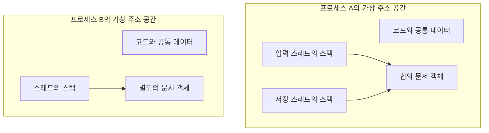
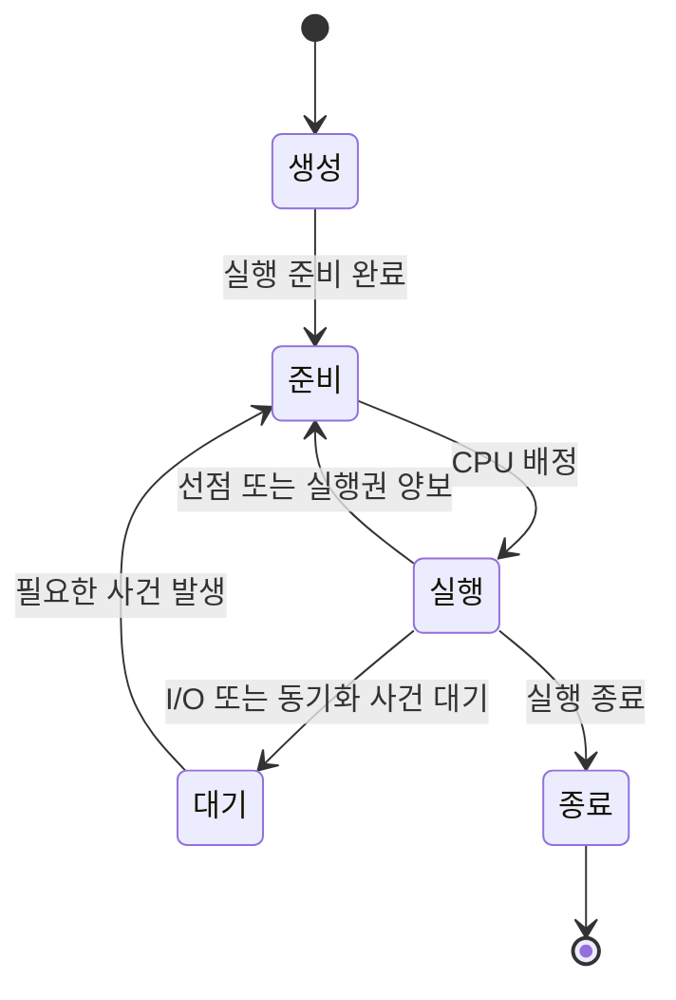
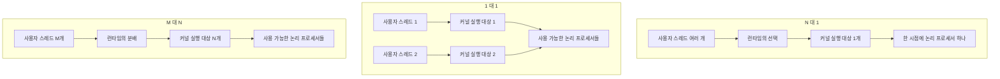
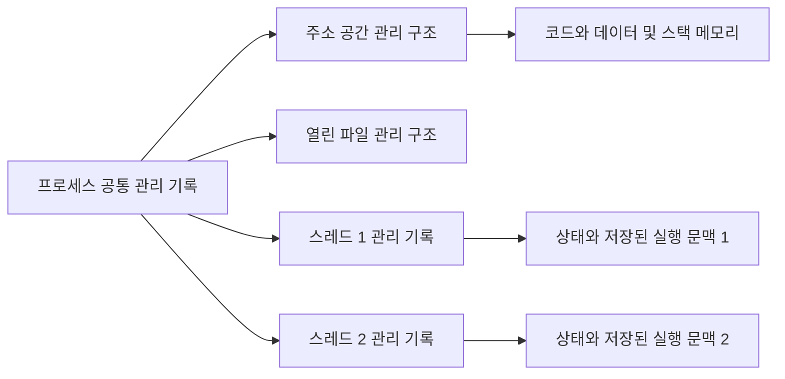
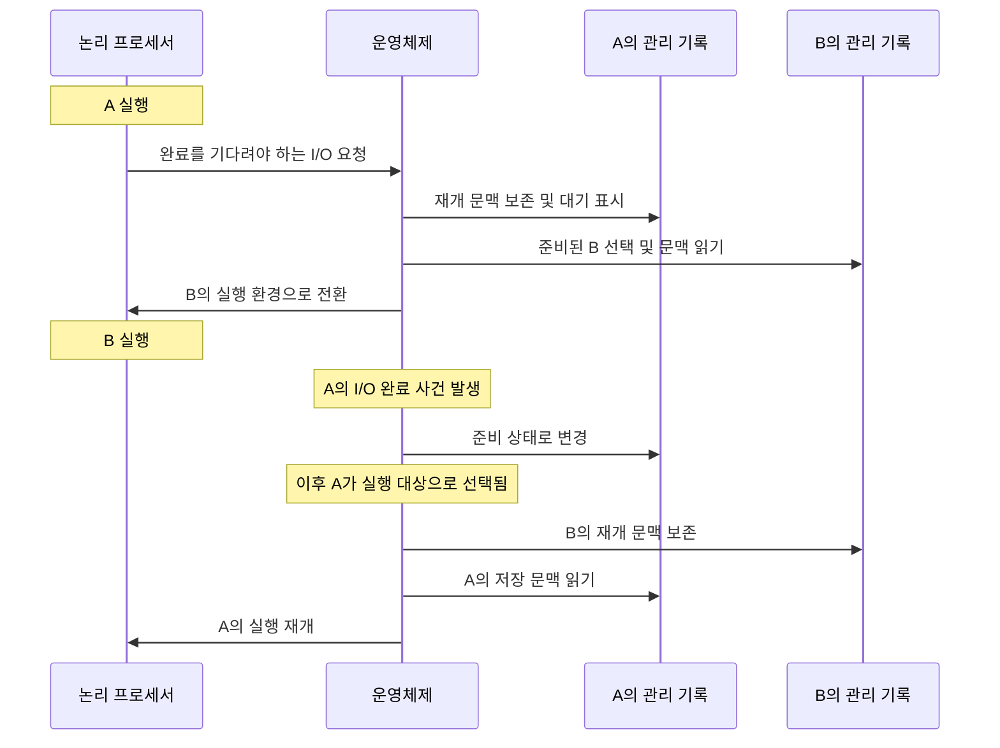
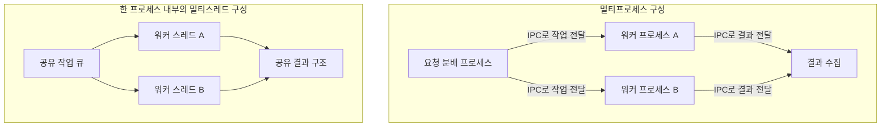

# 5회차 — 프로세스와 스레드

문서 편집기로 글을 쓰면서 음악을 듣고 파일을 내려받을 때, 컴퓨터는 여러 작업을 함께 진행한다. 이때 운영체제가 관리하는 것은 프로그램 파일의 목록만이 아니다. 각 작업이 사용하는 메모리와 파일, 어디까지 실행했는지, 지금 실행할 수 있는지까지 관리해야 한다.

이 장에서는 **프로세스를 자원과 보호 경계**, **스레드를 그 안에서 이어지는 실행 흐름**이라는 관점으로 이해한다. 이어서 운영체제가 이들을 기록하는 PCB와 TCB, 실행 흐름을 바꾸는 문맥 교환, 여러 프로세스와 스레드로 작업을 구성하는 방법을 연결한다.

변수와 함수 호출을 안다고 가정한다. 기본 설명은 가상 메모리와 메모리 보호를 제공하는 범용 운영체제를 대상으로 한다. 처음에는 논리 프로세서 하나와 단일 스레드 프로세스로 설명하고, 이후 다중 스레드와 여러 논리 프로세서로 확장한다. 특정 운영체제의 자료구조 이름이나 API 문법은 공통 개념과 구분한다.

## 1. Process / Thread: 실행할 자원과 실행 흐름

### 1.1 프로그램 파일과 실행 중인 프로세스

문서 편집기를 두 번 실행하여 한쪽에서는 보고서를, 다른 쪽에서는 여행 계획을 작성한다고 하자. 설명을 위해 두 실행이 각각 별도 프로세스를 만든다고 가정한다. 실제 제품에서는 창 하나가 프로세스 하나와 일치하지 않을 수 있다.

두 실행은 같은 편집기 명령을 사용하지만, 편집 중인 문서와 현재 수행 중인 작업은 다르다. 한쪽은 입력을 기다리고, 다른 쪽은 문서를 저장할 수 있다. 이 차이를 표현하려면 저장된 명령과 실행 인스턴스를 구분해야 한다.

**프로그램(program)**은 실행할 명령과 관련 데이터를 담은 것이다. **프로세스(process)**는 그 프로그램이 실행되는 인스턴스다. 같은 프로그램으로 여러 프로세스를 만들 수 있으며, 각 인스턴스는 자신의 실행 상태와 자원을 가진다. 프로세스가 지금 CPU를 사용하지 않고 입력을 기다리고 있어도 프로세스로 존재한다. ‘실행 중인 프로그램’이라는 정의에서 실행 중은 매 순간 명령을 수행한다는 좁은 뜻이 아니다.

CPU가 계산을 이어가려면 다음에 실행할 명령의 위치와 계산 중간값이 필요하다. 또한 편집기가 일을 하려면 문서를 저장할 메모리, 문서를 읽고 쓸 파일, 해당 자원에 접근할 권한도 필요하다. 따라서 프로세스를 이해할 때는 **실행을 이어가는 상태**와 **실행에 필요한 자원**을 함께 보아야 한다.

### 1.2 프로세스의 주소 공간과 메모리 구성

프로세스는 자신의 관점에서 사용할 수 있는 메모리 주소들의 공간인 **가상 주소 공간**을 가진다. 운영체제와 하드웨어는 이 주소를 실제 메모리에 연결하고 접근 권한을 확인한다. 서로 다른 프로세스에서 같은 숫자의 주소를 사용하더라도, 반드시 같은 데이터를 가리키는 것은 아니다.

이 구조는 격리를 가능하게 한다. 보고서 편집 프로세스가 자신의 문서 버퍼를 수정한다고 해서 여행 계획 프로세스의 문서 버퍼가 함께 바뀌지 않는다. 일반적인 사용자 코드가 다른 프로세스의 사적 메모리를 자기 메모리처럼 직접 읽고 쓰지 못하도록 보호한다. 다만 프로세스들이 명시적으로 공유 메모리를 설정하는 것은 가능하다.

실행에 사용되는 메모리는 역할에 따라 다음처럼 설명할 수 있다.

| 구성 | 역할 | 편집기 예시 |
|---|---|---|
| 코드 | 실행할 기계 명령 | 문자 삽입과 파일 저장을 수행하는 명령 |
| 데이터 | 전역 변수와 정적 수명의 데이터 등 | 프로그램 전체에서 사용하는 설정값 |
| 힙 | 실행 도중 동적으로 확보하는 데이터 공간 | 길이가 바뀌는 문서 내용과 편집 이력 |
| 스택 | 함수 호출을 이어가기 위한 기록 | 복귀 위치와 일부 인수·지역 변수 |

예를 들어 `문서저장()`이 `내용인코딩()`을 호출하면, 인코딩이 끝난 뒤 저장 함수의 어느 지점으로 돌아올지 기억해야 한다. 이러한 호출 기록은 보통 스택에 쌓인다. 인코딩 대상 문서가 힙에 있다면, 함수는 그 문서를 가리키는 참조를 이용해 접근할 수 있다. 함수의 호출 기록과 문서 데이터 자체는 역할과 수명이 다르다.

이 표는 개념적 분류다. 모든 지역 변수가 반드시 스택에 놓이는 것은 아니며, 정확한 배치는 언어·컴파일러·실행 환경에 따라 달라진다. 코드·힙·스택의 실제 주소 순서와 증가 방향도 고정된 법칙이 아니다. 가상 주소 공간 전체가 항상 물리 메모리에 올라와 있다고 해석해서도 안 된다.

프로세스의 자원은 메모리에 한정되지 않는다. 열린 파일, 통신 연결, 접근 권한 같은 자원과 관리 정보도 실행 환경에 포함된다. 이 때문에 프로세스를 단순히 ‘코드가 들어 있는 메모리 덩어리’로 이해하면 부족하다.

### 1.3 스레드는 왜 별도의 실행 문맥을 가지는가

이제 편집기 하나 안에서 입력 처리와 자동 저장을 나누어 보자. 입력 처리는 키보드 사건을 받아 문서를 수정하고, 자동 저장은 일정 시점의 문서 내용을 파일에 기록한다. 두 작업은 같은 문서 데이터에 접근하지만 서로 다른 함수와 명령을 실행한다.

**스레드(thread)**는 프로세스 안에서 이어지는 실행 흐름이다. 단일 스레드 프로세스에는 이러한 흐름이 하나 있고, 다중 스레드 프로세스에는 여러 개가 있다. 같은 프로세스의 스레드는 주소 공간과 여러 자원을 공유하면서 각자 실행을 이어갈 상태를 가진다.

대표적인 스레드별 상태는 다음과 같다.

- **프로그램 카운터(PC)**: 실행을 이어갈 명령의 위치를 나타낸다.
- **레지스터 문맥**: 계산 중간값과 실행 제어에 필요한 CPU 상태다.
- **스택과 스택 포인터(SP)**: 자신의 함수 호출 기록과 현재 스택 위치를 유지한다.
- **식별자와 관리 정보**: 스레드를 구별하고 실행 상태를 추적하는 데 사용한다.

입력 스레드는 `문자삽입()`을 실행하고, 저장 스레드는 `파일쓰기()`를 실행할 수 있다. 두 스레드가 하나의 호출 스택을 그대로 함께 사용한다면 어느 함수로 돌아가야 하는지 뒤섞일 것이다. 각 실행 흐름에 별도 스택이 필요한 이유다. 반면 두 스레드가 다루는 문서 내용까지 각각 다른 복사본이어야 하는 것은 아니다.



*스레드는 호출 경로를 따로 유지하지만 같은 주소 공간에서 실행한다. 그림은 역할과 경계를 나타내며 실제 메모리 배치를 나타내지 않는다.*

여기서 **스택의 개별 할당과 메모리 접근의 격리는 다르다.** 같은 프로세스의 스레드별 스택도 그 프로세스의 주소 공간 안에 있다. 유효한 주소와 접근 권한이 있다면 다른 스레드가 해당 메모리에 접근할 수 있다. 따라서 ‘스택은 스레드별이므로 다른 스레드가 절대 건드릴 수 없다’는 설명은 틀리다. 객체의 수명과 동기화도 별도로 지켜야 한다.

스레드별 레지스터 문맥이 있다는 말도 스레드마다 물리 CPU를 소유한다는 뜻이 아니다. 실행하는 동안에는 하드웨어 레지스터를 사용하고, 실행이 중단되면 나중에 복원할 상태를 메모리의 관리 기록 등에 보관한다. 여러 스레드가 같은 논리 프로세서를 번갈아 사용할 수 있다.

### 1.4 동시성과 병렬성

**동시성(concurrency)**은 여러 작업의 진행이 시간상 겹치는 성질이다. 한 작업이 끝나기 전에 다른 작업도 진행할 수 있다. **병렬성(parallelism)**은 여러 실행 흐름이 실제로 같은 시각에 실행되는 성질이다.

논리 프로세서 하나에서도 입력 처리와 저장 작업을 번갈아 진행하면 동시성이 있다. 그러나 그 논리 프로세서에서 두 스레드의 명령 흐름을 같은 순간에 각각 실행하는 것은 아니다. 여러 논리 프로세서를 사용할 수 있고 실행 가능한 흐름도 여러 개라면 병렬 실행이 가능해진다.

여기서 논리 프로세서는 운영체제가 명령 흐름을 배정하는 하드웨어 실행 단위를 뜻한다. 물리 코어 수와 논리 프로세서 수는 같지 않을 수 있으며, 논리 프로세서가 둘이라고 성능이 정확히 두 배가 되는 것도 아니다.

```text
시간 →       구간 1    구간 2    구간 3    구간 4

논리 프로세서 하나
CPU 0          A         B         A         B

논리 프로세서 둘에서 가능한 실행
CPU 0          A         A         A         A
CPU 1          B         B         B         B
```

*첫 번째는 교대 실행이고 두 번째는 병렬 실행이다. 구간 길이와 작업량은 성능 수치를 뜻하지 않는다.*

작업 수, 스레드 수, 실제 병렬 실행 수도 구분해야 한다. 이미지 변환 요청이 100개라고 해서 스레드가 100개 필요한 것은 아니다. 스레드 4개가 요청을 차례로 처리할 수 있다. 반대로 스레드가 100개 있어도 이용 가능한 논리 프로세서가 2개라면, 이들의 CPU 명령 흐름이 모두 한꺼번에 병렬 실행되지는 않는다.

단일 코어에서도 동시성이 유용한 이유는 CPU 계산과 외부 사건의 기다림이 섞여 있기 때문이다. 저장 장치의 작업 완료를 기다리는 동안 입력을 처리하면 편집기가 더 잘 반응할 수 있다. 이는 계산 장치가 갑자기 빨라졌기 때문이 아니라, 한 작업의 대기 시간에 다른 작업을 진행하기 때문이다. 단, 입력 처리도 저장 작업이 잡고 있는 잠금을 기다려야 한다면 기대한 응답성 향상이 제한될 수 있다.

### 1.5 준비·실행·대기 상태

실행 흐름이 존재한다고 해서 언제나 CPU를 배정받을 수 있는 것은 아니다. 먼저 단일 스레드 프로세스 A가 파일을 읽는 상황을 보자.

A가 명령을 수행하고 있으면 **실행(running)** 상태다. 읽기 요청을 했는데 필요한 데이터가 아직 없고 그 호출이 완료될 때까지 기다려야 한다면 **대기(blocked 또는 waiting)** 상태가 된다. 이때 A는 CPU를 받더라도 그 작업의 다음 단계로 진행할 수 없으므로 운영체제는 다른 실행 가능한 대상을 선택한다.

데이터가 준비되면 A는 **준비(ready)** 상태가 된다. 필요한 사건은 발생했지만 CPU 배정은 아직 받지 못한 상태다. 이후 스케줄러가 A를 선택하면 다시 실행 상태가 된다.

준비와 대기는 모두 겉으로는 ‘현재 실행하지 않음’이지만 원인이 다르다. 준비 상태는 CPU 차례를 기다린다. 대기 상태는 입력 완료, 잠금 해제, 다른 작업의 종료 같은 조건을 기다린다. CPU를 배정하는 것만으로 그 조건이 충족되지는 않는다.



*준비는 CPU를 받으면 실행할 수 있는 상태이고, 대기는 먼저 다른 조건이 충족되어야 하는 상태다. 기본 전이만 표현한 그림이다.*

시간 할당량을 사용하여 A의 실행을 멈추는 **선점(preemption)**은 보통 A를 준비 상태로 돌려놓는다. A에게 필요한 입력이 부족해서 멈춘 것이 아니기 때문이다. 반대로 완료되지 않은 I/O 때문에 멈췄다면 대기 상태다. I/O 완료도 A에게 즉시 CPU를 보장하지 않으며, 다시 선택될 자격을 준다.

모든 I/O 호출이 대기로 이어지는 것은 아니다. 필요한 데이터가 이미 준비되어 있으면 바로 완료할 수 있다. 앞의 사례는 완료를 기다려야 하는 블로킹 I/O를 가정했다.

다중 스레드 프로세스에서는 이 실행 상태를 스레드별로 생각해야 한다. 기본적으로 커널이 각 스레드를 따로 스케줄링할 수 있는 모델이라면, 저장 스레드가 I/O를 기다리는 동안 입력 스레드는 준비 또는 실행 상태일 수 있다. 프로세스 전체를 ‘대기 중’이라고만 표현하면 이 차이를 놓친다.

### 1.6 생성, 완료 대기, 종료

프로세스를 만들 때는 실행할 코드와 데이터에 접근할 수 있는 환경을 준비하고, 식별자와 관리 기록을 마련하며, 최초 실행 흐름의 시작 상태를 설정해야 한다. 생성이 끝났다는 것은 실행할 준비가 되었다는 뜻이지, 생성 요청 직후 반드시 먼저 실행된다는 뜻은 아니다.

프로세스가 다른 프로세스를 만드는 모델에서는 만든 쪽을 **부모 프로세스**, 만들어진 쪽을 **자식 프로세스**라고 부른다. 예를 들어 작업 관리 프로그램이 이미지 변환용 프로세스를 만들고, 변환이 끝난 뒤 성공 여부를 확인할 수 있다. 부모·자식 관계가 있다고 해서 주소 공간까지 하나가 되는 것은 아니다.

여기서 **완료 대기**는 작업 사이의 순서를 보장하는 데 필요하다. 결과 파일을 사용하는 부모가 자식의 완료를 확인하지 않으면, 아직 작성되지 않은 결과를 읽을 수 있다. 완료 대기는 일반적으로 계속 CPU로 검사하는 반복문을 작성한다는 뜻이 아니라, 운영체제가 제공하는 대기 기능을 이용한다는 뜻이다.

스레드도 시작할 함수와 인수를 지정해 생성하고, 작업을 수행한 뒤 종료한다. 다른 스레드는 **join**과 같은 기능으로 특정 스레드의 완료를 기다릴 수 있다. 예를 들어 T1과 T2가 서로 다른 이미지의 변환 결과를 만들고 주 스레드가 결과 목록을 완성한다면, 주 스레드는 필요한 작업의 완료를 확인한 뒤 목록을 사용한다.

join은 종료를 기다리는 동작이다. 두 스레드가 실행 도중 같은 변수를 잘못 갱신하는 문제까지 자동으로 해결하지 않는다. 또한 프로세스의 부모·자식 관계와 스레드 생성 관계를 동일한 생명주기 규칙으로 해석해서는 안 된다.

정상적인 스레드 하나의 종료와 프로세스 전체의 종료도 구별해야 한다. 다른 스레드가 남아 있는 프로세스는 계속 작업할 수 있다. 반면 프로세스 자체가 종료되면 그 안의 실행 흐름을 유지할 환경도 사라진다. 종료 결과 전달이나 남은 참조 처리 때문에 실행이 끝난 시점과 모든 관리 정보가 회수되는 시점은 다를 수 있다.

### 1.7 사용자 수준·커널 수준 관리와 매핑

앞에서는 커널이 각 스레드를 개별 실행 대상으로 관리한다고 가정했다. 그러나 애플리케이션에서 보이는 실행 흐름과 커널이 스케줄링하는 실행 대상이 항상 일대일로 대응하지는 않는다.

**사용자 수준 관리**에서는 사용자 공간의 라이브러리나 런타임이 실행 흐름을 만들고 선택하는 일을 담당한다. **커널 수준 관리**에서는 운영체제가 스케줄링할 실행 대상의 상태와 문맥을 관리한다. 관리가 어느 층에서 일어나는지와 두 층을 어떻게 연결하는지는 구분해야 한다.

이 절에서 ‘커널 스레드’는 커널이 스케줄링할 수 있는 실행 대상을 가리킨다. 사용자 프로그램의 명령도 실행할 수 있으며, 언제나 커널 코드만 수행하는 전용 작업 스레드라는 뜻은 아니다.

**N:1 매핑**은 여러 사용자 스레드를 커널 실행 대상 하나 위에서 번갈아 실행한다. 런타임이 사용자 스레드 사이를 전환할 수 있으므로 동시성은 가능하지만, 기반 실행 대상이 하나이므로 이 사용자 스레드들이 여러 CPU에서 병렬 실행되지는 않는다. 또한 기반 커널 실행 대상 자체가 블로킹되면 그 위의 다른 사용자 스레드도 실행할 기회를 잃는다. 사용자 스레드의 기다림을 런타임 내부에서 처리하여 기반 실행 대상을 막지 않는 경우와 구별해야 한다.

**1:1 매핑**은 사용자 스레드마다 커널 실행 대상을 둔다. 한 스레드가 I/O 때문에 대기하더라도 다른 준비된 스레드는 따로 선택될 수 있다. 여러 논리 프로세서에서의 병렬 실행도 가능하다. 대신 스레드를 많이 만들수록 커널 관리 기록과 스택 등 자원 부담이 커진다. 일대일 매핑이 물리 CPU와의 일대일 전용 연결을 의미하지는 않는다.

**M:N 매핑**은 M개의 사용자 스레드를 N개의 커널 실행 대상에 나누어 실행한다. 런타임이 사용자 스레드를 선택하고, 커널은 기반 실행 대상을 CPU에 배정한다. 여러 커널 실행 대상을 활용하므로 병렬 실행이 가능하면서도 사용자 스레드마다 커널 실행 대상을 만들 필요는 없다. 다만 두 층의 스케줄링과 블로킹 처리를 조정해야 하므로 관리가 복잡해진다. 기반 실행 대상이 모두 막혀 있다면 실행 가능한 사용자 작업이 있어도 진행이 제한된다.



*위에서 아래로 사용자 실행 흐름, 커널 스케줄링 대상, 하드웨어 실행 자원을 연결한다. 화살표는 특정 CPU에 대한 영구 고정을 뜻하지 않는다.*

이 분류에서 중요한 질문은 ‘스레드라는 이름을 사용하는가’보다 **누가 그 실행 흐름을 알고 선택하는가, 무엇이 블로킹되는가, 동시에 사용할 기반 실행 대상이 몇 개인가**이다.

## 2. PCB: 운영체제가 실행을 관리하는 기록

### 2.1 중단된 작업을 관리하려면 무엇이 필요한가

프로세스 A를 잠시 중단했다가 다시 실행한다고 하자. 실행 위치만 적어 두면 충분할까? 같은 명령 위치로 돌아가더라도 계산 중간값을 잃었다면 결과가 달라진다. 다른 주소 공간을 사용한다면 같은 주소에서 엉뚱한 데이터를 읽을 수 있다. 아직 파일 입력이 끝나지 않았다면 애초에 실행 대상으로 고르면 안 된다.

운영체제는 프로세스의 신원, 실행 가능 여부, 재개에 필요한 상태, 자원과의 연결을 유지해야 한다. 이를 설명하는 대표적인 개념이 **PCB(Process Control Block, 프로세스 제어 블록)**다. PCB는 운영체제가 프로세스를 추적하고 관리하는 자료구조다.

PCB를 배울 때는 필드 이름을 외우기보다 각 정보가 어떤 질문에 답하는지 이해하는 편이 좋다.

| 관리 질문 | 대표 정보 | 필요한 이유 |
|---|---|---|
| 누구인가? | PID, 부모 관계 | 대상을 식별하고 생성 관계를 추적한다. |
| 지금 실행할 수 있는가? | 상태, 대기 조건 | 준비된 대상과 사건을 기다리는 대상을 구별한다. |
| 어느 순서로 실행할 것인가? | 우선순위, 스케줄링 정보, 큐 연결 | 실행 후보를 조직하고 선택한다. |
| 어디서 이어갈 것인가? | 저장된 PC·SP·레지스터 문맥 | 중단된 계산을 재개한다. |
| 어떤 메모리를 사용하는가? | 주소 공간 관리 정보 또는 참조 | 해당 프로세스의 메모리 해석과 보호를 유지한다. |
| 어떤 외부 자원을 사용하는가? | 열린 파일·I/O 관련 참조 | 진행 중인 작업과 자원을 연결한다. |
| 어떤 조건으로 실행하는가? | 권한, 자원 사용량 등 | 접근을 통제하고 사용량을 관리한다. |

이는 단일 스레드 프로세스를 설명하기 위한 대표 목록이다. 실제 운영체제에서 모든 항목이 하나의 연속된 구조체 안에 들어갈 필요는 없다. 여러 자료구조로 나뉘거나 다른 구조를 참조할 수 있다.

### 2.2 PCB는 프로세스 메모리 전체의 복사본이 아니다

문서가 수백 MB라고 해서 PCB 안에도 수백 MB짜리 문서 복사본이 생기는 것은 아니다. 문서 내용은 프로세스가 사용하는 메모리에 있고, PCB의 메모리 관련 정보는 그 주소 공간을 관리하는 구조와 연결된다.

파일도 마찬가지다. 열린 파일 정보가 있다는 말은 파일 내용 전체를 PCB에 넣는다는 뜻이 아니다. 어떤 파일 자원을 열었는지, 관련 관리 구조가 무엇인지 찾아갈 수 있도록 기록한다. 자원 자체와 자원을 관리하는 메타데이터를 구별해야 한다.



*관리 기록은 실행 자원 전체의 복사본이 아니다. 화살표는 개념적인 참조 관계이며 특정 운영체제의 구조체 배치를 뜻하지 않는다.*

관리 기록은 사용자 프로그램이 마음대로 수정하는 보통의 업무 데이터와도 다르다. 애플리케이션이 자신의 우선순위나 자원 상태를 변경하려면 운영체제가 허용하는 인터페이스와 권한 검사를 거친다. 운영체제의 관리 정보가 임의로 변경된다면 실행과 보호의 기준 자체가 무너지기 때문이다.

### 2.3 상태와 큐는 어떻게 연결되는가

A가 실행 중이고 B가 준비 중인 상황을 다시 보자. A가 완료되지 않은 파일 입력을 기다리게 되면, 운영체제는 A를 대기 상태로 표시하고 무엇을 기다리는지 추적해야 한다. 준비된 대상을 고르는 자료구조에서는 A가 실행 후보로 선택되지 않도록 한다.

입력이 완료되면 운영체제는 그 사건을 기다리던 A를 찾아 준비 상태로 바꾼다. 이제 A의 관리 기록은 다시 실행 후보 집합에 연결될 수 있다. 이후 스케줄러가 A를 선택하면 실행 상태로 바뀐다.

교재에서 이를 ‘준비 큐에서 대기 큐로 이동한다’고 표현한다. 실제 자료구조가 언제나 하나의 선입선출 큐라는 뜻은 아니다. 준비 대상이 여러 우선순위별 구조에 나뉠 수 있고, 대기 대상도 기다리는 사건별로 관리될 수 있다. 핵심은 **상태에 맞는 후보 집합에 연결하고, 사건이 발생하면 올바른 대상을 찾아 갱신한다**는 것이다.

상태 표시와 큐 연결은 서로 일관되어야 한다. A가 아직 입력을 기다리는데 준비 대상으로 선택되거나, 입력이 끝났는데 영원히 대기 대상으로 남는다면 실행 관리가 잘못된 것이다. PCB는 단순한 상태 설명표가 아니라 이런 관리 동작에 실제로 사용되는 기록이다.

### 2.4 CPU의 현재 값과 저장된 문맥

A가 CPU에서 실행 중이면 PC와 계산 레지스터의 값은 명령 수행에 따라 계속 바뀐다. 운영체제가 매 명령마다 PCB의 대응 필드를 갱신하는 것은 아니다. 현재 실행에 사용되는 값은 CPU에 있고, 중단된 흐름을 다시 시작하는 데 필요한 값은 적절한 시점에 저장한다.

가령 A의 저장 문맥에 예전 값 `R=7`이 남아 있더라도 A가 실행 중이라면 실제 레지스터는 이미 `R=12`가 되었을 수 있다. 이때 저장 기록을 무조건 현재 계산 상태라고 읽으면 안 된다. 운영체제가 A를 중단할 때는 나중에 정확히 재개할 수 있도록 필요한 최신 상태를 보존한다.

문맥의 모든 값이 반드시 PCB의 이름 붙은 필드에 직접 들어가는 것도 아니다. 일부는 커널 스택이나 별도 저장 구조에 놓일 수 있다. ‘PCB에 문맥을 저장한다’는 설명은 PCB와 연결된 관리 체계를 통해 재개 상태를 유지한다는 개념으로 이해하면 된다.

### 2.5 다중 스레드에서는 TCB가 필요하다

한 프로세스에 T1과 T2가 있다면 실행 위치도 둘이다. T1은 문자를 삽입하는 중이고 T2는 저장 완료를 기다릴 수 있다. 프로세스당 PC 하나와 상태 하나만으로는 이들을 설명할 수 없다.

그래서 프로세스 공통 정보와 스레드별 실행 정보를 나누어 생각한다. 주소 공간과 여러 자원 참조는 프로세스 차원에 두고, 실행 상태·저장 문맥·스케줄링 관련 정보는 각 스레드에 연결한다. 이러한 스레드별 관리 기록을 **TCB(Thread Control Block, 스레드 제어 블록)**라고 부른다.

이 구분은 역할의 구분이다. PCB와 TCB라는 이름, 실제 구조의 분할 방식은 모든 운영체제에 통일된 규격이 아니다. 어떤 구현은 공통된 구조를 활용하고, 어떤 구현은 여러 객체를 조합한다. 사용자 수준 스레드라면 대응하는 관리 기록을 런타임이 유지할 수도 있다.

관리 기록에도 생명주기가 있다. 생성 시 만들어지고, 실행과 대기를 반복하며 갱신되고, 종료 시 결과와 자원 해제를 관리한다. 종료 결과를 다른 실행 주체가 확인해야 하는 경우에는 일부 정보가 실행 종료 뒤에도 남는다. 따라서 ‘종료 명령이 실행되는 순간 PCB의 모든 정보가 즉시 사라진다’고 일반화할 수 없다.

## 3. Context Switching: 실행 흐름을 바꾸는 과정

### 3.1 다른 작업을 실행하면서 이전 계산을 보존하기

A가 파일을 기다리는 동안 준비된 B가 있다면 B를 실행하여 CPU를 활용할 수 있다. 이후 A의 입력이 완료되면 A는 처음부터 다시 시작하는 대신 중단 지점부터 작업을 이어가야 한다.

이때 필요한 상태를 **문맥(context)**이라고 부른다. 넓은 의미에서는 주소 공간과 자원 관계도 실행 문맥의 일부다. 문맥 교환을 설명할 때는 특히 PC·SP·레지스터 값처럼 CPU 실행을 이어가는 데 필요한 상태와, 올바른 실행 환경으로 전환하는 데 초점을 둔다.

**문맥 교환(context switching)**은 현재 실행 흐름의 필요한 상태를 보존하고 다른 실행 흐름의 상태를 복원하여 실행 주체를 바꾸는 과정이다. 여기서는 같은 흐름의 커널 진입·복귀와 구별하기 위해 이 의미로 사용한다.

A와 B가 같은 논리 프로세서를 번갈아 사용한다고 하자. A는 어떤 계산 중간값으로 레지스터 R에 7을 가지고 있고, B는 별개의 계산을 위해 R에 20을 사용한다. A의 중단 위치는 `A의 다음 명령`, B의 중단 위치는 `B의 다음 명령`이라고 표시하자. 실제 명령어 체계와 무관한 가상 예시다.

| 순간 | CPU에서 사용하는 문맥 | 보존해야 하는 상태 |
|---|---|---|
| A 실행 중 | A의 실행 위치, R=7, A의 스택 위치 | A가 중단되면 이 값들을 보존해야 한다. |
| B로 전환 | B의 실행 위치, R=20, B의 스택 위치 | A의 재개 상태는 관리 기록에 남는다. |
| A로 복귀 | A의 실행 위치, R=7, A의 스택 위치 | B도 다시 실행할 필요가 있으면 그 상태를 보존한다. |

A에게 PC만 돌려주고 R은 20으로 남겨 두면 A는 자신의 계산을 이어가는 것처럼 보이면서 잘못된 값을 사용한다. SP를 잘못 복원하면 다른 호출 기록을 바탕으로 함수에서 돌아가려 할 수 있다. 실행 위치뿐 아니라 **그 위치에서 의미 있는 계산을 계속할 충분한 상태**가 필요하다.

반면 A의 문서 버퍼를 B의 문서 버퍼로 통째로 덮어쓸 필요는 없다. A의 메모리는 유지한 채 CPU에서 사용하는 실행 상태와 필요한 주소 공간 설정을 바꾸면 된다. 공유된 메모리는 다른 실행 흐름이 수정할 수 있으므로, A를 재개한다고 그 메모리까지 과거 상태로 되돌리는 것은 아니다.

### 3.2 A의 대기에서 B의 실행까지

A가 블로킹 I/O를 요청하고 B가 실행되는 과정을 개념적으로 나누면 다음과 같다.

1. **커널이 제어를 얻는다.** A의 시스템 호출을 처리하는 과정에서 요청이 아직 완료될 수 없음을 확인한다.
2. **A를 재개할 상태를 보존한다.** 중단된 계산과 호출 처리를 나중에 이어갈 정보가 남아야 한다.
3. **A의 상태와 대기 관계를 갱신한다.** A를 대기로 표시하고 기다리는 사건과 연결한다.
4. **다음 실행 대상을 고른다.** 준비된 대상 가운데 B를 선택한다.
5. **B의 실행 환경과 문맥을 복원한다.** 필요한 주소 공간 설정과 저장된 레지스터·스택 상태 등을 맞춘다.
6. **B의 실행을 재개한다.** B가 이전에 멈췄던 지점에서 진행한다.

이 목록은 이해를 위한 논리적 순서다. 실제 구현에서는 일부 저장이 커널 진입 시 하드웨어에 의해 일어나고, 나머지는 커널 코드가 수행할 수 있다. 저장 위치와 세부 순서도 다르다. 공통 조건은 A가 다시 실행될 수 있도록 필요한 상태를 잃지 않고, B에게 맞는 상태로 실행을 넘기는 것이다.

A의 I/O가 끝나면 A는 준비 상태가 된다. 그 즉시 B를 중단할지는 스케줄링 정책과 당시 조건에 달려 있다. 이후 A가 선택되면 A의 저장 문맥을 복원한다. A는 필요한 커널 처리를 마친 뒤 사용자 코드의 다음 단계로 돌아갈 수 있다. ‘A 재개’가 언제나 사용자 명령으로 즉시 점프하는 단일 동작인 것은 아니다.



*관리 기록에 남긴 상태를 이용해 실행을 이어간다. I/O 완료와 A의 실제 재개 사이에는 스케줄링 대기가 있을 수 있다.*

### 3.3 정책과 메커니즘, 선점과 자발적 중단

준비된 A·B·C 중 누구를 실행할지 결정하는 것은 **스케줄러의 정책**이다. 짧은 작업을 먼저 할지, 우선순위가 높은 작업을 먼저 할지, 각자 번갈아 실행할지를 판단한다.

선택한 대상에게 실제로 CPU를 넘기는 디스패치 과정에는 문맥 복원과 실행 재개 같은 **메커니즘**이 필요하다. 교재에서는 이 역할을 디스패처라고 부르기도 한다. 스케줄러와 디스패처가 언제나 별도의 프로그램으로 나뉜다는 뜻은 아니다. ‘누구를 고르는가’와 ‘어떻게 실행을 넘기는가’를 구별하는 것이다.

문맥 교환의 계기도 구분할 수 있다. **선점**은 현재 흐름이 계속 실행할 수 있어도 운영체제가 CPU 사용을 중단시키는 것이다. 시간 할당량이 끝났거나 정책상 더 우선하는 실행 대상이 준비되었을 때 일어날 수 있다. 이 경우 기존 흐름은 보통 준비 상태에 남는다.

반면 입력이나 동기화 사건을 기다려야 한다면 현재 흐름은 더 진행할 수 없어 실행권을 내려놓는다. 명시적으로 실행권을 양보하는 동작도 가능하다. 양보는 반드시 대기를 뜻하지 않는다. 계속 실행할 수 있지만 다른 대상에게 기회를 주는 양보라면 준비 상태로 남을 수 있다. 실행이 종료된 경우에도 CPU는 다른 대상을 실행할 수 있지만, 끝난 흐름을 나중에 재개하기 위한 문맥은 더 필요하지 않다.

선점형 시스템에서 운영체제가 제어를 되찾는 대표적인 수단은 타이머 인터럽트다. 프로그램이 긴 계산을 하며 시스템 호출을 하지 않더라도, 하드웨어 사건으로 커널이 실행되어 스케줄링을 판단할 수 있다. 다만 타이머 인터럽트가 발생할 때마다 반드시 다른 스레드로 바뀌는 것은 아니다. 현재 흐름을 계속 실행하기로 결정할 수도 있다.

### 3.4 모드 전환과 문맥 교환은 서로 다른 질문이다

일반 애플리케이션은 제한된 권한의 **사용자 모드**에서 실행된다. 운영체제의 핵심인 커널은 메모리 관리나 장치 제어 등에 필요한 권한으로 실행된다. 애플리케이션이 파일 읽기 같은 서비스를 요청하는 **시스템 호출**은 커널이 요청을 처리하도록 제어를 넘기는 통로다.

이때 두 가지 질문을 구별해야 한다. 하나는 ‘어떤 권한과 코드 영역에서 실행하는가’이고, 다른 하나는 ‘어느 실행 흐름을 이어가고 있는가’이다.

A가 시스템 호출을 하고, 커널이 즉시 처리한 뒤 A로 돌아간다면 사용자 모드에서 커널 모드로 갔다가 돌아왔다. 처리 중 필요한 상태 저장과 복원은 있지만 다른 스레드 B에게 실행을 넘긴 것은 아니다.

반대로 A의 요청이 대기를 요구하여 커널이 B를 선택했다면, 커널 진입에 더해 실행 주체가 A에서 B로 바뀐다. 이것이 여기서 구분하는 문맥 교환이다.

```text
즉시 처리 가능한 요청
A의 사용자 코드 → 커널에서 A의 요청 처리 → A의 사용자 코드

대기가 필요한 요청의 한 사례
A의 사용자 코드 → 커널에서 A를 대기 처리 → B의 실행 재개
```

*커널에 들어갔는지와 다른 실행 주체로 바뀌었는지는 별도로 확인해야 한다.*

인터럽트도 마찬가지다. 장치의 완료 사건을 처리하고 현재 실행하던 A로 돌아올 수 있고, 준비 상태가 된 다른 흐름을 선택할 수도 있다. 따라서 ‘시스템 호출 또는 인터럽트 발생’과 ‘다른 실행 흐름으로의 문맥 교환’을 같은 사건으로 외우면 안 된다.

사용자 수준 런타임이 자신의 실행 흐름 사이를 바꾸는 경우에는 매번 커널 스케줄러를 거치지 않을 수도 있다. 이 역시 관리 위치와 매핑을 알아야 전환의 경로를 정확히 설명할 수 있는 이유다.

### 3.5 같은 프로세스 안의 전환과 프로세스를 넘는 전환

한 프로세스의 T1에서 T2로 바꿀 때도 PC·SP·레지스터 문맥을 바꿔야 한다. T1과 T2가 같은 코드를 실행하더라도 실행 위치와 인수, 계산 중간값은 다를 수 있기 때문이다. 스레드 문맥 교환을 ‘스택만 바꾸는 작업’으로 설명하면 부족하다.

이 경우 주소 공간은 그대로 유지할 수 있다. 반면 서로 다른 프로세스에 속한 스레드 사이를 전환하면, 일반적으로 메모리 주소를 어느 프로세스의 주소 공간으로 해석할지도 바꾸어야 한다. 같은 숫자의 가상 주소가 각 프로세스에서 다른 데이터를 가리킬 수 있기 때문이다.

주소 공간을 바꾸는 것은 프로세스의 메모리 전체를 복사한다는 뜻이 아니다. 메모리 내용을 디스크로 내보냈다가 읽어 오는 **스와핑**과도 구별된다. 문맥 교환은 메모리를 그대로 둔 상태에서도 일어날 수 있다. 별도의 메모리 관리 상황 때문에 저장 장치 접근이 필요할 수는 있지만, 그것이 매 문맥 교환의 정의나 필수 단계는 아니다.

같은 프로세스의 스레드 전환은 주소 공간 전환 부담을 줄일 여지가 있다. 그렇다고 모든 스레드 전환이 모든 프로세스 전환보다 항상 빠르다는 순위를 정할 수는 없다. 구현과 실행 상태, 사용하는 데이터에 따라 전체 비용이 달라진다.

### 3.6 직접 비용과 간접 비용

문맥 교환의 **직접 비용**은 상태 저장·복원, 상태와 큐의 갱신, 실행 대상 선택, 필요한 실행 환경 변경에 쓰는 시간이다. 이 시간에는 CPU가 애플리케이션의 문서 편집이나 이미지 변환 대신 실행 관리 작업을 수행한다.

**간접 비용**은 전환 이후에 나타날 수 있다. CPU 캐시에는 최근 사용한 명령과 데이터가 남아 있어 다시 접근할 때 도움이 된다. A에서 B로 전환했는데 B가 전혀 다른 데이터를 사용한다면, B에게 필요한 데이터가 캐시에 충분히 없어 더 느린 메모리 접근이 늘 수 있다. 이후 A로 돌아왔을 때도 A가 사용하던 데이터 일부가 밀려났을 수 있다.

주소 변환 정보를 기억하는 TLB도 성능에 영향을 줄 수 있다. TLB는 명령이나 데이터 내용을 보관하는 캐시와 역할이 다르다. 주소 공간 전환 시 어떤 변환 정보를 유지하거나 무효화하는지는 하드웨어와 운영체제 구현에 따라 달라진다. **모든 문맥 교환이 모든 캐시를 초기화한다는 설명은 맞지 않는다.**

짧게 실행하고 자주 바꾸면 다른 작업이 CPU를 받을 기회가 빨리 돌아올 수 있지만, 유용한 계산에 비해 전환 비용의 비중이 커질 수 있다. 반대로 한 작업을 너무 오래 실행하면 전환 부담은 줄어들어도 대화형 작업의 응답이 늦어질 수 있다. 블로킹 중인 작업에서 다른 준비된 작업으로 전환하는 것은 CPU를 놀리지 않게 하는 이점도 있다.

따라서 좋은 시스템의 목표는 전환 횟수를 무조건 최소화하는 것이 아니다. **응답성, 유용한 작업의 처리량, 자원 활용, 관리 비용을 함께 고려하는 것**이다. 문맥 교환은 필요한 기능이며, 그 빈도와 효과를 작업 특성에 맞추어 판단해야 한다.

## 4. Multi Process / Multi Thread: 작업을 어떻게 나눌 것인가

### 4.1 같은 서비스를 두 가지 방식으로 구성하기

여러 이미지 파일을 받아 크기를 줄이는 서비스를 설계한다고 하자. 요청마다 입력을 읽고, 이미지를 변환하고, 결과를 돌려주는 작업이 필요하다. 이 작업을 수행하는 실행 주체를 워커라고 부르자.

**멀티프로세스 구성**에서는 여러 프로세스가 작업을 나누어 처리한다. 각 워커 프로세스는 자신의 주소 공간에서 입력과 중간 결과를 관리한다. 요청을 나누어 주는 쪽은 프로세스 간 통신으로 작업을 전달하고 결과를 받는다.

**멀티스레드 구성**에서는 한 프로세스 안에 여러 워커 스레드를 둔다. 스레드들은 같은 주소 공간의 작업 큐와 데이터에 접근할 수 있으며, 각자 별도의 호출 경로로 변환을 수행한다.



*같은 일을 여러 주소 공간에 나눌 수도 있고, 같은 주소 공간의 여러 실행 흐름에 나눌 수도 있다. 그림의 연결은 데이터 흐름을 나타낸다.*

멀티프로세스의 process와 멀티프로세서의 processor는 다르다. 전자는 소프트웨어 실행 인스턴스의 구성이고 후자는 하드웨어 실행 자원에 관한 말이다. 멀티프로세스와 멀티스레드는 모두 논리 프로세서 하나에서 교대로 실행할 수 있고, 조건이 충족되면 여러 논리 프로세서에서 병렬 실행할 수 있다.

### 4.2 격리는 통신 방법을 바꾼다

서로 다른 주소 공간에서는 한 프로세스의 일반 포인터를 그대로 다른 프로세스에 보내는 것만으로 그 데이터를 사용할 수 없다. 그 주소가 받는 프로세스에서도 같은 객체를 가리킨다는 보장이 없기 때문이다. 프로세스들은 의미 있는 데이터 전달 방법을 합의해야 한다.

이를 위한 수단이 **IPC(Inter-Process Communication, 프로세스 간 통신)**다. 기본 모델은 메시지 전달과 공유 메모리로 나누어 이해할 수 있다.

**메시지 전달**에서는 보내는 쪽과 받는 쪽이 통신 경로를 통해 정보를 주고받는다. 파이프와 소켓은 대표적인 수단이다. 전달할 데이터의 형식과 길이, 요청과 결과를 구별하는 방법 등을 정해야 한다. 메시지는 논리적인 설명이며 실제 통신 API가 항상 메시지 경계를 보존하는 것은 아니다.

이미지 서비스라면 `작업 번호, 입력 위치, 목표 크기`를 요청으로 보내고 `작업 번호, 성공 여부, 결과 위치`를 돌려받을 수 있다. 모든 경우에 이미지 전체를 전달해야 하는 것은 아니다. 양쪽에서 접근 가능한 저장 위치를 전달하는 설계도 가능하다. 반면 이미지 바이트 자체를 보내면 버퍼 복사나 형식 변환 같은 비용이 생길 수 있다. 그 비용의 크기는 통신 수단과 구현에 따라 달라진다.

**공유 메모리**에서는 같은 메모리 영역을 여러 프로세스의 주소 공간에 연결한다. 연결된 뒤에는 양쪽이 그 영역을 읽고 쓸 수 있으므로 큰 데이터를 반복해서 전달하는 비용을 줄일 여지가 있다. 그러나 데이터가 언제 완성되었는지, 누가 어느 부분을 수정하는지 정해야 한다.

예를 들어 생산자가 이미지 바이트를 절반만 기록했는데 소비자가 읽기 시작하면 잘못된 입력으로 변환할 수 있다. 공유 메모리는 접근 통로를 제공하지만 작업 순서를 자동으로 정하지 않는다. 공유 영역의 같은 객체가 각 프로세스에서 같은 가상 주소로 보일 필요도 없다.

스레드 사이에서는 이미 같은 주소 공간에 있으므로 객체의 참조를 전달하여 함께 접근하기 쉽다. 이 편리함의 대가는 공유 범위를 관리해야 한다는 점이다. 여러 스레드가 같은 결과 목록을 수정한다면 그 목록의 일관성을 누가 어떻게 보장할지 정해야 한다.

### 4.3 경쟁 조건: 문맥을 정확히 복원해도 틀릴 수 있다

두 워커가 작업을 하나씩 마칠 때마다 공유 변수 `완료수`를 1 증가시킨다고 하자. 시작 값은 0이다. 여기서는 증가 동작이 `읽기 → 1 더하기 → 쓰기`로 나뉘는 개념적 연산이라고 가정한다.

| 순서 | 워커 A | 워커 B | 공유된 완료수 |
|---|---|---|---|
| 1 | 완료수 0을 읽는다. |  | 0 |
| 2 |  | 완료수 0을 읽는다. | 0 |
| 3 | 자신이 읽은 값에 1을 더해 기록한다. |  | 1 |
| 4 |  | 자신이 읽은 값에 1을 더해 기록한다. | 1 |

작업은 두 개 완료했지만 최종 값은 1이다. A의 갱신을 반영하기 전에 읽어 둔 값을 B가 사용하면서 갱신 하나가 사라졌다. 여러 실행 흐름의 상대적인 순서에 따라 올바른 결과가 깨지는 이러한 문제를 **경쟁 조건(race condition)**이라고 한다.

이 문제는 CPU가 하나여도 발생한다. A가 값을 읽은 뒤 선점되고 B가 같은 값을 읽으면 충분하다. 실제 병렬 실행은 발생 가능한 교차 실행을 더 다양하게 만들지만, 경쟁 조건의 필수 전제는 아니다.

문맥 교환 자체는 완벽하게 동작했을 수 있다. 운영체제가 A의 ‘읽어 둔 값 0’을 정확히 복원했기 때문에 A가 그 계산을 이어갔을 수도 있다. **실행 문맥을 올바르게 보존하는 것과 공유 데이터의 갱신을 올바르게 조정하는 것은 다른 문제**다.

이 예시는 언어와 무관한 개념적 의사 연산이다. 실제 프로그래밍 언어에서 동기화 없는 동시 접근은 메모리 모델에 따라 더 복잡한 결과나 정의되지 않은 동작을 낳을 수 있으므로, 이 표가 모든 실제 실행 결과를 열거한다고 받아들이면 안 된다.

### 4.4 임계 구역과 동기화의 목적·비용

공유 데이터의 일관성을 위해 함께 보호해야 하는 코드 구간을 **임계 구역(critical section)**이라고 한다. 앞의 예시에서는 완료수를 읽어 수정하고 다시 기록하는 전체 과정이 하나의 보호 단위다.

뮤텍스 같은 상호 배제 수단을 사용하면 한 실행 흐름이 그 구간을 수행하는 동안 다른 흐름은 같은 보호 규칙을 따르며 기다린다. A가 0을 1로 바꾼 뒤 B가 진입하면 B는 1을 읽어 2를 기록한다. 단순한 카운터에는 적절한 원자적 연산을 사용하는 방법도 있다. 여러 값의 관계를 함께 유지해야 하는 경우에는 단일 변수 증가보다 더 넓은 보호가 필요하다.

동기화는 상호 배제만을 뜻하지 않는다. ‘입력이 완성된 뒤 소비한다’, ‘모든 워커가 끝난 뒤 결과를 합친다’처럼 사건과 작업의 순서를 맞추는 것도 포함한다. 잠금과 완료 대기는 서로 다른 요구를 해결한다.

동기화에는 비용이 있다. 같은 잠금을 여러 워커가 원하면 **경합(contention)**이 생긴다. 기다리는 시간이 늘고, 대기 방식에 따라 CPU 사용이나 문맥 교환도 발생할 수 있다. 전체 이미지 변환을 하나의 잠금으로 감싸면 데이터를 보호하더라도 워커들이 사실상 차례로만 변환하게 될 수 있다.

따라서 데이터 소유권을 나누는 설계가 중요하다. 각 워커가 자신의 이미지와 결과 공간만 수정하고, 끝난 결과만 짧게 합치면 공유 갱신 범위를 줄일 수 있다. 이는 잠금을 무조건 없애라는 뜻이 아니라, 실제로 함께 변경해야 하는 데이터를 분명하게 하라는 뜻이다.

멀티프로세스라고 이러한 문제가 사라지지는 않는다. 공유 메모리, 같은 파일, 같은 데이터베이스 레코드를 동시에 수정하면 프로세스 사이에서도 동기화가 필요하다. 메시지를 사용하는 설계에서도 요청 순서와 중복 처리 같은 협력 규칙을 정해야 한다.

### 4.5 장애 격리는 어디까지 보장하는가

프로세스의 분리된 주소 공간은 한 워커의 잘못된 메모리 쓰기가 다른 워커의 사적 메모리를 직접 손상시키는 일을 제한한다. 문제가 생긴 워커 프로세스를 종료하고 다시 시작하는 구조도 만들 수 있다. 이 때문에 오류가 전체 서비스로 번지는 범위를 줄이는 데 유리하다.

같은 프로세스의 스레드는 주소 공간을 공유하므로, 한 스레드의 잘못된 메모리 접근이 다른 스레드가 사용하는 데이터까지 손상시킬 수 있다. 프로세스를 종료시키는 치명적 오류가 발생하면 그 안의 다른 스레드도 함께 실행을 잃는다.

그렇다고 모든 스레드 오류가 즉시 전체 프로세스를 죽이는 것은 아니다. 이미지 형식이 잘못되어 해당 작업을 실패로 반환하는 것과, 프로세스를 종료시키는 치명적인 메모리 오류는 다르다. 처리 가능한 작업 실패와 실행 환경 자체의 손상을 구분해야 한다.

프로세스 격리에도 범위가 있다. 워커 A가 공용 결과 파일을 잘못 덮어쓰면 다른 프로세스도 잘못된 결과를 볼 수 있다. A의 응답을 기다리는 프로세스는 A가 죽었을 때 계속 기다리지 않도록 실패를 알아야 한다. 공유 메모리나 저장소를 통해서도 영향이 전파될 수 있다.

따라서 격리는 ‘다른 프로세스에는 아무 영향도 없다’는 보장이 아니다. **사적 메모리의 직접 손상을 제한하는 보호 경계**이며, 서비스 전체의 복구에는 작업 상태와 통신 실패 처리도 필요하다. 잠금을 사용한다고 모든 메모리 오류를 막거나 프로세스 수준의 격리가 생기는 것도 아니다.

### 4.6 생성·메모리·통신·전환 비용을 나누어 보기

멀티스레드가 흔히 가볍다고 설명되는 이유는 기존 주소 공간과 자원을 공유할 수 있기 때문이다. 프로세스별로 별도의 실행 환경을 만드는 것에 비해 생성과 관리 부담을 줄일 여지가 있고, 같은 데이터에 직접 접근할 수 있다.

하지만 스레드도 무료 자원은 아니다. 각 스레드의 스택, 문맥, 관리 기록이 필요하며 스케줄링과 동기화 비용이 생긴다. 스레드 수가 늘면 메모리 사용량도 늘 수 있다.

프로세스의 주소 공간이 나뉜다고 모든 코드와 데이터가 반드시 물리 메모리에서 완전히 중복되는 것도 아니다. 운영체제가 읽기 전용 코드 등을 공유할 수 있다. 논리적 격리와 물리 메모리 중복량은 서로 다른 문제다.

비용을 비교할 때는 적어도 생성·종료 비용, 유지할 메모리, 작업 전달 비용, 문맥 교환, 공유 자원 경합을 따로 보아야 한다. 한 번 만든 워커가 오래 실행된다면 생성 비용은 전체에서 작은 부분일 수 있다. 매우 작은 작업마다 새 워커를 만들면 반대로 생성과 정리 비용이 실제 계산보다 커질 수 있다.

| 관점 | 멀티프로세스 | 한 프로세스의 멀티스레드 |
|---|---|---|
| 기본 메모리 관계 | 사적 주소 공간을 분리한다. | 주소 공간을 공유한다. |
| 데이터 교환 | IPC나 명시적 공유를 설계한다. | 같은 객체를 참조하기 쉽다. |
| 관리 부담 | 별도 실행 환경의 관리가 필요하다. | 공통 자원을 재사용하지만 스레드별 자원은 필요하다. |
| 동기화 | 공유 자원과 통신 규칙에 필요하다. | 공유 메모리의 일관성 관리가 특히 중요하다. |
| 장애 영향 | 사적 메모리 손상의 직접 전파를 제한한다. | 메모리 손상과 프로세스 종료를 함께 겪을 수 있다. |
| 성능 | 통신량·작업 크기·격리 요구 등에 좌우된다. | 공유 이점·경합·실행 자원 등에 좌우된다. |

### 4.7 작업 특성과 성능 목표

이미지 변환에 대부분의 시간이 쓰인다면 **CPU 중심 작업**이다. 독립적인 변환을 여러 논리 프로세서에 배정하면 처리량을 높일 수 있다. 그러나 실행할 하드웨어 자원이 이미 충분히 바쁘다면 워커를 더 만드는 것만으로 계산 능력이 늘지는 않는다.

네트워크나 저장 장치의 응답을 기다리는 시간이 길다면 **I/O 중심 작업**이다. 일부 워커가 기다리는 동안 다른 워커를 실행하면 작업을 겹쳐 진행할 수 있다. 이 경우 논리 프로세서 수보다 많은 워커가 유용할 수도 있다. 그렇다고 무제한으로 늘릴 수는 없다. 메모리, 연결 수, 저장 장치와 외부 서비스의 처리 한계가 남아 있다.

성능 목표도 구분해야 한다. **처리량**은 단위 시간에 끝내는 작업 수이고, **지연시간**은 개별 요청이 도착한 뒤 완료될 때까지 걸리는 시간이다. **응답성**은 입력이나 요청에 얼마나 빨리 반응할 수 있는지와 관련된다. 변환 중에도 ‘요청을 받았다’는 응답을 빨리 줄 수 있지만, 그것만으로 이미지 변환의 완료 시간이 줄었다고 말할 수는 없다.

작업을 나누는 방식에는 데이터 분할과 기능 분할이 있다. 이미지 파일들을 워커별로 나누고 같은 변환을 수행하면 **데이터 병렬성**을 활용한다. 입력 읽기, 변환, 결과 전송을 서로 다른 실행 흐름에 배정하면 **작업 병렬성**을 활용한다. 실제 설계에서는 두 방식이 섞일 수 있다.

기능을 나누었다고 모든 단계가 같은 이미지에 대해 동시에 실행되는 것은 아니다. 변환에는 필요한 입력이 먼저 있어야 하고, 결과 전송에는 변환 결과가 필요하다. 여러 이미지의 서로 다른 단계를 겹쳐 진행할 수는 있지만 이러한 의존 관계는 남는다.

결과 합치기나 공유 목록 갱신처럼 순차적으로 처리해야 하는 부분도 확장을 제한한다. 워커를 늘려 변환 단계가 빨라져도 결과를 기록하는 한 지점에서 기다린다면 전체 처리량은 그 지점에 묶인다. 병렬화에서는 실행 흐름의 수보다 **독립적으로 수행할 수 있는 일과 함께 기다리는 지점**을 먼저 확인해야 한다.

### 4.8 제한된 워커 풀과 조건부 선택

요청마다 새 프로세스나 스레드를 만들면 요청이 몰릴 때 생성 비용과 자원 사용량도 함께 늘어난다. **워커 풀(pool)**은 일정한 범위의 워커를 유지하고 여러 작업에 재사용하는 방식이다. 작업을 큐에 넣고, 비어 있는 워커가 꺼내 실행한다. 스레드 풀과 프로세스 풀 모두 같은 목적에 사용할 수 있다.

예를 들어 요청 100개를 워커 4개가 처리하면, 실행 흐름 100개를 즉시 만들 필요가 없다. 하지만 풀은 처리 능력을 무한하게 만들지 않는다. 작업이 도착하는 속도가 처리 속도보다 빠르면 큐가 늘고 대기시간이 길어진다. 워커 수와 함께 받아 둘 작업량, 대기시간, 자원 한계를 고려해야 한다.

선택은 공유와 격리의 요구에서 출발할 수 있다. 서로 독립적인 이미지를 변환하고 한 변환기의 치명적 오류가 다른 요청에 미치는 영향을 줄이고 싶다면 여러 프로세스가 자연스러운 후보가 된다. 전달 데이터가 작고 변환 작업이 크다면 통신 부담을 감수할 여지도 있다.

반대로 큰 읽기 전용 데이터나 공통 객체를 자주 참조하고, 공유 상태의 변경을 명확하게 통제할 수 있다면 여러 스레드가 적합한 후보가 된다. 다만 주소 공간 공유의 편리함이 잠금 경합이나 데이터 수명 문제로 상쇄되지 않는지 살펴야 한다.

두 요구가 함께 있으면 **프로세스별로 제한된 스레드 풀을 두는 혼합 구성**도 가능하다. 예를 들어 워커 프로세스 두 개가 각각 스레드 두 개를 사용하면 프로세스 사이에는 보호 경계가 있고, 각 프로세스 안에서는 자원을 공유한다. 총 실행 흐름 수와 사용할 CPU·메모리도 함께 계산해야 하며, 한 프로세스 안의 장애 격리는 여전히 스레드 간에 제공되지 않는다.

모든 동시 작업을 프로세스나 스레드의 개수 증가로만 해결할 필요는 없다. 이벤트 루프와 비동기 I/O처럼 대기를 구성하는 다른 방식도 있다. 여기서 배운 주소 공간, 실행 문맥, 매핑, 대기 조건을 알고 나면 이러한 방식도 무엇을 공유하고 무엇을 기다리는지에 따라 비교할 수 있다.