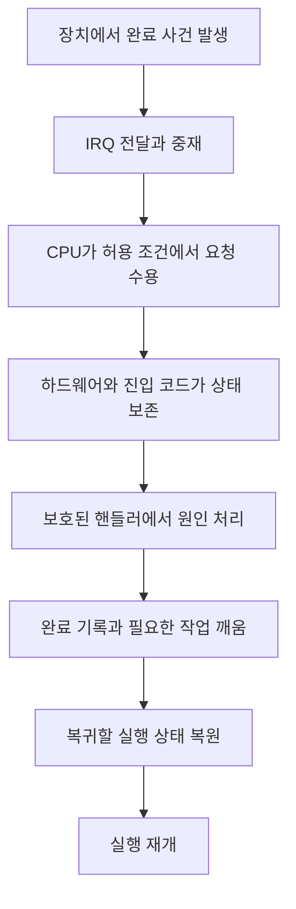
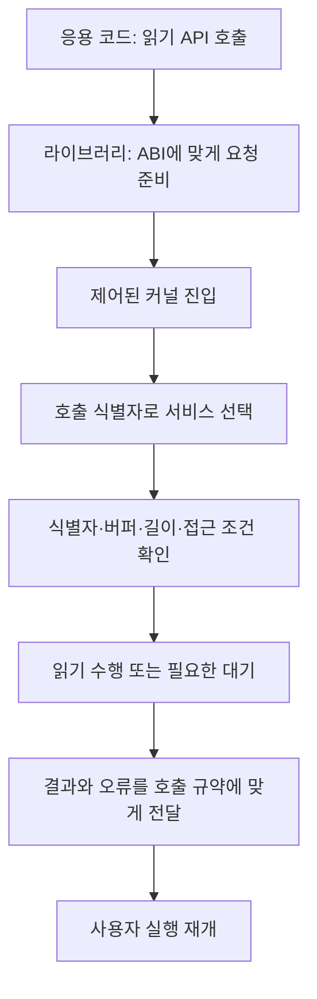
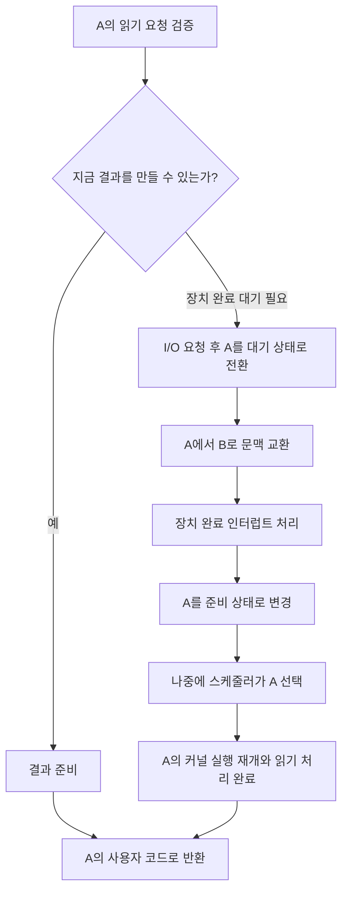
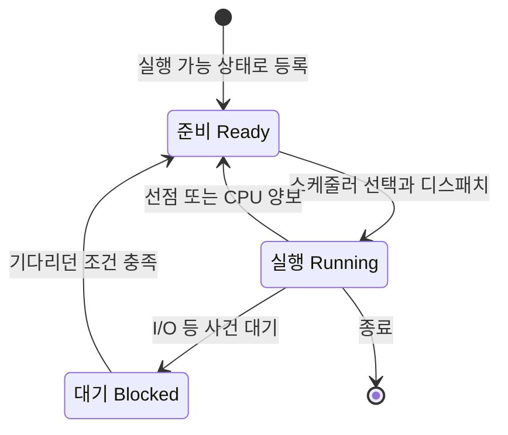
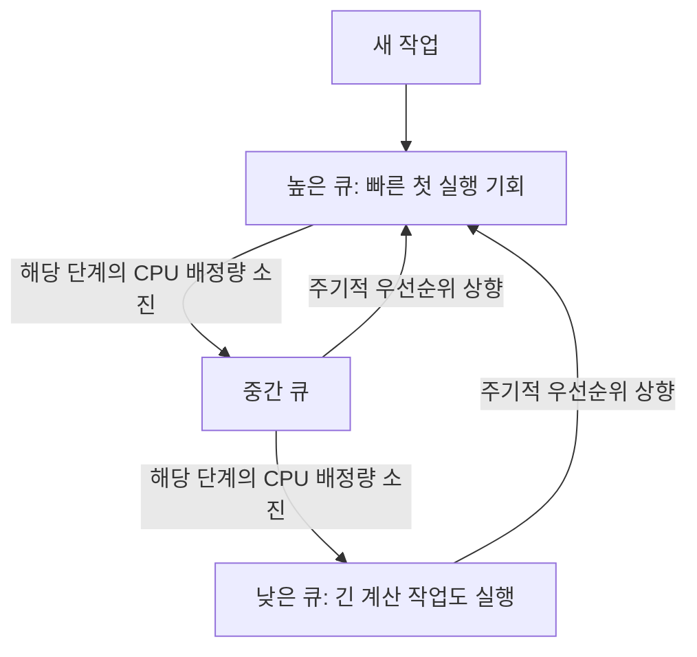

# 6회차 — CPU와 운영체제

프로그램 A가 파일을 읽는 동안 프로그램 B는 계산을 계속할 수 있다. 이를 가능하게 하려면 운영체제는 서로 다른 네 가지 문제를 해결해야 한다. 응용 프로그램의 자원 접근을 제한하고, 장치에서 일어난 사건을 전달받고, 프로그램의 서비스 요청을 처리하며, 실행 가능한 작업 가운데 다음 실행 대상을 골라야 한다.

**사용자 모드와 커널 모드**는 실행 권한을 구분한다. **인터럽트**는 장치 완료나 타이머 같은 사건을 CPU에 알린다. **시스템 콜**은 프로그램이 커널 서비스를 요청하는 인터페이스다. **CPU 스케줄링**은 실행 가능한 작업들에게 CPU 시간을 배분하는 정책이다. 이들은 함께 작동하지만 같은 개념은 아니다.

이 장에서는 사용자 모드와 커널 모드 → 인터럽트 → 시스템 콜 → CPU 스케줄링 순서로 공부한다. 기본 상황은 하나의 CPU 실행 자원과 단일 스레드 프로세스들이며, 멀티코어는 마지막에 확장한다. 특정 운영체제의 레지스터 이름이나 시스템 콜 번호 대신 여러 시스템에 적용되는 원리를 설명한다. `read`, `fork` 같은 이름은 Unix 계열의 구체적인 예시다.

## 1. User Mode / Kernel Mode — 직접 실행하면서도 보호하기

### 1.1 응용 프로그램도 CPU에서 직접 실행된다

배열의 합을 구하는 프로그램을 생각해 보자. CPU는 배열 원소를 읽고, 레지스터의 값에 더하고, 다음 반복으로 이동하는 명령을 실행한다. 운영체제가 덧셈 하나하나를 대신 해 주는 것은 아니다. 프로그램은 허용된 범위에서 CPU 명령을 직접 실행하므로 효율적으로 동작한다.

그런데 모든 프로그램이 모든 명령과 메모리에 접근할 수 있다면 문제가 생긴다. A가 자신의 배열 주소를 잘못 계산했을 때 운영체제의 준비 큐를 덮어쓸 수도 있고, 다른 프로그램의 비밀 데이터를 읽을 수도 있다. 악의적인 프로그램은 타이머를 꺼서 다른 프로그램에게 실행 기회가 돌아가지 않게 만들 수도 있다.

운영체제는 프로그램에게 계산할 능력을 주면서도 시스템 전체를 바꿀 권한은 제한해야 한다. 이를 위해 CPU 하드웨어는 현재 실행의 **권한 상태**를 구분하고, 운영체제는 그 상태를 이용하여 보호 정책을 강제한다.

여기서 **커널**은 CPU 시간, 메모리, 장치 등 핵심 자원을 관리하는 운영체제의 중심 소프트웨어다. **커널 모드**는 그 소프트웨어가 필요한 특권 연산을 수행할 수 있는 CPU 실행 상태다. 커널은 코드와 자료구조이고, 모드는 하드웨어가 현재 실행에 부여하는 권한이다.

### 1.2 일반 명령과 특권 명령

사용자 모드에서는 일반적인 계산, 분기, 허용된 메모리의 읽기와 쓰기를 수행할 수 있다. 반면 보호 설정을 바꾸거나 중요한 하드웨어 제어 상태를 변경하는 연산은 제한된다. 이런 제한된 연산에 사용하는 명령을 **특권 명령**이라고 한다.

예를 들어 응용 프로그램이 자신의 배열 값을 바꾸는 것은 정상적인 사용자 모드 실행이다. 그러나 메모리 보호 설정을 바꿔 커널 메모리에 접근할 수 있게 만드는 것은 허용해서는 안 된다. 사용자 모드 코드가 허용되지 않은 특권 명령을 실행하려 하면 CPU가 이를 차단하고 예외 처리 경로로 제어를 넘길 수 있다.

메모리 보호에서는 명령 종류뿐 아니라 접근 대상도 중요하다. 메모리를 읽는 명령 자체는 일반 명령이어도, 그 명령으로 접근하려는 주소에 읽기 권한이 없다면 접근이 거부된다. 따라서 “사용자 모드에서는 메모리 읽기 명령을 실행할 수 있다”와 “모든 메모리를 읽을 수 있다”는 전혀 다른 말이다.

이 과정은 운영체제와 CPU의 협력이다. 운영체제가 각 작업에게 허용할 주소와 접근 권한을 설정하면, CPU와 메모리 관리 하드웨어가 실제 명령 실행과 메모리 접근에서 그 설정을 검사한다. 커널이 매번 응용 프로그램 명령을 해석하며 감시하는 방식일 필요는 없다.

교재에서는 이 구분을 **모드 비트** 하나로 표현하기도 한다. 핵심은 하드웨어가 권한 상태를 관리한다는 사실이다. 실제 CPU가 제공하는 권한 단계의 개수와 인코딩은 아키텍처마다 다르므로, 특정 숫자를 사용자 모드나 커널 모드의 보편적인 값으로 암기할 필요는 없다.

### 1.3 실행 모드와 주소 공간은 다른 개념이다

프로그램이 사용하는 주소는 보통 **가상 주소**다. 운영체제와 하드웨어는 가상 주소가 어떤 메모리에 연결되는지, 해당 접근을 허용할지를 관리한다. 서로 다른 프로세스에서 같은 숫자의 주소를 사용하더라도 같은 물리 메모리를 뜻하지 않을 수 있다.

**사용자 공간**과 **커널 공간**이라는 표현은 이러한 주소와 접근 보호의 구분에 사용된다. 사용자 공간에는 응용 프로그램의 코드, 데이터, 스택 등이 있고, 커널 공간에는 보호해야 할 커널 코드와 자료구조가 있다. 구체적으로 어느 주소 구간에 무엇을 배치하는지는 운영체제와 CPU 구조에 따라 달라진다.

반면 사용자 모드와 커널 모드는 “지금 실행하는 명령이 어떤 권한을 갖는가”를 나타낸다. 주소 공간은 **어디에 접근하는가**, 실행 모드는 **어떤 권한으로 실행하는가**에 관한 개념이다. 두 개념이 연결되는 까닭은 메모리 접근 허용 여부를 판단할 때 현재 실행 권한도 고려하기 때문이다.

커널 모드가 되었다고 가상 주소의 의미가 없어지거나 모든 주소가 유효해지는 것은 아니다. 커널 코드도 존재하지 않는 주소나 허용되지 않은 방식으로 메모리에 접근하면 문제를 일으킬 수 있다. 또한 사용자 버퍼를 다룰 때는 그 주소가 호출한 프로세스에게 유효한지 확인해야 한다. 큰 권한은 정확한 주소 처리와 검증을 대신하지 않는다.

### 1.4 커널로 들어가는 길은 통제되어야 한다

응용 프로그램이 파일을 읽어야 한다고 하자. 프로그램에게 장치를 임의로 제어할 권한을 주지 않으면서도, 허용된 파일은 읽을 수 있게 해야 한다. 이를 위해 프로그램은 **시스템 콜**로 서비스를 요청하고, CPU는 정해진 커널 진입점으로 제어를 옮긴다.

이때 일어나는 일은 사용자 코드가 커널 권한을 얻어 그 자리에서 계속 실행하는 것이 아니다. 요청을 처리하도록 준비된 **커널 코드**가 실행되기 시작한다. 호출자는 원하는 서비스와 인자를 지정하지만, 커널 내부에서 실행을 시작할 임의의 주소를 지정할 수는 없다.

왜 진입점까지 보호해야 할까? 파일 읽기 코드가 먼저 접근 권한을 검사하고 그다음 데이터를 복사한다고 하자. 응용 프로그램이 검사 뒤의 명령으로 바로 들어갈 수 있다면 접근 검사가 무의미해진다. 따라서 특권으로의 전환과 정해진 코드로의 제어 이동이 함께 통제되어야 한다.


그림 1. 요청한 프로그램이 임의의 특권 코드를 실행하는 대신, 커널의 정해진 처리 코드로 제어가 이동한다.

복귀 역시 통제해야 한다. CPU가 어디에서 실행을 재개할지, 어떤 권한으로 돌아갈지를 나타내는 상태가 임의로 변조되면 보호 경계를 우회할 수 있기 때문이다. 커널은 정상적인 복귀에 필요한 상태를 보존하고, 허용된 상태로 실행을 재개하도록 한다.

시스템 콜 외에도 명령 실행 중 발생한 예외나 외부 인터럽트가 커널 처리 코드로 제어를 옮길 수 있다. 다만 커널 실행 중에 인터럽트가 발생했다면 이미 커널 모드이므로 사용자 모드에서 커널 모드로 바뀌는 전환은 없다.

### 1.5 모드 전환과 문맥 교환

프로그램을 실행하는 관리 단위를 **프로세스**, 그 안에서 명령을 순서대로 실행하는 흐름을 **스레드**라고 한다. 프로세스는 주소 공간과 열린 파일 같은 자원을 보유하고, 스레드는 실행 위치와 레지스터 상태 등을 가진다. 이 장에서는 프로세스마다 스레드가 하나 있다고 가정하므로 A의 실행과 A 스레드의 실행을 같은 대상으로 다룬다.

A가 간단한 시스템 콜을 호출하고 곧바로 결과를 받았다면 흐름은 다음과 같다.

```text
실행 주체:   A ───────── A ───────── A
실행 권한:  사용자  →   커널   →   사용자
```

CPU 권한은 바뀌었지만 다른 작업에게 실행을 넘기지는 않았다. 이것은 **모드 전환**이 있으며, A에서 B로의 **문맥 교환**은 없는 경우다.

반대로 A가 입력 완료를 기다려야 한다면 다음과 같은 흐름이 가능하다.

```text
실행 주체:   A ───────── A ─────── B ───────── B
실행 권한:  사용자  →   커널       커널   →   사용자
                              ↑
                         A에서 B로 문맥 교환
```

문맥 교환은 나중에 A를 이어서 실행할 수 있도록 상태를 보존하고 B의 실행 상태를 복원하는 것이다. **누구를 실행하는가**와 **어떤 권한으로 실행하는가**는 서로 다른 축이다. 인터럽트 처리 때문에 레지스터를 잠시 저장했다는 사실만으로 다른 프로세스로 문맥 교환했다고 판단해서는 안 된다.

### 1.6 관리자 계정과 커널 모드

관리자 계정의 권한은 운영체제가 서비스 요청을 허용할 때 적용하는 정책이다. 커널 모드는 CPU의 실행 권한이다. 관리자 권한으로 실행한 응용 프로그램도 사용자 모드에서 계산하며, 보호된 작업은 커널에 요청할 수 있다. 계정의 권한이 크다는 이유로 프로그램의 모든 명령이 커널 모드에서 실행되는 것은 아니다.

커널 모드는 오류를 없애 주지도 않는다. 커널이 잘못된 주소에 값을 쓰거나 공유 자료구조를 부적절하게 갱신하면 시스템의 넓은 범위가 영향을 받을 수 있다. 그래서 커널도 메모리 검증과 동시성 제어가 필요하다. 사용자 모드 격리는 직접적인 메모리 침범을 제한하지만, 공유 서비스에 대한 과도한 요청이나 커널 자체의 결함까지 모두 제거하지는 않는다.

또한 운영체제와 관련된 소프트웨어가 모두 커널 모드에서 실행되는 것은 아니다. 명령 해석기나 여러 시스템 서비스는 사용자 공간에서 실행될 수 있고, 일부 구조에서는 드라이버도 사용자 공간에 둔다. 이 장의 커널은 보호된 자원 관리의 핵심 부분을 뜻한다.

## 2. Interrupt — CPU 밖에서 일어난 사건을 전달하기

### 2.1 입력을 기다리는 동안 다른 일을 하려면

A가 파일 입력을 요청한 뒤 장치가 데이터를 준비하는 동안, CPU는 B의 계산을 실행할 수 있다. CPU와 장치가 서로 다른 일을 진행하므로 자원을 더 유용하게 사용한다. 그런데 B를 실행 중인 CPU는 A의 입력이 끝났다는 사실을 어떻게 알 수 있을까?

한 방법은 CPU가 장치의 상태를 반복해서 읽는 **폴링**이다. “완료되었는가?”를 확인하고, 아직이면 나중에 다시 확인한다. 장치가 매우 늦게 끝나는데 CPU가 쉬지 않고 확인만 반복하면 그 시간에 다른 계산을 하지 못한다. 이것이 바쁜 대기 방식의 폴링에서 발생하는 비용이다.

다른 방법은 장치가 사건 발생을 CPU에 알리는 **인터럽트**다. 운영체제가 요청을 시작한 뒤 다른 작업을 실행하고 있으면, 완료된 장치가 인터럽트 요청을 발생시킨다. CPU는 요청을 받아들일 수 있는 시점에 정해진 처리 코드로 이동한다.

```text
시간 흐름 →

반복 폴링
CPU:   I/O 요청 | 상태 확인 | 상태 확인 | 상태 확인 | 결과 처리
장치:           |----------- 입력 수행 -----------| 완료

인터럽트 기반 완료 통지
CPU:   I/O 요청 |------------ B 계산 ------------| 완료 처리
장치:           |----------- 입력 수행 -----------| 통지
```

그림 2. 장치가 일하는 동안 CPU는 다른 준비된 작업을 실행할 수 있다. 폴링 줄은 계속 확인하는 바쁜 대기 사례이며, 모든 폴링이 이 형태인 것은 아니다.

인터럽트가 언제나 더 효율적인 것은 아니다. 작업이 아주 빨리 끝난다면 한두 번 확인하는 비용보다 인터럽트 진입과 처리 비용이 클 수 있다. 사건이 매우 자주 발생할 때도 통지마다 처리 경로에 들어가는 부담이 커진다. 폴링 간격을 늘리면 확인 비용은 줄지만 완료를 알아차리는 지연이 늘어난다. 선택은 사건 빈도, 완료까지의 시간, 처리 비용, 허용 지연에 달려 있다.

### 2.2 비동기적 인터럽트와 동기적 예외

이 장에서는 장치 완료나 타이머처럼 현재 명령의 실행 결과와 직접 연결되지 않는 사건을 **외부 하드웨어 인터럽트**라고 부른다. B가 덧셈을 하는 도중 A의 장치 요청이 완료될 수 있다. 그 완료는 B의 덧셈 때문에 생긴 일이 아니다. 이런 의미에서 외부 인터럽트는 현재 명령 흐름에 대해 **비동기적**이다.

반면 **예외**는 실행 중인 명령과 직접적인 인과관계를 갖는다. 명령이 접근 권한 없는 주소를 참조하거나, 현재 상태로 처리할 수 없는 메모리 접근을 시도하면 해당 명령의 실행 때문에 예외가 발생한다. 이런 사건은 **동기적**이다.

페이지 폴트는 대표적인 예외다. 어떤 메모리 접근을 현재의 주소 변환 상태로 완료할 수 없어서 운영체제의 처리가 필요하다는 뜻이다. 이것이 항상 프로그램의 잘못을 의미하지는 않는다. 운영체제가 필요한 메모리를 준비한 뒤 명령을 다시 실행하게 할 수도 있다. 반대로 허용되지 않은 접근이라면 정상 실행을 계속할 수 없다고 판단할 수 있다.

시스템 콜 진입도 프로그램이 특정 명령을 실행하여 의도적으로 요청하는 동기적인 제어 이전이다. 장치가 어느 순간 보내는 완료 통지와 발생 원인이 다르다.

| 사례 | 현재 명령과의 관계 | 의미 |
|---|---|---|
| 저장장치 완료 | 비동기적 | 이전에 요청한 장치 작업의 완료 통지 |
| 타이머 만료 | 비동기적 | 설정한 시간이 지났다는 통지 |
| 시스템 콜 진입 | 동기적 | 프로그램의 의도적인 서비스 요청 |
| 페이지 폴트 | 동기적 | 메모리 접근을 완료하기 위한 예외 처리 필요 |

문헌에서는 `interrupt`, `exception`, `trap`의 범위를 다르게 사용한다. 어떤 자료는 시스템 콜 진입을 소프트웨어 인터럽트라고 하고, 어떤 자료는 `trap`을 예외의 한 종류로 쓴다. 또 어떤 교재는 인터럽트·예외·시스템 콜에 따른 커널 진입을 모두 `trap`으로 묶는다. 따라서 용어만 보고 분류하기보다 **현재 명령 때문에 발생했는지, 외부 사건인지, 의도적인 요청인지**를 먼저 확인해야 한다.

### 2.3 요청에서 핸들러까지

장치가 인터럽트를 발생시키면 곧바로 응용 프로그램의 코드가 호출되는 것은 아니다. 요청 전달과 CPU의 수용, 상태 보존, 원인 처리가 필요하다.

장치가 보내는 처리 요청을 **IRQ, Interrupt Request**라고 한다. 여러 장치의 요청을 전달하고 중재하는 하드웨어가 **인터럽트 컨트롤러**다. 컨트롤러는 어떤 요청이 들어왔는지 관리하고, 설정된 우선순위나 허용 상태에 따라 CPU에 알리는 역할을 맡을 수 있다. CPU 내부의 타이머 등은 외부 장치와 다른 경로를 사용할 수 있으므로, 모든 사건이 하나의 외부 컨트롤러를 통과한다고 생각할 필요는 없다.

CPU가 요청을 수용하면 현재 실행을 나중에 이어갈 수 있도록 필요한 상태를 보존하고 커널의 진입점으로 이동한다. **PC, Program Counter**는 명령 실행 위치를 나타내는 상태이며, 레지스터에는 계산 중인 값과 주소 등이 들어 있다. B가 중간 계산값을 레지스터에 넣어 둔 상태에서 핸들러가 같은 레지스터를 사용한다면, 원래 값을 보존하지 않고는 B를 올바르게 재개할 수 없다.

다만 모든 레지스터를 CPU가 자동으로 저장하는 것은 아니다. 하드웨어가 진입에 필수적인 일부 상태를 남기고, 초기 커널 코드가 나머지를 저장하는 구조도 있다. 저장하는 항목과 장소, 스택을 바꾸는 시점 등은 CPU와 커널 구현에 따라 달라진다. 보편적인 요구는 **처리에 필요한 안전한 상태를 확보하고, 재개해야 할 실행 상태를 잃지 않는 것**이다.

이후 원인에 맞는 **인터럽트 핸들러**, 또는 **ISR, Interrupt Service Routine**이 실행된다. 핸들러는 장치 상태를 확인하고, 완료나 오류를 기록하며, 필요한 후속 처리를 요청한다. 장치와 컨트롤러에 요청을 처리했다는 사실을 알리거나 원인 상태를 해제하는 작업도 해당 장치의 규약에 맞게 수행한다.



그림 3. 외부 장치 인터럽트의 개념적 경로다. 실제 배선이나 모든 CPU의 고정된 처리 순서를 나타내지는 않는다.

### 2.4 인터럽트 벡터는 처리할 코드를 찾는 데 쓰인다

키보드 입력과 저장장치 완료는 서로 다른 처리가 필요하다. CPU와 커널은 사건의 번호나 원인 정보를 이용해 알맞은 처리 경로를 찾아야 한다.

이때 **인터럽트 벡터**는 사건과 진입점을 연결하는 식별 정보 또는 진입 항목을 가리키는 데 사용된다. 벡터 테이블을 두고 번호에 대응하는 진입점을 찾는 구조가 대표적이다. 다른 구조에서는 공통 진입점으로 들어간 뒤 커널 코드가 원인 정보를 읽어 분기한다. 여러 장치가 하나의 통지 경로를 공유하면 추가로 실제 원인을 확인해야 할 수도 있다.

벡터는 “누가 요청했는지 확인하고 처리할 코드로 가는 방법”과 관련된다. 처리 이후 어떤 프로세스를 실행할지 정하는 스케줄링 정책과는 역할이 다르다. 또한 시스템 콜 번호를 서비스 구현에 연결하는 소프트웨어 디스패치 표와도 개념적으로 구별해야 한다.

### 2.5 마스킹, 보류, 우선순위와 중첩

커널이 중요한 상태를 갱신하는 짧은 구간에서는 일부 인터럽트 처리를 잠시 미뤄야 할 수 있다. **마스킹**은 특정 인터럽트를 당장 받아들이지 않도록 제한하는 것이다. 이는 장치의 작업을 중단한다는 뜻도, 모든 사건을 없앤다는 뜻도 아니다.

아직 처리되지 않은 요청은 **pending, 보류 상태**로 관리될 수 있다. 요청이 남아 있고 해당 인터럽트가 허용되는 조건이 갖춰지면 처리가 가능해진다. 다만 보류 정보를 저장하는 방식은 장치와 컨트롤러마다 다르다. 같은 사건이 여러 번 생겼다고 항상 그 횟수만큼 개별 요청이 무한히 보관되는 것은 아니다.

일부 시스템은 일반적인 마스킹으로 차단되지 않는 **비마스킹 인터럽트**를 제공한다. 어떤 종류의 사건이 여기에 속하는지는 플랫폼에 따라 다르다. 사용자 프로그램의 잘못된 메모리 접근 같은 동기적 예외도 보통의 외부 인터럽트 마스크를 껐다고 사라지는 것이 아니다.

여러 요청이 겹치면 **인터럽트 우선순위**로 처리 순서를 정할 수 있다. 허용된 구조에서는 낮은 우선순위 핸들러를 처리하는 중 더 높은 우선순위 사건을 받아들이는 **중첩**도 가능하다. 이때는 먼저 처리하던 핸들러의 상태 역시 보존해야 한다. 모든 핸들러가 언제나 중첩 가능한 것은 아니며, 하드웨어 지원과 커널의 허용 정책이 함께 작용한다.

인터럽트 우선순위와 프로세스 우선순위는 별개다. 저장장치 완료 통지를 먼저 처리했다고 해서 그 장치를 사용하던 프로세스가 다른 모든 프로세스보다 먼저 실행되어야 하는 것은 아니다. 사건 처리의 긴급성과 CPU 시간 배분의 기준을 구분해야 한다.

### 2.6 즉시 통지와 지연 없는 실행은 다르다

인터럽트를 “즉시 처리한다”고 설명하더라도 실제 지연이 0이라는 뜻은 아니다. 요청이 전달되고, CPU가 수용 조건을 만족하고, 상태를 보존하여 핸들러를 시작하는 데 시간이 든다. 마스킹된 구간이나 우선순위가 높은 처리 때문에 더 기다릴 수도 있다.

**인터럽트 지연**은 보통 사건 또는 요청 발생부터 핸들러 실행 시작까지의 시간을 뜻하며, 측정할 때 시작점과 끝점을 명확히 해야 한다. 핸들러의 처리 시간과 깨워진 작업이 실제 실행될 때까지의 대기 시간은 그 이후에 추가될 수 있다.

그래서 인터럽트 핸들러는 긴 계산이나 불필요한 작업을 오래 수행하지 않도록 설계한다. 긴 처리 동안 다른 사건의 처리나 응용 프로그램 실행이 늦어질 수 있기 때문이다. 당장 필요한 상태 확인과 기록을 먼저 하고, 미뤄도 되는 일을 후속 처리로 넘기는 설계가 사용된다. 구체적인 후속 처리 API는 운영체제마다 다르다.

### 2.7 완료 통지는 작업을 실행 가능하게 만든다

A의 입력 완료 인터럽트가 B의 실행 중 발생했다고 하자. 커널은 A가 기다리던 데이터가 준비되었음을 기록하고 A를 **준비 상태**로 바꿀 수 있다. 준비 상태란 CPU를 받으면 실행할 수 있다는 뜻이다.

그 직후 B를 계속 실행하는 것도 가능하다. A를 먼저 실행할지는 우선순위, 남은 할당량, 현재의 선점 가능 여부 등에 따라 정해진다. 따라서 **인터럽트 발생 → A 깨움 → A 즉시 실행**을 하나의 필연적인 동작으로 묶으면 안 된다. 깨움과 실제 CPU 배정 사이에는 스케줄링 판단이 있다.

타이머 인터럽트도 같은 방식으로 구분한다. 타이머는 응용 프로그램이 자발적으로 커널을 호출하지 않아도 커널이 CPU 제어권을 다시 얻는 기회를 제공한다. 커널은 실행 시간을 계산하고 다른 작업을 실행할지 판단한다. 실행할 다른 작업이 없거나 현재 작업을 계속 실행하는 것이 정책에 맞으면 같은 작업으로 돌아갈 수 있다.

커널 코드 실행 중에도 인터럽트가 발생할 수 있다. 같은 작업을 계속한다면 커널 코드로 복귀할 수 있고, 나중에 사용자 모드로 돌아간다. 원래 실행을 재개할지, 다른 작업으로 전환할지는 보존된 상태와 처리 결과에 따라 달라진다. 인터럽트마다 사용자 모드로 복귀하는 것은 아니다.

마지막으로 **DMA, Direct Memory Access**는 인터럽트와 역할이 다르다. DMA는 장치와 메모리 사이의 데이터 이동을 CPU의 반복적인 복사 작업 없이 수행하도록 돕는다. 인터럽트는 완료 등의 사건을 알린다. 커널이 전송 위치와 길이 등을 설정하고, DMA 장치가 데이터를 옮긴 뒤, 인터럽트로 완료를 알리는 조합이 가능하다. 통지와 데이터 이동은 서로 보완하는 별개의 메커니즘이다.

## 3. System Call — 보호된 서비스를 요청하기

### 3.1 파일을 읽는다는 요청과 장치를 직접 조작하는 일

응용 프로그램이 “이 파일에서 최대 100바이트를 읽어 내 버퍼에 넣어 달라”고 요청한다고 하자. 운영체제는 해당 파일이 유효한지, 읽도록 열린 파일인지, 결과를 넣을 버퍼가 적절한지 확인해야 한다. 실제 데이터가 어느 장치에 있으며 어떻게 가져오는지도 처리해야 한다.

이 일을 응용 프로그램이 임의로 수행하게 두면 파일 접근 정책과 장치 공유를 강제하기 어렵다. **시스템 콜**은 응용 프로그램이 필요한 작업을 요청하고, 커널이 검증한 뒤 수행하게 만드는 경계다. 프로그램은 서비스의 의미를 알고 요청하며, 장치의 세부 제어 방법까지 직접 알 필요는 없다.

일반적인 함수 호출과 비교해 보자. 문자열 길이를 계산하는 함수는 이미 접근 가능한 메모리를 읽으면서 사용자 모드에서 수행할 수 있다. 반면 운영체제가 관리하는 파일을 읽는 요청은 커널의 서비스를 필요로 한다. 두 작업이 소스 코드에서 모두 함수 호출 모양을 띠더라도 실행 경계는 다르다.

### 3.2 API, 라이브러리 함수, 시스템 콜, ABI

**API, Application Programming Interface**는 프로그램 작성자가 사용하는 인터페이스다. 함수 이름, 인자, 반환값, 동작의 의미 등이 여기에 포함된다. **라이브러리 함수**는 그러한 인터페이스를 실제 코드로 제공한다.

라이브러리 함수 가운데 일부는 사용자 공간에서 계산만 한다. 일부는 시스템 콜을 호출하는 얇은 래퍼이며, 일부는 버퍼링이나 데이터 변환을 수행하다가 필요할 때 커널을 호출한다. 따라서 라이브러리 함수 하나와 시스템 콜 하나가 항상 일대일로 대응하지 않는다. 한 API 호출이 시스템 콜을 전혀 일으키지 않을 수도 있고, 여러 번 일으킬 수도 있다.

**ABI, Application Binary Interface**는 컴파일된 코드들이 실행 수준에서 맞추어야 하는 약속이다. 시스템 콜 경계에서는 호출 식별자와 인자를 어디에 놓는지, 어떤 명령으로 진입하는지, 결과와 오류를 어떻게 표현하는지 등이 관련된다. 함수의 의미를 이해하는 것과 이진 호출 규약을 맞추는 것은 서로 다른 문제다.

예를 들어 두 환경에서 같은 형태의 파일 읽기 API를 제공하더라도 내부 시스템 콜 번호나 사용하는 레지스터는 다를 수 있다. 라이브러리는 이러한 차이를 감추어 소스 코드의 이식성을 돕는다. 같은 API를 제공한다는 사실만으로 서로 다른 환경의 실행 파일이 그대로 호환된다는 뜻은 아니다.

표준이 규정하는 서비스 의미와 실제 커널 진입 구현도 구분해야 한다. POSIX 같은 표준은 프로그램이 기대할 인터페이스와 동작을 다룬다. 여기에서 곧바로 모든 CPU가 같은 진입 명령이나 번호표를 사용한다는 결론은 나오지 않는다.

### 3.3 어떤 서비스를 요청하는가

시스템 콜의 종류는 커널이 관리하는 자원과 연결해서 이해하면 기억하기 쉽다.

| 서비스 범주 | 프로그램의 요구 | 커널이 관리하는 대상 |
|---|---|---|
| 프로세스 제어 | 실행 흐름 생성, 종료, 다른 작업의 종료 기다리기 | 프로세스 상태와 실행 자원 |
| 파일 관리 | 열기, 읽기, 쓰기, 닫기, 속성 조회 | 파일과 열린 파일 상태 |
| 장치 관리 | 장치 입출력과 설정 요청 | 공유 장치와 접근 권한 |
| 메모리 관리 | 주소 공간 확보, 매핑과 해제 | 가상 메모리와 보호 설정 |
| 정보 조회 | 시간, 식별자, 자원 상태 확인 | 운영체제가 유지하는 정보 |
| 통신 | 메시지 송수신, 통신 경로 생성 | 프로세스 간·네트워크 통신 자원 |
| 보호 | 접근 속성이나 권한 변경 요청 | 자원별 보호 정책 |

이 분류들은 서로 완전히 분리되지 않는다. 파일 읽기는 장치 관리와 메모리 처리를 함께 요구할 수 있고, 통신도 파일과 비슷한 인터페이스를 사용할 수 있다. 분류의 목적은 이름을 암기하는 데 있지 않고, 어떤 자원을 누가 통제해야 하는지를 이해하는 데 있다.

또한 이 범주의 모든 소스 코드 연산이 즉시 시스템 콜을 일으키는 것은 아니다. 예를 들어 라이브러리가 이미 확보한 메모리에서 작은 할당 요청을 처리하거나, 자신의 입력 버퍼에서 데이터를 꺼내 줄 수 있다. 프로그램 수준의 기능과 실제 커널 호출 횟수는 구분해야 한다.

### 3.4 `read(fd, buffer, length)`의 진입 과정

Unix 계열의 읽기 요청을 개념적으로 `read(fd, buffer, length)`라고 적어 보자. `fd`는 열린 파일 등을 가리키는 파일 디스크립터, `buffer`는 데이터를 받을 메모리 주소, `length`는 읽기를 요청하는 최대 바이트 수다.

각 인자는 서로 다른 질문에 답한다. `fd`는 **무엇을 읽을 것인가**, `buffer`는 **어디에 결과를 놓을 것인가**, `length`는 **얼마나 요청하는가**를 나타낸다. 파일 디스크립터는 저장장치의 물리 주소가 아니다. 커널이 해당 프로세스의 열린 자원 상태를 찾는 데 쓰는 식별자다.

라이브러리 래퍼는 요청을 시스템 콜 ABI에 맞춘다. 보통 호출을 구별하는 번호와 인자 값을 약속된 위치에 놓는다. 인자를 레지스터로 전달하거나, 메모리 블록의 주소를 전달하거나, 정해진 스택 위치를 사용하는 방식 등이 가능하다. 실제 방식은 ABI가 결정하며 프로그램이 호출할 때마다 자유롭게 고르는 것은 아니다.

그다음 전용 명령 등의 커널 진입 메커니즘을 실행한다. CPU는 허용된 진입 경로로 제어를 이동하고, 커널 진입 코드는 요청을 처리할 상태를 준비한다. 커널의 시스템 콜 디스패치 코드는 호출 식별자를 확인하여 읽기 서비스를 담당하는 코드로 연결한다.



그림 4. 일반 함수 호출처럼 보이는 요청도 내부에서는 보호 경계를 통과할 수 있다. 그림의 라이브러리 처리는 사용자 모드에서 시작된다.

시스템 콜 디스패치는 요청한 **서비스 종류**를 고른다. 앞서 본 인터럽트 벡터가 하드웨어 사건 등의 **진입 경로**를 찾는 것과는 구별된다. 구현에서 일부 진입 코드를 공유할 수 있어도 두 표의 목적이 같아지는 것은 아니다.

### 3.5 커널에 진입했다고 요청이 승인된 것은 아니다

커널은 사용자 프로그램이 넘긴 값을 신뢰해서는 안 된다. 존재하지 않는 파일 디스크립터를 전달할 수 있고, 읽기 작업을 허용하지 않는 상태의 자원을 가리킬 수도 있다. `buffer`가 사용자 프로그램이 쓸 수 없는 주소이거나, 길이만큼의 전체 범위가 유효하지 않을 수도 있다.

예를 들어 버퍼 시작 주소가 유효하더라도 요청한 범위의 뒤쪽이 접근 불가능한 영역에 걸칠 수 있다. 따라서 주소 숫자 하나가 그럴듯하다는 이유로 전체 접근을 허용할 수 없다. 커널은 필요한 범위와 접근 방향을 고려하여 사용자 메모리를 안전하게 다뤄야 한다.

접근 권한을 확인하는 시점은 서비스에 따라 다르다. 파일을 여는 과정에서 확인한 권한과, 이미 열린 디스크립터가 읽기를 허용하는지를 확인하는 일은 서로 관련되지만 동일하지 않다. 중요한 것은 서비스 수행에 필요한 접근 조건을 커널이 책임지고 강제한다는 점이다.

검증에 실패하면 요청을 거부하고 오류를 돌려줄 수 있다. **커널 진입의 성공**은 정해진 요청 경로로 들어왔다는 의미이고, **서비스 성공**은 그 요청이 허용되어 실제 작업을 수행했다는 의미다. 시스템 콜은 검사를 우회하는 특권 획득 수단이 아니라 검사를 받는 서비스 요청이다.

### 3.6 곧바로 끝나는 호출과 블로킹되는 호출

파일 읽기라고 해서 항상 저장장치에 새로운 요청을 보내는 것은 아니다. 필요한 데이터가 커널의 메모리 캐시에 있고 다른 대기 조건도 없다면, 커널은 버퍼에 데이터를 전달하고 결과를 반환할 수 있다. 이 경로에서는 다른 작업으로 문맥 교환하지 않고 A의 실행을 이어갈 수 있다.

반면 데이터를 가져오는 데 장치 완료를 기다려야 한다면, 커널은 A를 **블로킹**할 수 있다. 블로킹된 작업은 필요한 사건이 아직 발생하지 않아 당장 실행을 진행할 수 없는 상태다. 단일 스레드 예제에서 A가 블로킹되면 CPU는 다른 준비된 작업 B를 실행할 수 있다.



그림 5. 설명을 위해 관련 없는 선점은 생략했다. 아래 경로에서 A의 호출은 대기와 재스케줄링을 거친 뒤 반환한다.

A가 잠든 동안 커널이 A의 시스템 콜 처리를 계속 CPU에서 실행하고 있는 것은 아니다. 재개에 필요한 상태를 남겨 두고 B에게 CPU를 준다. 완료 통지는 A를 다시 실행 가능한 상태로 만들며, A가 선택된 뒤 남은 커널 처리를 마쳐 호출 결과를 돌려준다.

따라서 “시스템 콜을 호출하면 항상 문맥 교환한다”는 설명은 틀리다. 시스템 콜은 보호 경계를 통과하지만, 다른 작업으로 전환할지는 대기나 스케줄링 필요에 달려 있다. 반대로 사용자 코드가 시스템 콜을 호출하지 않더라도 타이머에 의해 선점되어 문맥 교환할 수 있다.

블로킹 방식과 **논블로킹 방식**도 구별할 수 있다. 논블로킹 요청은 요청한 데이터가 아직 없을 때 그 데이터를 기다리며 잠드는 대신, 현재 처리 가능한 결과나 지금은 진행할 수 없다는 상태를 반환하도록 정의된다. 논블로킹이라는 말이 함수 실행 시간이 문자 그대로 0이거나 언제나 완성된 데이터를 준다는 뜻은 아니다. 이 장의 공통 읽기 사례는 블로킹 가능한 호출을 가정한다.

### 3.7 결과와 오류, 그리고 일반적인 복귀의 예외

Unix 계열의 `read`는 성공했을 때 실제로 읽은 바이트 수를 반환한다. 요청한 길이는 최대치이므로 성공했다고 반드시 그 길이만큼 읽은 것은 아니다. 양수 길이를 요청한 일반적인 파일 읽기에서 반환값 0은 파일 끝을 나타낼 수 있다. 프로그램은 반환값에 따라 얼마만큼의 버퍼 내용이 유효한지 판단해야 한다.

오류의 표현은 인터페이스마다 다르다. Unix/C 환경에서는 래퍼가 실패를 나타내는 반환값과 `errno`를 제공하는 방식이 흔하다. 커널 내부 오류 표현을 라이브러리가 프로그램용 표현으로 바꿀 수도 있으므로, 오류 반환 방식 역시 API와 ABI를 나누어 이해해야 한다.

대부분의 서비스 요청은 호출자에게 돌아오지만 모든 시스템 콜이 일반 함수처럼 다음 줄로 복귀하는 것은 아니다. 프로세스 종료는 그 실행을 끝내며, 실행 이미지 교체에 성공하면 이전 프로그램의 호출 다음 명령으로 돌아가지 않는다.

이를 보여 주는 Unix 계열의 세 가지 동작이 `fork`, `exec`, `wait`다. `fork`는 새 자식 프로세스를 만든다. `exec` 계열은 현재 프로세스에서 실행할 프로그램 이미지를 바꾼다. `wait` 계열은 자식의 상태 정보를 회수하며, 해당 상태가 아직 준비되지 않았다면 대기할 수 있다.

예를 들어 명령 해석기가 외부 프로그램을 실행할 때 자식을 만들고, 자식이 자신의 실행 이미지를 대상 프로그램으로 교체하며, 부모가 자식의 종료 상태를 기다리는 흐름을 구성할 수 있다. 여기서 새 프로세스를 만드는 단계와 새 프로그램으로 바꾸는 단계는 별개다. `exec` 자체를 프로세스 생성이라고 설명하거나, `wait`가 언제나 실제로 잠든다고 설명하면 역할을 혼동하게 된다.

### 3.8 호출 경계에는 비용이 있다

시스템 콜의 비용은 모드 전환만으로 결정되지 않는다. 요청을 준비하고, 진입 상태를 보존하며, 인자와 권한을 검증하고, 데이터를 복사하거나 실제 서비스를 수행해야 한다. 블로킹이 발생하면 장치 대기와 재스케줄링 시간까지 호출이 끝나는 시간에 영향을 준다.

문자를 한 개씩 출력할 때마다 커널에 요청하는 것과, 라이브러리 버퍼에 모았다가 한 번에 요청하는 것을 비교해 보자. 후자는 같은 양의 데이터를 보내면서 커널 경계를 통과하는 횟수를 줄일 수 있다. 대신 버퍼를 비울 때까지 외부에서 출력이 보이는 시점이 늦어질 수 있다.

따라서 API 호출 횟수, 시스템 콜 횟수, 실제 장치 작업 횟수는 각각 다를 수 있다. 성능을 이해하려면 함수 이름만 세는 대신 요청이 어느 경계까지 내려가고 어디에서 기다리는지를 살펴봐야 한다.

## 4. CPU Scheduling — 실행 가능한 작업 사이에서 선택하기

### 4.1 CPU 공유의 목적

A가 파일 입력을 기다리는 동안 CPU까지 쉬게 할 필요는 없다. 준비된 B가 있다면 B를 실행하여 장치 작업과 계산을 겹칠 수 있다. 이 경우 A의 전체 작업은 아직 끝나지 않았지만, A가 당장 CPU를 사용해 진행할 수 있는 일은 없는 것이다.

두 작업 모두 계산만 한다면 다른 문제가 생긴다. A가 아주 긴 계산을 끝낼 때까지 B를 전혀 실행하지 않으면, B의 사용자는 프로그램이 멈췄다고 느낄 수 있다. 운영체제는 CPU를 적절히 나누어 여러 작업에게 진행 기회를 주어야 한다.

이때 목표는 하나가 아니다. CPU를 유휴 상태로 두지 않는 **이용률**, 일정 시간 동안 끝낸 작업 수인 **처리량**, 사용자가 기다리는 **응답성**, 작업 간 **공정성**, 실시간 작업의 **기한 준수**가 모두 중요할 수 있다. 어떤 환경에서는 짧은 작업을 빨리 끝내는 것이 유리하고, 다른 환경에서는 오래 기다린 작업에게 기회를 주는 것이 더 중요하다.

그러므로 스케줄링은 단순히 “CPU를 가장 바쁘게 만드는 알고리즘”을 찾는 문제가 아니다. 무엇을 개선하고 어떤 지연을 허용할지 정한 뒤, 그 목표에 맞게 CPU 시간을 배분하는 문제다.

### 4.2 프로세스, 스레드, 실행 문맥과 PCB

스케줄링을 이해하려면 실행을 멈추었다가 이어 갈 수 있어야 한다. A가 반복문의 중간에서 멈췄다면 다음 명령 위치뿐 아니라 반복 횟수, 중간 합, 사용하는 스택 위치 등이 유지되어야 한다. 이러한 재개에 필요한 상태를 **실행 문맥**이라고 한다.

CPU의 PC와 레지스터 값은 실행 문맥의 중요한 부분이다. 다른 프로세스를 실행하려면 필요한 주소 공간 정보도 맞추어야 한다. 스택에 보관된 함수 호출 정보와 메모리의 데이터는 재개 후에도 이어서 사용할 수 있어야 한다.

운영체제는 프로세스별 관리 정보를 **PCB, Process Control Block** 같은 자료구조에 보관한다. 여기에는 프로세스 상태, 식별자, 스케줄링 정보, 자원 관리 정보, 저장된 실행 상태 또는 그 위치를 가리키는 정보 등이 들어간다. 모든 구현에서 모든 레지스터를 PCB의 한 고정된 칸에 직접 저장하는 것은 아니다. 별도 스택이나 스레드 자료구조와 연결하여 관리할 수도 있다.

실제 CPU 스케줄러가 선택하는 단위는 운영체제가 인식하는 스레드인 경우가 많다. 같은 프로세스의 스레드들은 주소 공간을 공유하면서도 각자의 실행 위치와 레지스터 상태를 갖는다. 여기서는 프로세스마다 스레드가 하나라고 가정하여 A, B, C를 스케줄링한다. 다중 스레드 환경에서는 한 스레드의 블로킹이 반드시 그 프로세스의 모든 스레드의 블로킹을 뜻하지 않는다.

### 4.3 준비, 실행, 대기 상태

CPU를 원하는 모든 작업이 지금 실행할 수 있는 것은 아니다. 다음 세 상태를 구분해야 한다.

**실행 상태, Running**는 현재 CPU에서 명령을 실행하는 상태다. **준비 상태, Ready**는 필요한 사건을 기다리는 상황이 아니어서 CPU를 배정받으면 실행할 수 있지만, 아직 자기 차례가 아닌 상태다. **대기 상태, Blocked 또는 Waiting**는 I/O 완료나 다른 조건을 기다려 지금은 실행을 진행할 수 없는 상태다.



그림 6. 입출력이 끝나면 실행 가능한 상태가 되며, 실제 실행은 선택된 뒤 시작된다. 생성과 종료의 세부 상태는 생략했다.

준비 작업들을 관리하는 집합을 **준비 큐**라고 한다. 이름에 큐가 들어가더라도 반드시 FIFO 자료구조여야 하는 것은 아니다. 도착 순서를 보존할 수도 있고, 우선순위나 다른 기준으로 다음 대상을 빠르게 찾는 구조를 사용할 수도 있다.

대기 작업은 기다리는 장치나 사건과 연결된 **대기 큐** 등으로 관리한다. 입력을 기다리는 A는 준비 큐에서 차례를 기다리는 B와 다르다. A에게 CPU를 더 준다고 아직 도착하지 않은 입력이 만들어지는 것은 아니다. 반대로 B는 CPU만 받으면 진행할 수 있다.

현재 작업이 대기에 들어갔는데 다른 준비 작업도 없다면 CPU는 유휴 상태가 될 수 있다. 스케줄러는 존재하지 않는 실행 가능 작업을 만들어 낼 수 없다. 이용률이 낮다는 관찰만으로 스케줄링 정책이 잘못되었다고 단정할 수 없는 이유다.

### 4.4 CPU 버스트와 I/O 버스트

프로그램은 흔히 계산을 수행하다가 입출력을 기다리고, 결과가 준비되면 다시 계산한다. 다음 I/O 대기 등으로 넘어가기 전 필요한 CPU 실행 구간을 **CPU 버스트**, 입출력 수행·대기에 해당하는 구간을 **I/O 버스트**라고 설명한다.

선점이 있으면 하나의 CPU 버스트를 완료하는 데 필요한 CPU 시간이 여러 실행 조각으로 나뉠 수 있다. 버스트 길이와 한 번 배정된 시간 할당량은 같은 것이 아니다. 6만큼 계산해야 하는 버스트를 시간 할당량 2로 세 번에 나누어 실행할 수 있다.

**CPU-bound** 작업은 긴 계산 구간이 많아 CPU 처리 능력의 영향을 크게 받는다. 큰 수치 계산이나 데이터 변환을 떠올릴 수 있다. **I/O-bound** 작업은 상대적으로 짧은 계산 뒤 입출력을 자주 기다려 I/O 성능의 영향을 크게 받는다. 작업은 실행 단계에 따라 성격이 바뀔 수도 있다.

이 차이는 스케줄링에 영향을 준다. I/O-bound 작업에게 짧은 CPU 기회를 빨리 주면 다음 I/O 요청을 시작하거나 사용자 입력을 처리한 뒤 다시 CPU를 내놓을 수 있다. 그러나 이런 작업을 긴 계산 작업 뒤에 계속 세워 두면 대화식 반응이 느려지고 장치가 다음 요청을 기다리는 시간도 늘어날 수 있다.

### 4.5 스케줄러와 디스패처

**스케줄러**는 실행 가능한 후보 가운데 누구에게 CPU를 줄지 선택한다. **디스패처**는 그 결정을 실제 실행으로 연결한다. 다른 작업으로 바꾸어야 한다면 현재 작업의 필요한 상태를 저장하고, 선택한 작업의 문맥을 복원하여 적절한 위치에서 실행을 재개한다.

이 구분은 정책과 메커니즘의 차이다. “남은 시간이 짧은 B를 고른다”는 정책이고, “A의 실행 상태를 보존하고 B의 레지스터와 실행 위치를 복원한다”는 메커니즘이다. 선택 정책을 바꾸더라도 안전한 저장과 복원의 필요성은 그대로다.

실행권을 넘기는 데 드는 시간을 **디스패치 지연**이라고 한다. 문맥 교환에는 직접적인 저장·복원 비용이 있으며, 다른 작업을 실행하면서 캐시의 유용한 내용이 달라져 이후 실행에도 영향을 줄 수 있다. 너무 잦은 전환은 응용 프로그램의 유용한 계산에 사용할 시간을 줄인다. 문맥 교환이 메모리 전체를 복사하는 작업이라는 뜻은 아니다.

커널이 선점이나 인터럽트에 의해 공유 자료구조를 갱신하는 도중 다시 접근받을 수 있다는 점도 고려해야 한다. 예를 들어 준비 큐의 연결 정보를 절반만 바꾼 상태에서 다른 처리 경로가 그 큐를 읽으면 일관성이 깨질 수 있다. 따라서 선점 가능한 시스템은 공유 상태를 안전하게 다루는 동기화가 필요하다. 구체적인 락 설계는 별도 주제지만, 선점이 공짜로 제공되는 기능은 아니라는 점은 알아야 한다.

### 4.6 장기·중기·단기 스케줄링

CPU 스케줄링은 흔히 **단기 스케줄링**이라고 부른다. 이미 실행 가능한 작업 가운데 다음 실행 대상을 고르는 결정이기 때문이다.

전통적인 **장기 스케줄링**은 제출된 작업 가운데 어떤 작업을 시스템의 활동 집합에 받아들일지 결정한다. 특히 배치 처리에서는 한꺼번에 너무 많은 작업을 받아들이지 않으면서 계산 중심과 I/O 중심 작업의 구성을 조절하는 문제가 중요하다.

**중기 스케줄링**은 메모리 압박이나 부하 조절 등을 위해 일부 작업을 일시 중단했다가 다시 참여시키는 결정이다. 전통적인 설명에서는 프로세스를 메모리에서 내보내고 다시 들여오는 동작과 연결된다.

세 구분은 단순히 실행 주기만 다르다는 뜻이 아니다. **입장시킬 작업**, **활동에서 잠시 제외할 작업**, **지금 CPU를 줄 작업**이라는 결정 대상이 다르다. 모든 운영체제가 세 개의 독립된 스케줄러 모듈을 그대로 갖추는 것은 아니다.

### 4.7 선점과 비선점: 언제 선택하는가

**비선점 스케줄링**에서는 실행 중인 작업이 종료하거나 대기에 들어가거나 자발적으로 CPU를 양보할 때까지 다른 준비 작업이 그 자리를 강제로 빼앗지 않는다. 여기서 비선점은 인터럽트를 처리하지 않는다는 뜻이 아니다. 인터럽트 핸들러를 실행한 뒤 원래 작업을 계속할 수 있다.

**선점 스케줄링**에서는 현재 작업이 계속 실행 가능하더라도 운영체제가 실행을 중단하고 다른 작업에게 CPU를 줄 수 있다. 시간 할당량이 끝났거나, 더 높은 우선순위의 작업이 준비되었을 때가 대표적인 기회다.

현재 작업이 종료하거나 블로킹되면 그 작업은 그대로 실행을 계속할 수 없다. 다른 준비 작업을 찾고, 없다면 유휴 상태로 들어가야 한다. 반면 새 작업의 도착, 대기 작업의 깨움, 타이머 사건에서는 현재 작업을 유지할지 바꿀지 정책에 따라 판단할 수 있다.

새 작업이 “도착한다”는 것은 스케줄러가 그 작업을 실행 가능한 후보로 알게 되었다는 뜻이다. 커널은 자신이 제어권을 얻은 적절한 시점에 이 정보를 반영한다. 선점 정책을 사용한다고 해서 모든 사건의 물리적 발생 순간에 지연 없이 작업을 교체하는 것은 아니다.

또한 타이머가 울렸다는 사실, 스케줄러가 판단했다는 사실, 실제로 다른 작업으로 문맥 교환했다는 사실은 서로 다르다. 같은 작업을 계속 선택할 수도 있다.

### 4.8 평가 지표를 먼저 정하기

정책을 비교할 때는 다음 지표가 무엇을 측정하는지 알아야 한다.

| 지표 | 이 장에서의 의미 |
|---|---|
| CPU 이용률 | 관찰 시간 중 CPU가 유휴 상태가 아닌 시간의 비율 |
| 처리량 | 단위 시간당 완료한 작업 수 |
| 반환 시간 | 작업 도착부터 완료까지 걸린 시간 |
| 대기 시간 | 준비 상태에서 CPU 차례를 기다린 시간의 합 |
| 응답 시간 | 작업 도착부터 첫 CPU 실행 시작까지 걸린 시간 |

반환 시간에는 준비 큐 대기뿐 아니라 실제 실행과 I/O 대기도 포함된다. 준비 큐 대기 시간에는 블로킹된 시간이 들어가지 않는다. 이 장의 응답 시간은 **첫 실행까지**의 지표다. 실제 서비스에서 요청을 보내고 화면에 결과를 받을 때까지의 응답 시간과 동일한 뜻으로 확장해서는 안 된다.

짧은 예를 보자. X가 시각 2에 도착하고 5에 처음 실행한다. 5~7에 CPU를 사용한 뒤 7~10에 I/O를 기다린다. 10에 준비 상태가 되고 12에 다시 실행하여 14에 끝난다고 하자. 관리 비용은 생략한다.

반환 시간은 `14 - 2 = 12`, 응답 시간은 `5 - 2 = 3`이다. 준비 큐 대기는 처음의 2~5와 두 번째의 10~12이므로 `3 + 2 = 5`다. CPU 실행 4와 I/O 대기 3까지 더하면 반환 시간 12가 된다. `반환 시간 - CPU 실행 시간`만으로 준비 큐 대기를 계산하면 I/O 대기까지 잘못 포함하게 된다.

이용률이 높아도 좋은 정책이라고 단정할 수 없다. 불필요한 관리 작업이나 바쁜 대기로 CPU를 채울 수도 있기 때문이다. 처리량도 작업 크기에 영향을 받으므로 비교 대상의 작업 구성이 달라지면 해석에 주의해야 한다. 평균 대기가 짧더라도 특정 작업이 무한히 밀린다면 공정성 문제는 남는다.

### 4.9 FCFS: 먼저 온 작업부터 실행하기

**FCFS, First-Come, First-Served**는 준비 큐에 들어온 순서대로 실행하는 기본적인 비선점 정책이다. 새 작업은 뒤에 서고, 실행 중인 작업이 현재 CPU 버스트를 끝내거나 CPU를 내놓으면 다음 작업이 실행된다.

정책 비교를 위해 A, B, C가 모두 시각 0에 도착하고 CPU 버스트가 각각 6, 2, 1이라고 하자. 각 작업에는 버스트가 하나만 있고 I/O는 없다. 초기 동률 순서는 A→B→C이며, 문맥 교환 비용은 0으로 둔다. 시간 단위는 임의다.

```text
FCFS:  0 ── A ── 6 ─ B ─ 8 ─ C ─ 9
```

B는 시각 6에 처음 실행하고 8에 끝난다. 도착이 0이므로 응답 시간과 대기 시간은 각각 6, 반환 시간은 8이다. C는 CPU를 1만큼만 사용하지만 앞의 두 작업 때문에 8을 기다린다.

긴 작업 뒤에 짧은 작업들이 줄지어 기다리는 현상을 **호위 효과, convoy effect**라고 한다. I/O-bound 작업까지 길게 기다리면 장치에 다음 요청을 제때 보내지 못하는 상황도 생길 수 있다. FCFS는 도착 순서가 명확하고 실행 시간 예측이 필요 없지만, 먼저 온 긴 작업이 뒤의 반응을 크게 늦출 수 있다.

### 4.10 SJF와 SRTF: 짧은 작업을 먼저 끝내기

**SJF, Shortest Job First**는 준비된 작업 가운데 다음 CPU 버스트가 가장 짧은 작업을 먼저 선택한다. 여기서는 비선점 SJF를 뜻한다. 일반적으로 전체 프로그램이 끝날 때까지의 시간보다 다음 CPU 버스트의 길이가 선택 기준이라는 점이 중요하다.

앞의 A=6, B=2, C=1 예제를 SJF로 실행하면 다음과 같다.

```text
SJF:   0 ─ C ─ 1 ─ B ─ 3 ─── A ─── 9
```

대기 시간은 C가 0, B가 1, A가 3이다. FCFS에서는 A가 0, B가 6, C가 8을 기다렸으므로, 평균 대기는 `14/3`에서 `4/3`으로 줄어든다. 총 CPU 실행량은 여전히 9다. 작업 순서를 바꾸어 짧은 작업들이 긴 작업 뒤에서 기다리는 시간을 줄인 것이다.

동시에 준비된 작업들의 길이를 정확히 알고, 각 작업이 하나의 CPU 버스트만 가지며, 전환 비용을 무시하는 조건에서는 짧은 작업부터 실행하는 순서가 평균 대기를 최소화한다. 긴 작업을 한 번 뒤로 미루는 동안 여러 짧은 작업이 기다리지 않아도 되기 때문이다. 이것이 모든 환경의 모든 성능 지표에서 SJF가 최선이라는 뜻은 아니다.

현실에서는 다음 버스트 길이를 정확히 모른다. 과거 버스트의 길이나 작업 특성으로 예측할 수 있지만 행동이 바뀌면 예상이 틀릴 수 있다. 또한 짧은 작업이 계속 들어오면 긴 작업이 오래 밀릴 수 있다.

이제 도착 시점이 다른 예제를 보자. A는 시각 0에 도착하여 CPU 6이 필요하고, B는 시각 1에 도착하여 CPU 2가 필요하다.

```text
비선점 SJF:  0 ───── A ───── 6 ─ B ─ 8
SRTF:        0 ─ A ─ 1 ─ B ─ 3 ─── A ─── 8
```

비선점 SJF는 시각 0에 준비된 유일한 작업 A를 시작한다. B가 더 짧아도 실행 중인 A를 빼앗지 않으므로 B는 시각 6까지 기다린다.

**SRTF, Shortest Remaining Time First**는 남은 실행 시간이 가장 짧은 작업을 선택하는 선점 정책이다. B가 도착한 시각 1에 A에게 남은 시간은 5, B에게 필요한 시간은 2다. 그래서 A를 멈추고 B를 실행한다. B의 첫 실행까지 대기는 SJF의 5에서 0으로 줄어든다.

중요한 비교 대상은 원래 버스트 길이가 아니라 **남은 시간**이다. 처음에는 길었던 A라도 거의 끝났다면 새 작업보다 먼저 마칠 수 있다. 관련 문헌에서는 SRT 또는, 단일 작업의 완료 시간을 다루는 설명에서 STCF라고 부르기도 한다. 선점으로 늦게 도착한 짧은 작업에 대응할 수 있지만, 시간 예측과 긴 작업의 기아 문제는 여전히 남는다.

### 4.11 우선순위, 기아와 에이징

**우선순위 스케줄링**은 준비 작업의 우선순위를 비교하여 실행 대상을 정한다. 우선순위는 업무 중요도, 서비스 종류, 관찰한 행동 등으로 정할 수 있다. 큰 숫자가 높은 우선순위를 의미하는지 작은 숫자가 높은지를 시스템마다 다르게 정의하므로, 여기서는 높고 낮음으로만 표현한다.

선점형에서는 더 높은 우선순위의 작업이 준비되면 현재 작업을 교체할 수 있다. 비선점형에서는 현재 작업이 CPU를 내놓을 때 우선순위를 비교한다. 따라서 우선순위 스케줄링 자체가 반드시 선점형인 것은 아니다. 같은 우선순위 안에서 FCFS나 RR 같은 추가 규칙도 필요하다.

낮은 우선순위의 L이 준비되어 있는데 높은 우선순위 작업이 끊임없이 들어온다고 하자. CPU는 계속 유용한 일을 하면서도 L을 한 번도 실행하지 않을 수 있다. 실행 가능한 작업이 정책 때문에 기회를 계속 얻지 못하는 문제가 **기아, starvation**다. 필요한 입력이 아직 없어 대기하는 상태와는 원인이 다르다.

**에이징, aging**은 오래 기다리는 작업의 우선순위를 높여 이런 문제를 완화한다. 처음의 중요도만 보는 대신 누적된 기다림도 선택 기준에 반영하는 것이다. 적절한 상향 규칙과 동률 처리 아래에서는 오랫동안 밀린 작업도 실행 기회를 얻을 수 있다.

우선순위는 기한이나 중요도를 표현하는 수단이지만, 높은 우선순위를 부여하는 것만으로 정해진 시각까지 반드시 끝난다는 보장은 생기지 않는다. 실제 실행량과 다른 대기 원인도 함께 고려해야 한다.

### 4.12 RR: 조금씩 돌아가며 실행하기

**RR, Round Robin**은 준비 작업들에게 순서대로 제한된 CPU 실행 기회를 준다. 한 번에 실행할 수 있는 최대 구간을 **시간 할당량**, 또는 **타임 퀀텀**이라고 한다. 할당량을 다 썼는데도 실행할 일이 남아 있으면 준비 큐 뒤로 이동한다. 그 전에 버스트가 끝나거나 블로킹되면 남은 할당량을 억지로 채우지 않는다.

앞의 A=6, B=2, C=1 예제에서 초기 순서는 A→B→C, 퀀텀은 2라고 하자.

```text
RR:  0 ─ A ─ 2 ─ B ─ 4 ─ C ─ 5 ─ A ─ 7 ─ A ─ 9
```

A는 먼저 2만큼 실행하고 뒤로 간다. B는 자기 차례에 필요한 2를 모두 사용하여 끝난다. C는 1만큼 실행하고 끝난다. 이후 준비된 작업이 A뿐이므로 A가 남은 4를 실행한다. 시각 7에 할당량 경계를 표시했지만 다른 작업으로 문맥 교환할 필요는 없다.

| 작업 | 첫 실행 시각 | 완료 시각 | 준비 큐 대기 시간 |
|---|---:|---:|---:|
| A | 0 | 9 | 3 |
| B | 2 | 4 | 2 |
| C | 4 | 5 | 4 |

FCFS와 비교하면 B와 C가 더 일찍 CPU를 한 번씩 받는다. 그러나 A의 완료는 6에서 9로 늦어진다. **첫 실행 기회를 빨리 주는 것**과 **전체 작업을 빨리 끝내는 것**은 다른 목표다. RR이 모든 입력에서 SJF보다 응답 시간이 좋다거나, 평균 반환 시간이 언제나 더 나쁘다고 일반화해서도 안 된다. 결과는 작업 길이와 순서, 퀀텀에 따라 달라진다.

퀀텀이 짧으면 다른 작업의 첫 차례까지 기다리는 시간을 줄이기 쉽다. 대신 여러 작업이 계속 준비된 상황에서는 전환 횟수가 늘고 관리 비용의 비중이 커진다. 퀀텀이 매우 길어 대부분의 버스트가 한 번에 끝나면 RR은 FCFS와 비슷하게 동작한다.

RR은 남은 실행 시간을 미리 몰라도 실행 기회를 나눌 수 있다는 장점이 있다. 다만 같은 대우를 받는 준비 작업들이 많아지면 한 바퀴를 기다리는 시간도 늘어난다. 공평하게 순서를 돌아가는 것만으로 임의의 부하에서 짧은 응답을 보장할 수는 없다.

### 4.13 MLQ와 MLFQ: 여러 큐를 사용하는 두 가지 이유

**MLQ, Multilevel Queue**는 작업을 종류별 큐에 분류하고, 큐마다 다른 정책을 적용하는 방식이다. 예를 들어 대화식 작업 큐에는 RR을, 배치 작업 큐에는 FCFS를 적용할 수 있다. 기본적인 MLQ 모델에서는 한번 정해진 소속 큐가 고정된다.

큐 내부 정책만 정해서는 충분하지 않다. 대화식 큐와 배치 큐가 모두 비어 있지 않다면 어느 큐에 CPU를 줄지도 정해야 한다. 엄격한 큐 간 우선순위를 사용할 수도 있고, 큐들에 일정한 비율로 시간을 나눌 수도 있다. 높은 큐가 항상 우선인 구조에서는 낮은 큐가 기아를 겪을 수 있다.

**MLFQ, Multilevel Feedback Queue**는 실행 이력에 따라 작업이 큐 사이를 이동한다. 이름의 피드백은 관찰한 행동이 다음 선택에 영향을 준다는 뜻이다. 짧은 작업을 빨리 끝내고 대화식 반응도 좋게 만들고 싶지만 미래의 버스트 길이는 모르는 문제에 대응한다.

대표적인 교육용 정책을 생각해 보자. 새 작업은 높은 우선순위 큐에 넣는다. 가장 높은 비어 있지 않은 큐에서 선택하고, 같은 큐에서는 RR을 사용한다. 작업이 해당 단계에 배정된 CPU 사용량을 소비하면 낮은 큐로 내린다. 오래 계산하는 작업은 점차 내려가고, 짧게 처리한 뒤 입력을 기다리는 작업은 초기에 빠른 실행 기회를 받을 수 있다.



그림 7. 미래 실행 시간을 직접 아는 대신 지금까지의 행동으로 우선순위를 조정한다. 큐 수와 이동 규칙은 MLFQ 설계마다 다르다.

예를 들어 계산 작업 C와 입력 처리 작업 I가 높은 큐에서 시작했다고 하자. C는 계속 CPU를 사용하므로 배정량을 소비하고 내려간다. I는 짧게 입력을 처리한 뒤 다시 대기한다. I가 준비될 때 높은 우선순위에서 짧게 실행되도록 하면 대화식 반응에 도움이 된다. 낮은 큐의 C도 높은 큐가 비거나 정책이 기회를 배정하면 실행한다.

이 정책에는 두 가지 보완이 필요하다. 첫째, 높은 큐의 작업이 계속 들어오면 C가 굶을 수 있다. **주기적 우선순위 상향**은 낮은 단계의 작업도 다시 높은 큐에서 기회를 얻도록 한다. 이전에 계산 중심이던 작업이 대화식 단계로 바뀐 경우에도 행동을 다시 평가하는 데 도움이 된다.

둘째, CPU를 잠깐 내놓았다는 이유로 이전 사용량을 전부 잊어버리면 정책을 악용할 수 있다. 어떤 작업이 배정량 소진 직전에 짧은 I/O를 반복하면 높은 우선순위에 계속 머무를 수 있기 때문이다. 그래서 해당 단계에서 사용한 CPU 시간을 **누적해서 계산**하는 방법이 필요하다. 여러 번 나누어 사용했더라도 합계가 배정량에 도달하면 우선순위를 내린다.

한 번의 RR 퀀텀과 한 우선순위 단계의 총 배정량은 다르게 설정할 수 있다. 퀀텀은 같은 큐에서 한 차례에 얼마나 실행할지, 단계별 배정량은 그 우선순위에서 총 얼마나 실행한 뒤 내려갈지를 정한다. MLFQ는 하나의 고정된 알고리즘이라기보다 큐 수, 퀀텀, 하향·상향 규칙으로 구체화하는 정책 계열이다.

### 4.14 멀티코어와 실시간으로 확장하기

CPU 실행 자원이 여러 개가 되면 스케줄러는 “누구를 다음에 실행할까?”에 더해 **어느 CPU에서 실행할까?**도 결정해야 한다. 한 CPU의 준비 작업은 많고 다른 CPU는 쉬고 있다면 작업을 옮겨 **부하 분산**을 할 수 있다.

그러나 작업 이동에도 비용이 있다. A가 어떤 CPU에서 실행되는 동안 자주 사용하는 코드와 데이터가 그 CPU의 캐시에 남아 있을 수 있다. 같은 CPU에서 다시 실행하면 이를 활용하기 쉽다. 이런 성질을 **캐시 친화성**이라고 한다. 작업을 자주 옮기면 대기 분산에는 도움이 되어도 새 CPU의 캐시를 채우는 비용이 늘 수 있다.

따라서 멀티코어 스케줄링은 부하를 나누는 이점과 기존 실행 위치를 유지하는 이점을 함께 고려한다. 공통 준비 큐를 둘지 CPU별 큐를 둘지에 따라서도 공유 자료구조의 관리 비용과 작업 이동 방식이 달라진다. 단일 CPU 알고리즘 이름만으로 멀티코어 배치 문제가 모두 해결되지는 않는다.

**실시간 스케줄링**에서는 완료 시점이 요구 조건의 일부다. 결과가 정확해도 필요한 시각을 지나면 쓸모가 없거나 시스템 요구를 위반할 수 있다. **경성 실시간, hard real-time**은 기한 위반을 허용할 수 없는 요구를 다루고, **연성 실시간, soft real-time**은 일부 지연이 품질 저하로 이어지지만 어느 정도 허용되는 요구를 다룬다.

영상 재생에서 일부 프레임이 늦으면 끊김이 생기는 상황은 연성 요구를 이해하는 예다. 반드시 정해진 시각까지 완료해야 하는 제어 작업은 경성 요구의 예가 된다. 분류는 기한 위반의 허용 여부와 결과에 관한 것이며, 단순히 처리 속도가 빠른 시스템과 느린 시스템을 구분하는 말이 아니다.

평균 반환 시간만 줄이는 정책은 개별 작업의 기한을 보장하지 못한다. 필요한 CPU 시간, 작업 도착 특성, 인터럽트와 디스패치 지연, 다른 자원 대기까지 고려해야 한다. 상세한 기한 기반 알고리즘과 실행 가능성 분석은 이 기초 위에서 공부할 주제다.

## 5. 파일 읽기 한 번으로 네 주제 연결하기

이제 A가 블로킹 파일 읽기를 수행하고, 그동안 B가 계산하는 상황을 처음부터 따라가 보자. 데이터는 아직 메모리에 없고 장치 요청이 필요하다고 가정한다. 장치 처리는 성공하며, 설명과 무관한 사건은 생략한다.

처음에는 A의 사용자 코드가 실행 중이다. A가 읽기 API를 호출하면 라이브러리가 인자를 준비하고 커널 진입을 요청한다. **시스템 콜**이 서비스 요청을 표현하고, **모드 전환**을 통해 정해진 커널 코드가 실행된다. 아직 다른 프로세스로 바뀐 것은 아니다.

커널은 요청을 확인하고 장치 작업을 시작한다. 결과가 아직 없으므로 A를 대기 상태로 바꾼다. **스케줄러**가 준비된 B를 선택하고 **문맥 교환**으로 B의 실행 상태를 복원한다. B는 사용자 모드에서 계산하고, 장치는 A의 입력을 진행한다.

장치 작업이 끝나면 **인터럽트**가 발생한다. CPU는 B의 재개에 필요한 상태를 보존하고 커널 핸들러를 실행한다. 완료 처리는 A를 준비 상태로 만든다. 이 시점의 A는 실행 중이 아니라 실행 후보가 된 것이다.

```text
순서   CPU에서 하는 일                         A의 상태
①     A의 사용자 코드 실행                    실행
②     A의 시스템 콜을 커널에서 처리            실행
③     장치 요청 후 A를 블로킹                  대기
④     A → B 문맥 교환, B의 사용자 코드 실행    대기
⑤     장치 완료 인터럽트 처리                  대기 → 준비
⑥     정책에 따라 B의 실행을 계속함            준비
⑦     이후 A 선택, B → A 문맥 교환             실행
⑧     A의 남은 커널 처리 후 사용자 코드 복귀   실행
```

그림 8. 모드 전환, 사건 처리, 상태 변화, 문맥 교환은 서로 다른 지점에 나타난다. ⑥은 가능한 정책 선택의 예이며, A가 곧바로 선택되는 경우도 있다.

이후 스케줄러가 A를 선택하면 저장해 둔 A의 커널 실행을 재개한다. 읽기 결과를 정리하고 사용자 모드로 복귀하면, A의 프로그램은 반환값을 확인한 뒤 받은 데이터를 처리한다. 프로그램 관점에서는 하나의 함수 호출이 돌아온 것이지만, 그 사이에는 대기와 다른 작업의 실행이 끼어 있을 수 있다.

반대로 데이터가 이미 준비되어 있었다면 장치 요청과 블로킹 없이 같은 A로 돌아갈 수 있다. 타이머가 울렸어도 실행할 다른 작업이 없다면 같은 작업을 계속할 수 있다. 네 주제를 이해할 때는 매 순간 **어떤 사건이 생겼는지, 현재 권한은 무엇인지, 누가 실행 중인지, 어떤 작업이 실행 가능한지**를 각각 구분해서 추적하는 것이 중요하다.