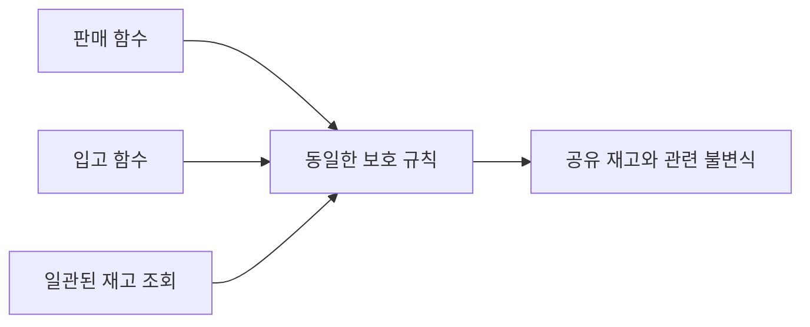
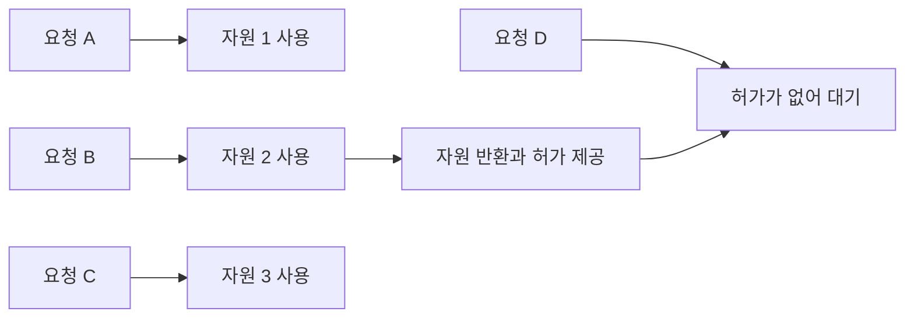
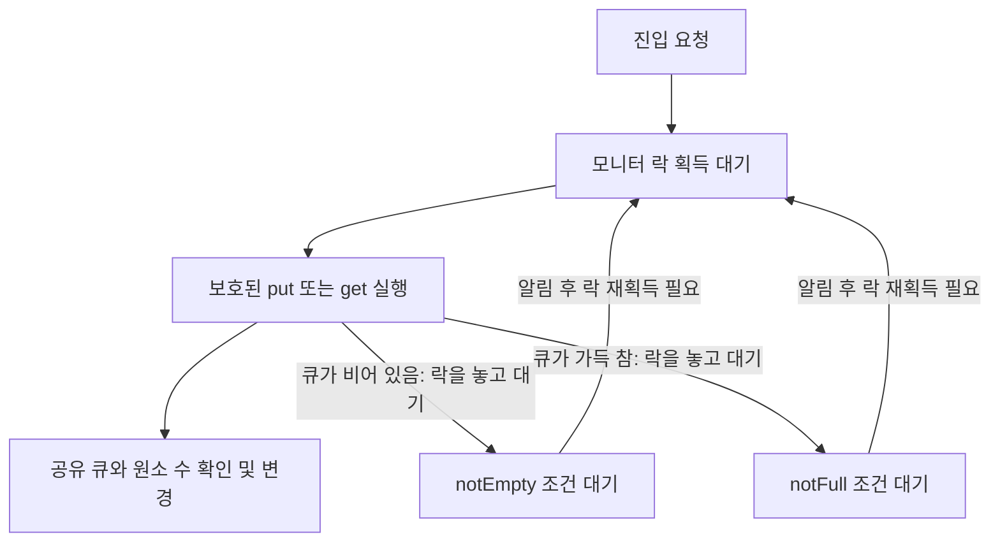
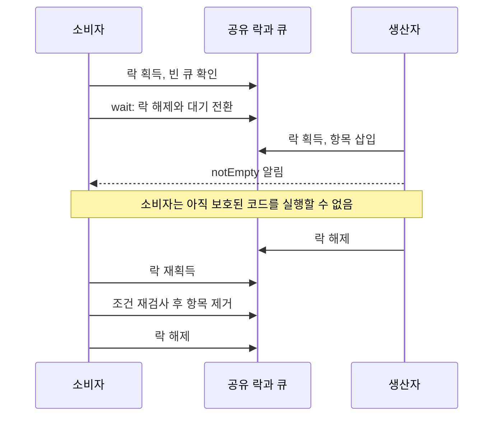
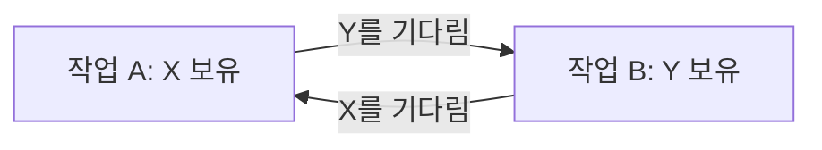

# 7회차 — 동시성 제어

## 1. 동기화가 필요한 이유

온라인 주문을 처리하는 두 작업이 마지막 재고 한 개를 각각 판매했다고 해 보자. 각 작업만 따로 보면 재고를 확인하고 판매하는 정상적인 코드일 수 있다. 그러나 함께 실행할 때 두 작업 모두 같은 재고를 판매할 수 있다. 다른 상황으로, 계산 작업이 아직 결과를 만들지 않았는데 출력 작업이 그 결과를 읽을 수도 있다. 첫 번째 문제에는 **공유 상태를 일관되게 변경하는 규칙**이, 두 번째 문제에는 **선행 작업 이후에 다음 작업을 실행하는 규칙**이 필요하다.

동기화는 이처럼 여러 실행 주체 사이에 필요한 실행 제약을 만드는 일이다. 대표적인 목적은 **상호 배제**와 **실행 순서 조정**이다. 모든 작업을 같은 시각에 실행한다는 뜻도, 프로그램 전체를 한 줄로 세운다는 뜻도 아니다. 서로 독립적인 일은 함께 진행하도록 두고, 함께 수행하면 문제가 되는 부분과 선후 관계가 필요한 부분을 조정한다.

프로세스는 실행 중인 프로그램과 그 실행 환경이며, 스레드는 그 안에서 명령을 수행하는 실행 흐름이다. 같은 프로세스의 스레드는 메모리의 일부를 공유하므로 같은 변수나 자료구조에 접근할 수 있다. 프로세스끼리도 공유 메모리 등을 통해 공동 상태를 다룰 수 있지만, 이 장의 예제는 한 프로세스 안의 스레드를 중심으로 설명한다.

**동시성(concurrency)**은 여러 작업의 진행 기간이 겹치는 성질이고, **병렬성(parallelism)**은 여러 작업이 실제로 같은 순간에 실행되는 성질이다. 코어가 하나여도 작업을 번갈아 실행하면 동시성이 생긴다. 따라서 동기화 문제를 이해하려면 실제 동시 실행뿐 아니라 실행 단계가 서로 끼어드는 **실행 교차(interleaving)**를 살펴야 한다.

이 장의 코드는 특정 언어의 실행 코드가 아닌 의사코드다. 처음에는 개별 읽기와 쓰기를 나누어 순서대로 추적하는 개념적 모델을 사용한다. 실제 언어에서 동기화 없는 접근이 허용하는 결과는 그 언어의 메모리 모델에 따른다. 뮤텍스는 소유권 기반 도구를, 모니터는 알림을 보낸 작업이 계속 실행하는 Mesa 방식을 기준으로 설명한다.

## 2. Race Condition과 Critical Section

### 2.1 두 번 증가시켰는데 왜 1이 되는가

공유 변수 `count`의 초기값이 0이고, 스레드 A와 B가 각각 한 번씩 증가시킨다고 하자. 두 작업이 모두 끝난 뒤 기대하는 값은 2다.

```text
count = count + 1
```

코드는 한 줄이지만, 증가 작업은 다음 세 단계로 나뉠 수 있다.

```text
local = count       // 공유 값을 자신의 임시 변수로 읽는다
local = local + 1   // 임시 값을 계산한다
count = local       // 계산한 값을 공유 변수에 저장한다
```

A와 B의 임시 변수는 서로 별개다. A가 값을 읽은 뒤 B가 실행되면 다음과 같은 순서가 가능하다.

| 순서 | 스레드 A | 스레드 B | 공유 count |
|---|---|---|---|
| 1 | 0을 읽음 | | 0 |
| 2 | | 0을 읽음 | 0 |
| 3 | 임시 값을 1로 계산 | | 0 |
| 4 | | 임시 값을 1로 계산 | 0 |
| 5 | 1을 저장 | | 1 |
| 6 | | 1을 저장 | 1 |

B는 A가 저장한 1에 다시 1을 더하지 않았다. 자신이 이전에 읽었던 0을 기준으로 계산한 1을 저장했다. 그 결과 한 번의 증가 효과가 사라진다. 이를 **갱신 유실(lost update)**이라고 한다.

이 실행에는 두 스레드가 정확히 같은 순간에 명령을 수행해야 한다는 조건이 없다. 단일 코어에서도 A가 읽기를 마친 뒤 문맥 교환으로 B가 실행되면 문제가 생긴다. 여러 코어에서는 이러한 접근이 병렬로 일어날 수도 있다.

**경쟁 상태(race condition)**는 실행 타이밍이나 순서에 따라 프로그램의 올바름이 달라지는 상황이다. 여기서는 두 증가를 모두 반영해야 한다는 요구가 실행 순서에 따라 깨진다. 반면 독립적인 두 작업의 완료 메시지가 어느 순서로 출력되어도 된다는 요구라면 출력 순서가 달라지는 것 자체는 오류가 아니다. 경쟁 상태를 판단하려면 먼저 프로그램이 지켜야 할 조건을 정해야 한다.

### 2.2 개별 연산이 안전해도 조합이 안전하지 않을 수 있다

재고가 한 개 남았을 때의 판매를 생각해 보자.

```text
if stock > 0:
    stock = stock - 1
    판매 성공 처리
```

A가 재고 1을 확인하고, 실제 감소 전에 B도 재고 1을 확인하면 둘 다 판매 가능하다고 판단한다. 이후 감소가 각각 정확하게 수행되더라도 이미 두 요청이 판매 단계에 진입했다. 이 문제는 **확인 후 실행(check-then-act)** 사이에 다른 작업이 상태를 바꾸기 때문에 발생한다.

재고를 읽는 함수와 감소시키는 함수가 각각 내부적으로 잠금을 사용해도 충분하지 않을 수 있다.

```text
// 잘못된 보호 단위
available = 재고를_잠그고_읽기()
if available > 0:
    재고를_잠그고_감소시키기()
    판매 성공 처리
```

두 함수 사이에서는 잠금이 풀려 있다. A와 B가 모두 첫 함수를 통과한 뒤 두 번째 함수를 실행할 수 있다. 필요한 보호 단위는 개별 읽기나 감소가 아니라 **재고 확인부터 판매 수량 확보까지의 전체 판단**이다.

```text
// 하나의 보호 단위
같은 잠금 획득
if stock > 0:
    stock = stock - 1
    success = true
else:
    success = false
같은 잠금 해제
```

여기서 판매 성공은 메모리 안에서 재고 한 개를 확보했다는 의미다. 결제나 외부 저장소 갱신까지 함께 다루는 거래 처리는 이 예제의 범위에 포함하지 않는다.

### 2.3 불변식에서 임계 구역을 찾는다

**불변식(invariant)**은 올바른 상태에서 유지되어야 하는 관계다. 재고 예제에서는 재고가 음수가 되지 않아야 하고, 성공한 판매마다 재고 한 개가 정확히 차감되어야 한다. 큐에서는 기록된 원소 수가 실제 저장된 원소 수와 일치해야 한다.

**임계 구역(critical section)**은 이러한 공유 상태의 일관성을 위해 다른 접근과 실행을 조정해야 하는 코드 구간이다. 재고 변수 자체는 공유 자원이고, 재고를 확인하고 감소시키는 코드는 임계 구역이다.

임계 구역은 한 함수에만 존재하는 것도 아니다. `purchase()`가 재고를 감소시키고 `restock()`이 재고를 증가시킨다면, 두 함수는 같은 상태에 대한 보호 규칙을 공유해야 한다. 각 함수가 서로 다른 락을 사용하면 서로의 진입을 막지 못한다. 조회 함수도 변경 도중의 불완전한 상태를 읽지 않아야 한다면 그 규칙에 참여해야 한다.



그림: 보호 대상을 결정하는 것은 함수 이름이 아니라 함수들이 함께 유지해야 하는 상태다.

여러 변수를 함께 보호해야 할 수도 있다. 예를 들어 `available`과 `reserved`를 관리하면서 두 값의 합을 일정하게 유지한다면, 하나를 줄이고 다른 하나를 늘리는 전체 변경이 보호 대상이다. 잠금 아래에서는 갱신 중 관계가 잠시 성립하지 않을 수 있지만, 다른 작업이 상태를 관찰할 수 있도록 잠금을 놓기 전에는 관계를 회복해야 한다.

### 2.4 원자성은 관찰 가능한 실행 단위에 관한 성질이다

**원자성(atomicity)**은 관련 실행 주체의 관점에서 어떤 연산이 중간 단계로 나뉘어 관찰되거나 간섭받지 않고 하나의 단위처럼 이루어지는 성질이다. 카운터 증가를 올바르게 보호하면 다른 증가 작업은 그 중간에 같은 값을 읽어 끼어들 수 없다.

원자적이라는 말이 반드시 CPU를 계속 독점한다는 뜻은 아니다. 락을 가진 스레드가 임계 구역 도중에 잠시 실행을 멈출 수 있다. 그동안 다른 스레드가 같은 락을 획득하지 못한다면 보호된 접근 사이의 원자성은 유지된다. 반대로 소스 코드가 한 줄이라는 사실은 원자성을 보장하지 않는다.

어떤 범위에 대해 원자적인지도 중요하다. 재고의 읽기와 감소가 각각 원자적이어도 두 연산의 조합까지 자동으로 원자적이 되지는 않는다. 먼저 작업의 의미에 맞는 단위를 정하고, 그 단위를 보장하는 연산이나 동기화 규칙을 선택해야 한다.

### 2.5 임계 구역 해결의 세 요구 조건

임계 구역을 사용하는 작업은 개념적으로 네 구역으로 나눌 수 있다.

```text
진입 구역: 진입 허가를 요청하고 필요하면 기다림
임계 구역: 공유 상태에 대한 보호된 작업
퇴출 구역: 허가를 반환하고 다음 진입을 가능하게 함
나머지 구역: 이 공유 상태의 보호와 무관한 작업
```

올바른 임계 구역 해법을 평가할 때는 세 요구 조건을 구별한다.

**상호 배제(mutual exclusion)**는 같은 보호 대상에 대한 임계 구역을 둘 이상이 동시에 실행하지 못하게 하는 조건이다. 두 판매 요청이 동시에 재고를 확보하는 것을 막는 역할이다. 서로 독립적인 자원에 대한 임계 구역까지 모두 배제해야 한다는 뜻은 아니다.

**진행(progress)**은 임계 구역이 비어 있고 들어가려는 작업이 있다면 다음 진입자를 정하는 일이 무한히 미뤄지지 않아야 한다는 조건이다. 임계 구역에 들어갈 의사가 없는 작업이 결정을 가로막아서도 안 된다. 예를 들어 A와 B가 반드시 번갈아 들어가도록 했는데 B가 나머지 구역에서 오래 머문다고 하자. 임계 구역은 비어 있고 A만 들어가려 해도 B 차례라는 이유로 막힌다면 진행에 문제가 있다.

**한정 대기(bounded waiting)**는 한 작업이 진입을 요청한 뒤 허가받기 전까지 다른 작업이 먼저 진입할 수 있는 횟수에 상한이 있어야 한다는 조건이다. 누군가는 계속 들어가지만 특정 작업만 끝없이 추월당한다면 진행은 이루어져도 한정 대기는 만족하지 못할 수 있다. 이는 몇 밀리초 이내에 실행된다는 고정 응답 시간 보장과 다르다.

아무도 임계 구역에 들어가지 못하게 하는 방법은 상호 배제만 보면 안전하지만 쓸모 있는 해결책이 아니다. 이 차이를 더 넓게 표현하면, **안전성(safety)**은 잘못된 상태가 발생하지 않는 성질이고 **진행성(liveness)**은 필요한 일이 결국 진행되는 성질이다. 임계 구역의 진행과 한정 대기는 진행성과 관련된 서로 다른 요구다. 이러한 논의에는 실행 주체가 계속 실행 기회를 얻고 임계 구역의 작업을 끝낸다는 전제가 필요하다.

### 2.6 경쟁 상태와 데이터 경쟁

**데이터 경쟁(data race)**은 일반적인 경쟁 상태보다 메모리 접근에 초점을 맞춘 용어다. 보통 같은 메모리 위치에 대한 충돌하는 접근, 그중 적어도 하나의 쓰기, 필요한 동기화 순서의 부재와 관련되며 정확한 정의는 언어마다 다르다. 단순히 두 접근이 물리적으로 같은 순간에 일어났는지만으로 판단하지 않는다.

앞의 재고 예제에서 모든 읽기와 쓰기를 같은 락으로 각각 보호하면 데이터 경쟁을 없앨 수 있다. 그래도 확인과 감소 사이에 락을 놓으면 논리적 경쟁 상태는 남는다. 따라서 데이터 경쟁이 없다는 사실만으로 업무 규칙까지 올바르다고 결론 내릴 수 없다.

## 3. Mutex와 Semaphore

### 3.1 뮤텍스: 보호된 작업을 수행할 권한

**뮤텍스(mutex)**는 상호 배제를 위한 잠금이다. 이 장에서 사용하는 소유권 기반 뮤텍스는 획득한 스레드가 소유자가 되고, 그 스레드가 작업을 마친 뒤 해제한다.

카운터 예제에 적용하면 다음과 같다.

```text
m.lock()
try:
    count = count + 1
finally:
    m.unlock()
```

A가 `m`을 획득하면 B는 A가 해제할 때까지 같은 `m`의 획득을 완료하지 못한다. A가 0을 읽고 1을 저장한 뒤 해제하면 B는 이후 1을 읽고 2를 저장한다. A와 B 중 누가 먼저 들어가는지는 달라질 수 있지만, 두 증가가 서로의 중간에 끼어들지 못하므로 결과는 두 번의 증가를 반영한다.

뮤텍스는 변수에 붙어서 모든 접근을 자동 차단하는 장치가 아니다. 어떤 코드가 `m`을 획득하지 않고 `count`를 변경하면 보호를 우회한다. 함수 호출마다 새 뮤텍스를 만드는 경우도 각 스레드가 서로 다른 락을 획득하므로 해결책이 되지 않는다. 공유 상태에 대해 **공유된 동일한 락과 일관된 사용 규칙**이 필요하다.

하나의 뮤텍스로 여러 변수를 보호할 수 있다. 앞의 `available`과 `reserved`처럼 변수 사이의 관계가 중요하면 오히려 함께 보호하는 편이 자연스럽다. 따라서 뮤텍스를 단순히 자원 한 개를 위한 도구라고 외우면 보호 단위를 잘못 이해하기 쉽다.

### 3.2 획득과 해제는 반드시 짝을 이뤄야 한다

잠금을 획득한 뒤 중간에 반환하거나 예외가 발생해 해제를 건너뛰면 다른 작업이 계속 기다릴 수 있다. 위 코드의 `finally`는 정상 종료뿐 아니라 중간 탈출에서도 해제를 수행하도록 하는 구조다. 언어에 따라 범위가 끝날 때 자동으로 해제하는 기능을 사용하기도 한다.

다만 락을 해제한다는 사실과 상태를 올바르게 복구한다는 사실은 별개다. 두 필드를 갱신하다가 첫 번째 변경 후 실패했다면, 해제 전에 불변식을 회복하거나 불완전한 상태가 외부에 보이지 않는 설계가 필요하다. 잠금은 변경 내용의 의미까지 검증해 주지 않는다.

소유권은 해제 책임을 분명하게 만든다. 일반적인 소유권 기반 뮤텍스를 다른 스레드가 대신 해제하는 방식으로 완료 알림을 구현해서는 안 된다. 다른 실행 주체가 신호를 보내는 문제에는 뒤에서 설명할 세마포어나 조건 대기가 더 적합하다. 실제 API의 `Lock`이라는 이름만으로 소유권 규칙을 단정할 수는 없으므로 계약을 확인해야 한다.

### 3.3 잠금 획득 자체는 어떻게 경쟁을 피하는가

다음 코드는 그럴듯하지만 올바른 락이 아니다.

```text
while locked == true:
    아무것도 하지 않음
locked = true
```

A가 `locked == false`를 확인한 직후 B도 같은 값을 확인할 수 있다. 이후 둘 다 `locked = true`를 실행하면 각자 자신이 잠금을 획득했다고 생각한다. 공유 상태의 경쟁을 막으려던 잠금 변수에서 다시 경쟁이 발생한 것이다.

필요한 것은 사용 가능 여부의 확인과 획득 상태로의 변경이 서로 분리되지 않는 계약이다. 실제 동기화 도구는 원자적 연산과 필요한 런타임·운영체제 지원을 조합해 이 계약을 구현한다. 사용자 코드는 일반 변수의 검사와 대입을 나열하여 이를 흉내 내는 대신 검증된 도구를 사용한다.

여기서 획득이 원자적이라는 것은 대기하는 모든 시간 동안 CPU를 독점한다는 뜻이 아니다. 여러 요청 중 어떤 요청이 사용 권한을 얻는지에 관한 상태 전이가 모순 없이 이루어진다는 뜻이다.

### 3.4 기다리는 방법: 스핀과 블로킹

잠금을 얻지 못했을 때의 대기 방식에는 중요한 차이가 있다.

**바쁜 대기(busy waiting)**는 조건을 반복 검사하며 CPU를 사용하는 방식이다. **스핀락(spinlock)**은 잠금을 얻을 때까지 이런 방식으로 반복하는 락이다. 잠금이 곧 풀릴 상황에서는 대기 상태로 전환하고 다시 깨우는 비용을 피할 수 있다. 반면 기다림이 길거나 락 소유자가 실행되지 못하는 상황에서는 유용한 작업 없이 CPU를 소비한다.

**블로킹(blocking)**은 기다리는 동안 해당 스레드의 실행을 멈추고 다른 작업에 실행 기회를 주는 방식이다. 자원이 사용 가능해지면 깨우기(wakeup)를 통해 다시 실행할 수 있게 한다. 대기 중 반복 검사 비용을 줄일 수 있지만, 대기와 재개를 관리하는 비용이 든다. 깨워졌다고 즉시 CPU를 얻거나 반드시 다음 락 소유자가 되는 것도 아니다.

어느 방식이 유리한지는 대기 길이, 코어 수, 경합 정도, 스케줄링 상황에 따라 달라진다. 실제 구현은 잠시 스핀한 뒤 블로킹하는 방식을 사용할 수도 있다. **뮤텍스와 세마포어는 무엇을 조정하는지에 관한 추상화이고, 스핀과 블로킹은 어떻게 기다리는지에 관한 구분**이다. 도구 이름만 보고 항상 한 가지 대기 방식이라고 단정하면 안 된다.

### 3.5 세마포어: 사용 가능한 허가의 수

**세마포어(semaphore)**는 허가 수를 통해 실행을 조정하는 동기화 도구다. 우선 사용 가능한 허가를 비음수로 나타내는 추상 모델로 이해하자.

`acquire()`는 허가가 있으면 하나를 소비하고 진행한다. 허가가 없으면 획득할 수 있을 때까지 기다린다. `release()`는 허가 하나를 제공하여 다른 획득이 진행할 수 있게 한다. 허가의 검사·소비·제공과 대기 처리는 서로 충돌하지 않도록 동기화되어 있다.

같은 계열의 연산을 교재나 API에 따라 다르게 부른다.

| 역할 | 자주 사용하는 명칭 |
|---|---|
| 허가 획득 | P, wait, down, acquire |
| 허가 제공·반환 | V, signal, up, release |

여기서 `wait`는 호출할 때마다 반드시 잠든다는 뜻이 아니다. 허가가 있으면 바로 통과한다. 뒤에서 나오는 조건 변수의 `wait`와는 계약이 다르다.

자원이 세 개 있는 풀을 생각해 보자. 세마포어의 초기 허가 수를 3으로 두고, 자원을 빌리기 전에 허가를 얻고 반환할 때 허가를 돌려준다. 세 요청이 허가를 획득했다면 남은 허가는 0이다. 네 번째 요청은 앞선 요청 중 하나가 반환할 때까지 진행할 수 없다.



그림: 모든 허가가 사용 중이면 다음 요청은 반환이 생길 때까지 기다린다. 어느 대기자가 다음 허가를 얻는지는 별도의 정책이다.

### 3.6 이진 세마포어와 카운팅 세마포어

**카운팅 세마포어(counting semaphore)**는 여러 허가를 관리한다. 자원이 N개일 때 초기값 N을 사용하여 동시에 자원을 사용하는 작업 수를 제한할 수 있다.

**이진 세마포어(binary semaphore)**는 사용 가능한 허가를 0 또는 1로 제한한다. 초기값이 1이고 각 작업이 진입 전에 획득하고 퇴출할 때 반환하면 상호 배제를 구현할 수 있다.

뮤텍스와 이진 세마포어는 이 용도에서 기능이 겹친다. 그러나 소유권 기반 뮤텍스는 획득한 스레드가 해제해야 하는 반면, 세마포어는 일반적으로 같은 스레드가 획득하고 반환해야 한다는 소유권 규칙이 없다. 이 차이 덕분에 한 작업이 다른 작업의 진행을 허용하는 신호를 줄 수 있다.

일반 카운팅 세마포어를 1로 초기화했다고 해서 구현이 자동으로 최대값 1을 강제하는 것은 아니다. 잘못된 중복 반환으로 허가가 2가 되면 두 작업이 함께 통과할 수 있다. 이진 상태를 강제하는 도구인지, 사용 규칙으로 유지하는지 구별해야 한다.

### 3.7 초기값 0은 실행 순서를 만든다

작업 A가 결과를 만든 뒤에만 작업 B가 결과를 사용해야 한다고 하자. 완료 세마포어 `done`을 0으로 초기화한다.

```text
초기화: done = Semaphore(0)

작업 A:
    result = 계산()
    done.release()

작업 B:
    done.acquire()
    결과 사용(result)
```

B가 먼저 도착하면 허가가 없어 기다린다. A가 결과를 만들고 신호를 보내면 B가 진행할 수 있다. 반대로 A가 먼저 끝났다면 허가 하나가 남아 있으므로 B가 나중에 도착해도 통과한다. **신호가 대기보다 먼저 발생해도 그 효과를 허가로 남길 수 있다**는 점이 중요하다.

이 예제는 한 번의 결과 생성과 한 번의 소비를 가정한다. 한 번의 `release()`가 여러 대기자를 모두 통과시키는 것은 아니다. 또한 결과 기록과 읽기 사이의 가시성이 보장되는 동기화 API를 사용해야 한다.

초기값은 단순한 설정값이 아니라 처음에 무엇을 허용할지 나타낸다. 초기값 1은 한 작업의 진입, N은 N개의 사용, 0은 아직 어떤 통과도 허용하지 않음을 표현한다.

### 3.8 허가 수와 자료구조 보호는 다른 책임이다

자원이 세 개인 풀에서 세마포어는 최대 세 요청의 동시 사용을 허용한다. 하지만 그 세 요청이 같은 자원 목록을 함께 수정하면 목록에서는 여전히 경쟁이 발생할 수 있다. 예를 들어 두 요청이 같은 빈 항목을 발견하고 모두 자신의 것으로 표시할 수 있다.

따라서 풀에서는 다음 두 책임을 분리해 생각한다.

```text
빌리기:
    available.acquire()
    목록 락 획득
    사용하지 않는 자원 하나를 선택하고 사용 중으로 표시
    목록 락 해제
    선택한 자원 반환

돌려주기:
    목록 락 획득
    해당 자원을 사용 가능 상태로 표시
    목록 락 해제
    available.release()
```

자원 사용 자체를 목록 락 안에서 수행할 필요는 없다. 목록을 통해 각각 다른 자원을 배정받았고 사용 중에는 그 자원을 독점한다는 조건이라면, 실제 작업은 병렬로 진행할 수 있다. 자원을 먼저 목록에 돌려놓고 허가를 제공해야 새 요청이 존재하지 않는 가용 자원을 기대하지 않는다.

### 3.9 표현과 계약을 구별한다

어떤 교재는 세마포어 내부 값을 감소시킨 결과가 음수이면 대기하도록 설명한다. 그 모델에서는 음수의 절댓값이 아직 해결되지 않은 대기 요청 수를 나타내기도 한다. 이는 사용 가능한 허가 수를 비음수로 설명하는 모델과 표현 방식이 다르다. 자원 수가 실제로 음수가 되었다는 뜻은 아니며, 특정 구현의 조회값이 항상 대기자 수까지 나타낸다는 뜻도 아니다.

공정성도 별도의 계약이다. 뮤텍스나 세마포어를 썼다는 사실만으로 FIFO 진입이나 기아 방지가 보장되지는 않는다. 먼저 기다린 작업보다 새 작업이 먼저 획득할 수 있는 구현도 있다. 임계 구역의 이상적 요구 조건과 실제 도구가 제공하는 보장을 구분해야 한다.

마지막으로 동기화는 접근을 번갈아 시키는 역할뿐 아니라 **공유 데이터의 가시성과 순서**에도 관련된다. 적절한 동기화 관계는 앞선 작업의 변경을 이후 작업이 올바르게 관찰하도록 해 준다. 구체적인 보장 범위는 언어와 API의 메모리 모델에 따른다. 시간을 충분히 기다리거나 평범한 플래그를 검사하는 것만으로 이러한 관계가 만들어지는 것은 아니다.

## 4. Monitor와 조건 변수

### 4.1 락을 얻었지만 작업할 수 없는 경우

작업 큐에서 항목을 꺼내려는 소비자가 큐의 뮤텍스를 획득했다고 하자. 이제 다른 스레드와 충돌하지 않고 큐를 확인할 수 있다. 그런데 큐가 비어 있다면 꺼낼 항목이 없다. **상태를 안전하게 확인할 권한**과 **작업을 수행할 수 있는 상태**는 다르다.

소비자가 락을 가진 채 큐가 채워지기를 기다리면 생산자는 같은 락을 획득하지 못해 항목을 넣을 수 없다. 소비자는 생산자를 기다리고, 생산자는 소비자가 가진 락을 기다리게 된다.

이 문제에는 기다리는 동안 다른 스레드가 상태를 바꿀 수 있도록 락을 놓고, 상태가 달라졌을 때 다시 확인하는 기능이 필요하다. 이 기능을 공유 상태의 보호와 함께 구성하는 것이 모니터의 핵심이다.

### 4.2 모니터의 구성

**모니터(monitor)**는 공유 상태와 그 상태를 다루는 연산을 묶고 상호 배제를 제공하는 고수준 동기화 구성이다. 필요한 경우 조건 변수로 상태 변화에 대한 대기도 제공한다.

작업 큐 모니터라면 내부 상태는 큐와 용량이고, 외부에 제공하는 연산은 `put()`과 `get()`이다. 초기화는 빈 큐와 용량을 설정한다. 진입을 제어하는 락은 보호된 연산이 서로 간섭하지 않도록 한다. 조건 변수는 큐가 비어 있거나 가득 찼을 때의 대기를 관리한다.

언어가 모니터 진입과 퇴출을 지원할 수도 있고, 프로그래머가 뮤텍스와 조건 변수를 묶어 같은 패턴을 만들 수도 있다. 후자의 경우 접근 규칙을 지키는 책임은 구현자에게 있다. 공유 상태를 밖으로 노출해 무보호 접근을 허용하면 모니터의 보호 경계를 우회하게 된다.



그림: 진입 대기는 락을 얻기 위한 대기이고, 조건 대기는 필요한 상태가 되기를 기다리는 것이다. 그림의 대기 집단은 개념적 구분이며 특정 구현의 내부 큐 구조를 뜻하지 않는다.

모니터에서 한 번에 하나만 실행한다는 말은 한 번에 하나의 실행 주체가 보호된 코드를 수행한다는 뜻이다. 조건 대기로 정지한 여러 스레드의 호출이 존재할 수 있으며, 그 스레드들은 기다리는 동안 다른 스레드의 진입을 허용한다.

### 4.3 조건식과 조건 변수

소비자가 진행할 수 있는 조건은 `queue.size > 0`이다. 이것이 **조건식(predicate)**이다. 조건식의 참·거짓은 실제 공유 상태에서 계산한다.

반면 `notEmpty`라는 **조건 변수(condition variable)**는 그 상태 변화를 기다리는 작업들을 위한 대기·알림 수단이다. 이름이 `notEmpty`라고 해서 큐가 비었는지 자동으로 감시하거나 참·거짓을 저장하지 않는다. 큐를 바꾸는 코드가 필요한 알림을 보내고, 기다리던 코드는 깨어난 뒤 실제 조건식을 검사해야 한다.

조건 변수의 핵심 연산은 다음과 같다.

- `wait`: 연결된 락을 놓고 조건을 기다리며, 정상 복귀 전에 락을 다시 획득한다.
- `signal` 또는 `notify`: 해당 조건 변수의 대기자 하나를 깨울 대상으로 선택한다.
- `broadcast` 또는 `notifyAll`: 해당 조건 변수의 모든 대기자에게 다시 확인할 기회를 준다.

알림은 큐에 항목을 넣는 연산이 아니다. 상태 변경은 별도의 코드가 수행해야 한다. 알림을 받은 스레드가 다시 실행할 때 조건이 참이라는 보장도 없다.

### 4.4 wait는 락 해제와 대기 진입을 연결한다

소비자의 기본 패턴은 다음과 같다.

```text
m.lock()
try:
    while queue.isEmpty():
        notEmpty.wait(m)
    item = queue.remove()
finally:
    m.unlock()
```

처음 조건을 검사할 때 소비자는 `m`을 소유한다. 큐가 비어 있으면 `wait(m)`가 **락 해제와 조건 대기로의 전환을 원자적으로 수행**한다. 따라서 생산자가 락을 얻어 상태를 변경하고 알리는 사이에 소비자의 대기 등록이 빠지는 틈이 생기지 않는다.

이 두 단계를 사용자가 따로 구현하면 다음 실패가 가능하다.

```text
1. 소비자가 큐가 비었음을 확인한다.
2. 소비자가 락만 해제하고 아직 대기하지 않는다.
3. 생산자가 항목을 넣고 알린다. 아직 대기자가 없다.
4. 소비자가 이제 대기에 들어간다.
```

큐에는 항목이 있는데 소비자는 다음 알림이 없으면 계속 기다릴 수 있다. 이를 **깨우기 유실(lost wakeup)** 문제로 볼 수 있다. 조건 검사와 상태 변경에 같은 락을 사용하고, 대기 전환에는 조건 변수의 원자적 계약을 사용해야 이 틈을 막을 수 있다. `wait`만 올바르게 호출하고 생산자의 상태 변경을 무보호로 수행해서는 충분하지 않다.

정상 실행은 소비자의 대기 이후 생산자가 락을 얻어 항목을 넣고 알리는 순서로 이어진다. 이후 생산자가 락을 놓아야 소비자가 다시 획득할 수 있다. 소비자의 `wait`가 정상 반환했을 때는 이미 락을 다시 소유하고 있으므로, 이어지는 조건 검사와 큐 변경도 보호된다.



그림: 알림을 받는 것과 락을 다시 얻어 작업을 수행하는 것은 서로 다른 단계다.

### 4.5 if가 아니라 while인 이유

Mesa 방식에서는 알림을 보낸 생산자가 계속 실행한다. 알림받은 소비자는 이후 락을 재획득해야 한다. 그 사이 다른 스레드가 먼저 들어올 수 있다.

소비자 C1과 C2가 있고 생산자가 항목 하나를 넣는 상황을 보자.

1. C1이 빈 큐를 확인하고 `notEmpty`에서 기다린다.
2. 생산자가 항목 하나를 넣고 C1에 알린 뒤 락을 놓는다.
3. C1이 락을 얻기 전에 C2가 먼저 얻어 그 항목을 가져간다.
4. C1이 락을 얻었을 때 큐는 다시 비어 있다.

C1이 `if`로 한 번만 검사했다면 대기에서 돌아온 다음 바로 항목을 제거하려 할 수 있다. `while`을 사용하면 현재 상태를 다시 검사하고 필요하면 다시 기다린다. 이는 알림을 놓친 문제가 아니다. 알림은 제대로 전달되었지만, 그때 가능했던 작업이 지금도 가능하다고 보장할 수 없는 문제다.

일부 API에서는 대응하는 알림이 없어도 대기가 끝나는 **허위 깨움(spurious wakeup)**을 허용한다. 이것도 재검사가 필요한 이유지만, 허위 깨움이 전혀 없더라도 앞의 C2 사례 때문에 `while`은 필요하다.

이 `while`은 바쁜 대기와도 다르다. 조건이 거짓이면 `wait` 안에서 블로킹하므로 계속 CPU를 사용하며 검사하지 않는다. 재개되어 락을 얻었을 때만 조건을 다시 확인한다.

### 4.6 조건 변수는 알림을 허가로 저장하지 않는다

세마포어에 허가를 하나 제공하면 나중에 도착한 작업이 그것을 소비할 수 있다. 반면 조건 변수에 대기자가 없을 때 보낸 알림은 미래의 `wait`를 통과시키는 허가로 누적되지 않는다.

그렇다고 생산자가 먼저 실행되면 반드시 문제가 되는 것은 아니다. 생산자가 큐에 항목을 남겨 두면 나중에 온 소비자는 큐가 비어 있지 않다는 사실을 보고 대기하지 않는다. **기억해야 할 사실은 공유 상태에 저장하고, 알림은 그 상태를 다시 확인하게 하는 데 사용한다.**

완료 상태도 같은 원리로 표현할 수 있다.

```text
초기 상태: finished = false

완료 작업:
    m.lock()
    result = 계산된 결과
    finished = true
    completed.broadcast()
    m.unlock()

결과를 기다리는 작업:
    m.lock()
    while not finished:
        completed.wait(m)
    localResult = result
    m.unlock()
    localResult 사용
```

이 예제는 결과가 한 번 정해진 뒤 바뀌지 않고, 여러 작업이 완료 사실을 관찰할 수 있다고 가정한다. 완료 작업이 먼저 끝나도 `finished`가 남아 있으므로 뒤늦게 온 작업은 기다리지 않는다. 신호 한 번당 획득 하나가 진행하는 세마포어와 목적이 다르다.

### 4.7 유한 버퍼 모니터

용량 N인 큐에는 두 조건이 있다. 소비자는 원소가 있어야 진행할 수 있고, 생산자는 빈칸이 있어야 진행할 수 있다. 따라서 `notEmpty`와 `notFull`이라는 두 조건 변수를 둔다. 두 조건 변수는 같은 큐 상태를 다루므로 같은 모니터 락과 연결한다.

아래 의사코드에서 `with m`은 진입할 때 락을 얻고 블록을 떠날 때 해제하는 구조다. `wait(m)`는 대기 중 그 락을 놓았다가 반환 전에 다시 얻는다. 큐 연산은 정상적으로 끝나며 취소는 없다고 가정한다.

```text
monitor BoundedQueue:
    capacity = N                 // N > 0
    queue = 빈 큐
    m = Mutex()
    notEmpty = Condition(m)
    notFull  = Condition(m)

    put(item):
        with m:
            while queue.size == capacity:
                notFull.wait(m)
            queue.add(item)
            notEmpty.signal()

    get():
        with m:
            while queue.size == 0:
                notEmpty.wait(m)
            item = queue.remove()
            notFull.signal()
            return item
```

`put()`은 빈칸이 있다는 사실을 락 아래에서 확인하고, 같은 락을 유지한 채 삽입한다. 따라서 확인 직후 다른 생산자가 마지막 빈칸을 먼저 채우는 간섭을 막는다. 삽입 후에는 소비자가 진행할 수 있으므로 `notEmpty`에 알린다. `get()`은 대칭적으로 원소를 확인하고 제거한 뒤 빈칸을 기다리는 생산자에게 알린다.

유지할 불변식은 `0 ≤ queue.size ≤ N`이며, 큐의 내부 구조와 원소 수도 일치해야 한다. 각 연산은 조건이 충족되지 않으면 상태를 변경하지 않고 기다린다. 다른 작업에 락을 넘기는 시점에는 큐가 올바른 상태여야 한다.

### 4.8 누구를 얼마나 깨울 것인가

위 버퍼에서는 항목 하나를 넣으면 소비자 한 명이, 항목 하나를 꺼내면 생산자 한 명이 진행할 수 있다. 같은 조건을 기다리는 집단을 분리했으므로 한 명에게 알리는 방식이 자연스럽다.

반대로 생산자와 소비자를 하나의 조건 변수에 모두 기다리게 하고 아무 대기자 하나만 깨우면, 상태 변화에 맞지 않는 작업이 선택될 수 있다. 깨어난 작업은 재검사 후 다시 잠들고 실제로 진행할 수 있는 작업은 잠든 채 남을 수 있다. `while`은 잘못된 작업 수행을 막지만, 올바른 대기자가 반드시 깨도록 보장하지는 않는다.

한 상태 변화로 여러 작업이 진행할 수 있거나, 같은 조건 변수의 대기자들이 서로 다른 조건을 기다린다면 `broadcast`가 필요할 수 있다. 예를 들어 어떤 작업은 자원 두 개를, 다른 작업은 다섯 개를 기다린다고 하자. 두 개가 생겼는데 다섯 개를 기다리는 작업만 깨우면 진행 가능한 작업을 놓칠 수 있다.

모두 깨워도 모두가 동시에 보호된 코드를 실행하는 것은 아니다. 락을 하나씩 획득하여 각자 조건을 재검사한다. 불필요하게 많은 작업을 깨우면 경합이 늘어나므로 알림 대상과 진행 가능한 작업 수를 함께 고려한다.

### 4.9 Hoare 방식과 Mesa 방식

Hoare 방식에서는 조건 변수에 신호를 보냈을 때 대기자에게 모니터 실행권을 즉시 넘긴다. 신호를 보낸 작업은 잠시 물러나며, 올바른 신호 규칙 아래에서는 깨어난 작업이 신호 시점에 성립한 조건을 바탕으로 진행할 수 있다.

Mesa 방식에서는 신호를 보낸 작업이 계속 실행한다. 대기자는 나중에 락을 재획득하므로 다른 작업의 상태 변경을 고려해 조건을 다시 검사해야 한다. 이 장의 모든 조건 대기 예제는 이 방식을 따른다.

모니터는 보호 규칙을 한곳에 모으는 데 도움이 되지만 조건식, 상태 변경, 알림 대상까지 자동으로 정해 주지는 않는다. 틀린 조건식이나 누락된 알림, 보호 경계를 우회하는 접근은 여전히 잘못된 결과나 무한 대기를 만들 수 있다.

## 5. 적용 사례로 동기화 설계하기

### 5.1 도구보다 먼저 필요한 제약을 적는다

동기화 문제를 만나면 먼저 공유 상태가 무엇인지, 누가 변경하는지, 반드시 유지할 관계가 무엇인지 설명해 보자. 그다음 진행하려면 어떤 상태가 필요한지, 누가 그 상태를 만들 수 있는지 확인한다. 이 질문에 답하면 어떤 도구가 필요한지도 더 명확해진다.

| 상황 | 필요한 제약 | 기본적인 표현 |
|---|---|---|
| 공유 카운터 증가 | 읽기–수정–쓰기의 간섭 방지 | 뮤텍스로 전체 증가 보호 |
| 재고 확보 | 검사부터 감소까지 하나의 판단 | 같은 임계 구역으로 묶기 |
| 자원 N개인 풀 | 동시 사용자 수 제한 | 초기값 N의 세마포어 |
| 계산 완료 후 결과 사용 | 결과 생성 이후에 소비 | 초기값 0의 완료 세마포어 |
| 유한 작업 큐 | 구조 보호와 빈칸·항목 대기 | 락과 세마포어 또는 모니터 |

자원 풀에서는 허가 수 외에 목록 보호가 필요했고, 작업 큐에서는 락 외에 상태 대기가 필요했다. 하나의 도구 이름으로 문제 전체를 분류하기보다 서로 다른 제약을 분리하여 표현하는 것이 중요하다.

### 5.2 생산자–소비자 문제의 요구

생산자는 작업을 만들고 큐에 넣으며, 소비자는 큐에서 작업을 꺼내 처리한다. 큐의 용량을 제한하면 생산자가 무한히 앞서가며 작업을 쌓는 것을 막을 수 있다. 큐가 가득 차면 생산자가, 비어 있으면 소비자가 기다린다.

이 문제에는 세 가지 요구가 있다. 큐의 삽입·제거가 서로 간섭해 자료구조를 망가뜨리지 않아야 하고, 생산자는 빈칸을 확보해야 하며, 소비자는 항목을 확보해야 한다. 앞의 모니터는 하나의 보호 경계 안에서 상태 조건을 검사하여 이 요구를 표현했다. 이번에는 허가 수로 표현해 보자.

### 5.3 세마포어를 이용한 유한 버퍼

용량이 N인 빈 큐에서 시작한다.

```text
empty = Semaphore(N)    // 생산자가 확보할 수 있는 빈칸
full  = Semaphore(0)    // 소비자가 확보할 수 있는 항목
m = Mutex()            // 처음에는 잠금 해제 상태
queue = 빈 큐
```

생산자는 빈칸 허가를 먼저 얻고 큐를 변경한다. 소비자는 항목 허가를 먼저 얻고 큐를 변경한다.

```text
생산자:
    item = 작업 생성()
    empty.acquire()
    with m:
        queue.add(item)
    full.release()

소비자:
    full.acquire()
    with m:
        item = queue.remove()
    empty.release()
    작업 처리(item)
```

예제는 허가 획득 이후의 큐 연산이 실패하거나 취소되지 않는 정상 경로를 가정한다. 실제 취소를 지원한다면 확보한 허가와 상태 변경을 일치시키는 별도 처리가 필요하다.

`empty.acquire()`는 생산자에게 빈칸 하나를 예약하는 역할을 한다. 다른 생산자도 빈칸을 예약할 수 있으므로 큐 구조의 변경은 여전히 `m`으로 보호해야 한다. 삽입을 마친 뒤 `full.release()`를 수행하면 소비자에게 항목 하나가 제공된다. 소비자는 제거를 마친 뒤 `empty.release()`로 빈칸을 제공한다.

작업 생성과 작업 처리는 큐 구조를 변경하지 않는다는 전제 아래 락 밖에서 수행한다. 큐를 안전하게 고치는 시간만 직렬화하고 실제 처리 시간은 여러 소비자가 겹쳐 사용할 수 있게 한다.

용량 2인 큐를 짧게 추적해 보자. 각 삽입이나 제거가 허가 반환까지 끝난 시점을 관찰한다.

| 상태 | 큐 | 사용 가능한 empty | 사용 가능한 full |
|---|---|---|---|
| 초기 | 비어 있음 | 2 | 0 |
| A 삽입 완료 | A | 1 | 1 |
| B 삽입 완료 | A, B | 0 | 2 |
| A 제거 완료 | B | 1 | 1 |

가득 찬 상태에서 세 번째 생산자는 빈칸 허가를 얻지 못해 기다린다. 소비자가 A를 제거하고 빈칸 허가를 반환하면 다시 진행할 수 있다.

단, 실행 중의 모든 순간에 세마포어 값이 큐의 실제 원소 수와 정확히 일치한다고 생각하면 안 된다. 소비자가 `full` 허가를 얻고 아직 큐에서 제거하지 않았다면, 큐에 남아 있는 항목 중 하나는 이미 예약되어 있다. 위 표는 진행 중인 예약이 없는 완료 시점의 설명이다. 허가 수는 단순 상태 표시를 넘어 앞으로 수행할 작업의 권한을 나타낸다.

### 5.4 왜 허가를 기다린 뒤 락을 얻는가

소비자가 먼저 `m`을 얻고 그 안에서 `full.acquire()`를 수행하도록 순서를 바꿔 보자. 큐가 비어 있다면 소비자는 항목을 기다리면서 `m`을 계속 가진다. 생산자는 항목을 넣으려면 `m`이 필요하므로 진행할 수 없다. 항목을 만드는 작업을 소비자 자신이 막는 셈이다.

세마포어의 획득 대기는 이미 보유한 별도 뮤텍스를 자동으로 해제하지 않는다. 그래서 이 해법에서는 먼저 필요한 허가를 기다리고, 그다음 큐 구조 변경을 위한 락을 얻는다.

앞의 모니터 코드가 락을 가진 상태에서 조건을 기다렸던 것과 비교하면 중요한 차이가 드러난다. 조건 변수의 `wait(m)`는 기다리는 동안 `m`을 놓는 계약이 있다. 세마포어의 `acquire()`에는 다른 락을 놓는 계약이 없다. 연산 이름이 모두 기다림을 나타낸다고 같은 순서로 조합할 수는 없다.

세마포어 해법과 모니터 해법은 같은 요구를 다르게 표현한다. 세마포어는 빈칸과 항목의 **허가를 먼저 확보**하고, 모니터는 락 아래에서 **현재 상태를 검사하여 가능할 때 변경**한다. 어느 방식에서도 큐 구조의 일관성과 작업 가능한 상태라는 두 요구를 모두 충족해야 한다.

### 5.5 독자–작성자: 읽기끼리는 함께 진행할 수 있다

공유 검색 목록을 여러 작업이 조회하고 가끔 다른 작업이 갱신한다고 하자. 모든 조회를 하나의 뮤텍스로 직렬화하면 정확성을 확보할 수 있지만, 서로 상태를 바꾸지 않는 조회까지 기다리게 된다.

**독자–작성자(readers–writers) 문제**는 읽기와 쓰기의 충돌 관계를 구별한다.

| 접근 조합 | 같은 상태에 대한 동시 접근 |
|---|---|
| 읽기와 읽기 | 허용 가능 |
| 읽기와 쓰기 | 배제 |
| 쓰기와 쓰기 | 배제 |

읽기 작업들이 실제로 공유 상태를 변경하지 않는다는 전제에서 여러 독자의 동시 접근을 허용할 수 있다. 작성자는 독자가 없고 다른 작성자도 없을 때 독점 접근한다. 읽기–쓰기 락은 이런 규칙을 표현하는 도구다.

여기에 우선 정책 문제가 생긴다. 작성자가 기다려도 새 독자를 계속 받아들이는 독자 우선 정책에서는 독자가 끊임없이 겹쳐 들어와 작성자가 기아에 빠질 수 있다. 작성자 우선 정책은 기다리는 작성자를 위해 새 독자의 진입을 제한하지만, 작성자가 계속 도착할 때 독자의 기다림이 길어질 수 있다. 공정한 정책은 요청 순서나 단계별 진입 규칙으로 한쪽이 계속 밀리는 것을 제한한다.

읽기 동시성을 허용한다고 반드시 더 빠른 것은 아니다. 읽기와 쓰기의 비율, 작업 길이, 경합, 추가 관리 비용이 영향을 준다. 또한 이름이 조회인 함수도 내부에서 통계나 캐시를 변경한다면 그 변경에 대한 보호를 따로 고려해야 한다.

### 5.6 교착 상태와 기아

**교착 상태(deadlock)**는 관련 작업들이 서로가 해야 할 일을 기다려 더 진행하지 못하는 상황이다. 두 락 X와 Y를 사용하는 경우를 보자.

```text
작업 A: X 획득 → Y 획득 시도
작업 B: Y 획득 → X 획득 시도
```

A가 X를, B가 Y를 얻은 상태에서 각각 다음 획득을 시도하면 둘 다 기다린다. 두 락이 각자의 상호 배제를 정확하게 보장해도 전체 프로그램은 멈출 수 있다.



그림: 각 작업이 상대가 가진 락을 기다리므로 어느 쪽도 다음 단계로 가지 못한다.

관련된 모든 코드가 X 다음 Y라는 동일한 획득 순서를 따르면 이 사례의 순환 대기를 방지할 수 있다. 락이 많을 때도 공통 순서를 정하는 원칙으로 확장할 수 있다. 다만 이것은 해당 락들의 순환 대기를 다루는 규칙이며, 알림 누락처럼 다른 원인으로 생기는 무한 대기까지 해결하는 것은 아니다.

**식사하는 철학자 문제**도 여러 자원을 함께 얻어야 하는 상황을 보여 준다. 각 철학자가 식사하려면 양옆의 도구 두 개가 필요한데 모두 한쪽을 먼저 잡고 다른 쪽을 기다리면 순환 대기가 생길 수 있다. 개별 자원의 중복 사용 방지만으로 충분하지 않고 여러 자원의 획득 규칙이 필요하다는 점을 보여 주는 사례다.

**기아(starvation)**는 다른 작업들은 진행하지만 특정 작업만 필요한 기회를 계속 얻지 못하는 상황이다. 독자들이 계속 들어와 작성자가 기다리는 경우가 이에 해당한다. 교착 상태에서는 관련 집단이 서로 막히고, 기아에서는 전체 시스템이 바쁘게 진행하면서도 일부 작업이 배제될 수 있다. 공정성은 주로 이러한 기회 배분과 관련된다.

### 5.7 정확성을 유지하면서 동시성을 확보한다

여러 스레드가 같은 락을 필요로 하면 **경합(contention)**이 발생한다. 임계 구역에 긴 계산이나 느린 입출력을 포함하면 그 작업과 무관한 요청도 오래 기다릴 수 있다. 그렇다고 무조건 락 범위를 줄이면 재고 확인과 감소를 나누었던 것처럼 보호 단위가 깨진다.

락 밖으로 옮겨도 되는 작업은 보호된 상태의 일관성을 깨뜨리지 않는 작업이다. 예를 들어 큐에서 항목을 제거하여 해당 소비자에게 소유권을 넘긴 뒤 그 항목을 처리한다면, 다른 소비자가 같은 큐에서 다른 항목을 가져오는 것을 막을 필요가 없다. 반면 공유 상태를 읽고 긴 계산을 수행한 후 그 결과로 공유 상태를 갱신한다면, 계산하는 동안 원래 상태가 변했을 가능성을 처리해야 한다. 단순히 계산을 밖으로 옮겼다는 이유만으로 안전한 최적화가 되는 것은 아니다.

공유를 줄이는 설계도 가능하다. 각 스레드가 자신의 부분 합을 계산하고 완료 후 합치면 매 증가마다 공유 카운터를 잠글 필요가 줄어든다. 생성 후 바뀌지 않는 데이터를 적절히 전달하거나, 자료의 소유권을 한 실행 주체에만 두는 방식도 충돌을 줄인다. 다만 결과를 합치거나 소유권을 넘기는 경계에는 필요한 동기화가 남을 수 있다.

보호 범위도 실행 환경과 맞아야 한다. 한 프로세스 안의 락은 그 락을 공유하고 사용하는 스레드 사이의 접근을 조정한다. 별도 프로세스가 각자 만든 락으로 같은 외부 재고를 수정한다면 하나의 공동 규칙이 되지 않는다. 공유 메모리 밖의 저장소나 여러 서버에 걸친 상태에는 그 범위에 맞는 동시성 제어가 필요하다.

동기화 코드를 점검할 때는 먼저 불변식을 깨뜨릴 수 있는 실행 교차를 찾아본다. 다음으로 각 대기에서 무엇을 기다리는지, 그 조건을 만들 작업이 어떤 락을 필요로 하는지 확인한다. 여러 번 실행해서 성공했다는 사실은 관찰한 실행들이 성공했다는 증거다. 아직 관찰하지 않은 실행 순서에서도 올바른지는 보호 단위와 대기 계약을 바탕으로 따로 검토해야 한다.