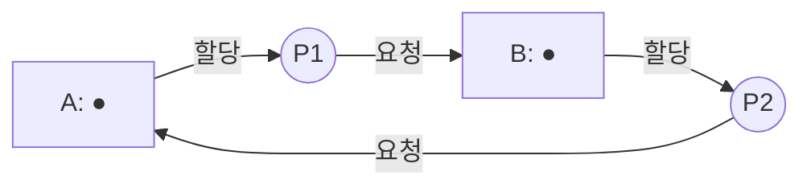
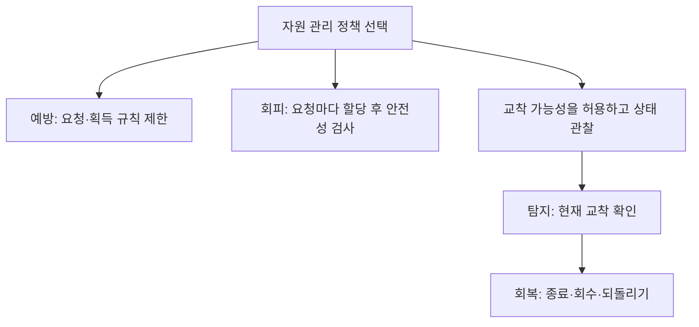
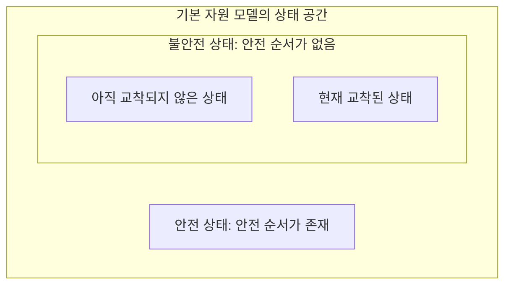
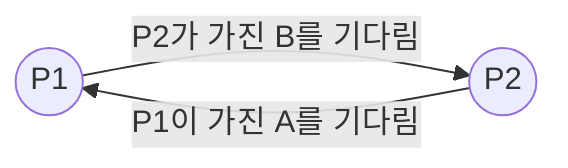

# 8회차 — 교착상태

## 1. Deadlock 발생 조건

### 정상적인 기다림과 교착상태

여러 작업이 같은 자원을 사용하면 기다림은 자연스럽게 생긴다. P1이 잠금 A를 획득하여 공유 데이터를 수정하는 동안 P2는 A를 기다릴 수 있다. P1이 수정을 마치고 A를 반납하면 P2가 이어서 실행된다. 이 경우에는 기다리는 조건을 해소할 작업이 진행 중이다.

문제는 **기다림을 끝내 줄 작업마저 자신을 기다리고 있을 때** 생긴다. P1이 A를 가진 채 B를 기다리고, P2가 B를 가진 채 A를 기다린다고 하자. 두 작업 모두 두 번째 잠금을 얻어야 다음 단계로 넘어가고, 잠금을 반납하는 코드는 그 뒤에 있다. 이제 어느 쪽도 반납 지점에 도달할 수 없다.

이처럼 한 집합의 실행 주체들이 그 집합 안에서 일어나야 할 사건을 기다리며 스스로 진행할 수 없는 상태를 **교착상태, 데드락(Deadlock)**이라고 한다. 기다리는 시간이 길다는 사실보다, 기다림을 해소하는 데 필요한 의존 관계가 막혔다는 점이 핵심이다.

이 장에서는 실행 주체를 대표하여 ‘프로세스’라고 부른다. 프로세스는 실행 중인 프로그램이고, 스레드는 그 안에서 명령을 실행하는 흐름이다. 같은 자원을 놓고 경쟁하는 스레드 사이에도 아래 원리가 적용된다. 잠금은 공유 데이터에 접근할 권한을 조정하는 동기화 수단이며, 여기서는 한 번에 한 주체만 보유할 수 있는 잠금을 가정한다.

### 두 잠금으로 실행을 따라가 보기

다음은 서로 다른 순서로 잠금을 획득하는 두 작업이다. `acquire`는 잠금을 얻지 못하면 기다리고, `release`는 보유한 잠금을 반납한다.

```text
P1                         P2
acquire(A)                 acquire(B)
acquire(B)                 acquire(A)
공유 데이터 처리           공유 데이터 처리
release(B)                 release(A)
release(A)                 release(B)
```

잠금 A와 B가 처음에는 비어 있다고 하자. 다음 순서로 실행되면 교착상태에 이른다.

| 단계 | P1의 동작 | P2의 동작 | 결과 |
|---|---|---|---|
| 1 | A 획득 | — | A는 P1이 보유 |
| 2 | — | B 획득 | B는 P2가 보유 |
| 3 | B 요청 후 대기 | — | P1은 A를 계속 보유 |
| 4 | — | A 요청 후 대기 | P2는 B를 계속 보유 |

P1이 진행하려면 P2가 B를 반납해야 한다. 그런데 P2가 B를 반납하려면 먼저 P1이 A를 반납해야 한다. 두 프로세스를 번갈아 실행시켜도 요청한 잠금의 소유권은 달라지지 않는다. CPU를 더 주는 것만으로는 이 의존 관계가 풀리지 않는다.

같은 코드가 언제나 교착되는 것은 아니다. P1이 A와 B를 모두 얻고 작업을 마친 다음 P2가 시작하면 두 작업 모두 완료된다. 따라서 ‘교착을 일으킬 수 있는 코드’와 ‘특정 실행에서 이미 교착된 상태’를 구분해야 한다. 동시성 오류가 어떤 실행에서는 나타나고 다른 실행에서는 나타나지 않는 이유도 여기에 있다.

### 자원 유형과 인스턴스

잠금 예제를 일반화하기 위해 유한한 수의 **재사용 가능한 자원**을 생각하자. 자원은 사용한다고 없어지지 않으며 반납하면 다른 프로세스가 다시 사용할 수 있다. 기본 흐름은 요청 → 할당 → 사용 → 반납이다. 요청했지만 아직 받지 못한 자원과 이미 받아서 보유한 자원을 구별해야 한다.

**자원 유형(Resource Type)**은 서로 같은 역할을 하는 자원의 종류다. **인스턴스(Instance)**는 그 유형에 속하는 개별 자원이다. 같은 종류의 작업 장치가 세 대 있고 어느 장치로도 같은 요청을 처리할 수 있다면 하나의 유형에 인스턴스가 세 개 있는 것으로 모델링할 수 있다. 반면 기능이 달라 대체할 수 없는 장치들은 별도 유형으로 다루어야 한다.

잠금 A와 B는 각각 인스턴스가 하나인 서로 다른 자원 유형으로 생각할 수 있다. ‘A를 달라’는 요청을 B로 대신 충족할 수 없기 때문이다. 이후 은행가 알고리즘에서는 같은 유형의 여러 인스턴스를 수량으로 세어 다룬다.

이 장의 기본 모델에서는 필요한 자원을 얻은 작업이 유한한 작업 후 자원을 반납하고, 대기 중에는 기존 보유 자원을 유지한다고 가정한다. 자원이 갑자기 소멸하거나 외부에서 강제로 회수되는 상황은 기본 판정에서 제외하고, 강제 회수는 별도의 예방·회복 정책으로 다룬다. 그래프 판정 역시 이 자원 모델을 전제로 한다.

### Coffman의 네 필요조건

일반적인 자원 교착상태가 발생하려면 다음 네 조건이 함께 성립해야 한다. 조건을 이름만 외우기보다 두 잠금 사례에서 각각 무엇을 의미하는지 연결해 보자.

**상호 배제(Mutual Exclusion)**는 적어도 일부 자원을 한 번에 한 프로세스만 사용할 수 있다는 조건이다. P1이 A를 보유하면 P2는 A를 동시에 얻을 수 없다. 모든 자원이 배타적이어야 한다는 뜻은 아니다. 교착에 관련된 자원 중 공유할 수 없는 자원이 있다는 뜻이다. 공유 데이터를 안전하게 수정하려면 이런 배타성이 필요한 경우가 많다.

**점유하며 대기(Hold and Wait)**는 이미 자원을 보유한 상태에서 추가 자원을 기다리는 조건이다. P1은 A를 놓지 않고 B를 기다리고, P2도 B를 놓지 않고 A를 기다린다. 자원을 전혀 보유하지 않은 채 기다리는 작업은 다른 작업이 필요로 하는 자원을 붙잡는 역할을 하지 않는다.

**비선점(No Preemption)**은 보유자가 반납하기 전에는 자원을 강제로 빼앗을 수 없다는 조건이다. 여기서 선점 대상은 교착에 관련된 자원이다. 운영체제가 P1의 CPU 실행을 중단하고 P2를 실행시킨다고 해서 P1이 가진 잠금 A까지 회수되는 것은 아니다. 따라서 선점형 CPU 스케줄링을 사용하는 시스템에서도 잠금 교착은 발생할 수 있다.

**순환 대기(Circular Wait)**는 각 프로세스가 다음 프로세스가 보유한 자원을 기다리고, 마지막 프로세스가 다시 처음 프로세스의 자원을 기다리는 관계다. 두 잠금 사례에서는 P1이 P2를 기다리고 P2가 P1을 기다린다. 더 많은 프로세스가 연결된 고리도 가능하다.

이 네 조건 중 하나라도 성립하지 않도록 강제하면 해당 자원 모델의 교착을 예방할 수 있다. 예를 들어 추가 자원을 기다릴 때 기존 자원을 반드시 반납하게 하면, 서로 상대가 필요한 자원을 붙잡은 채 기다리는 구조가 유지되지 않는다.

다만 네 조건을 **허용하는 설계**라는 사실만으로 현재 교착이라고 판정할 수는 없다. 실제 보유·요청 관계와 자원 수량을 확인해야 한다. 특히 인스턴스가 여러 개일 때는 대기 관계에 고리가 보이더라도 그 바깥에서 반환되는 자원으로 진행할 수 있다.

### 자원 할당 그래프 읽기

**자원 할당 그래프(Resource-Allocation Graph, RAG)**는 누가 무엇을 보유하고 무엇을 기다리는지 표현한다. 프로세스는 원, 자원 유형은 사각형으로 표시한다. 자원 사각형 안의 점은 인스턴스 하나를 뜻한다.

요청 간선 `P → R`은 P가 자원 유형 R의 인스턴스를 요청하여 기다린다는 뜻이다. 할당 간선 `R → P`는 R의 특정 인스턴스가 P에게 할당되었다는 뜻이다. 아래는 각 유형에 인스턴스가 하나뿐이므로 점이 들어 있는 자원 상자에서 할당 간선을 그린 것이다.



그림에서 화살표를 따라가면 A → P1 → B → P2 → A로 돌아온다. 각 자원의 유일한 인스턴스가 고리 안에 묶여 있고, 이를 가진 프로세스들은 모두 다음 자원을 기다린다. 외부의 강제 개입이 없다면 이 고리는 스스로 풀리지 않는다.

기본 자원 모델에서 RAG에 사이클이 없으면 자원 교착도 없다. **모든 자원 유형에 인스턴스가 하나이면 사이클의 존재로 교착을 판정할 수 있다.** 그러나 여러 인스턴스를 가진 유형이 있으면 사이클만으로 교착을 확정할 수 없다.

다음 반례를 보자. A는 두 개, B는 한 개다.

| 프로세스 | 현재 보유 | 현재 추가 요청 |
|---|---|---|
| P1 | A 한 개 | B 한 개 |
| P2 | B 한 개 | A 한 개 |
| P3 | A 한 개 | 없음 |

유형을 기준으로 보면 P1 → B → P2 → A → P1이라는 고리가 있다. 하지만 P3는 추가 요청 없이 작업을 마치고 A를 반납할 수 있다. P2는 그 A를 받아 작업을 마친 뒤 A와 B를 반납한다. 그러면 P1도 B를 얻어 완료한다. **P3 → P2 → P1이라는 진행 경로가 있으므로 현재 교착은 아니다.**

P2가 필요로 하는 것은 반드시 P1이 가진 바로 그 A가 아니라, 같은 유형에 속하는 A 한 개다. 여러 인스턴스에서 사이클 판정이 충분하지 않은 이유는 이런 대체 가능성에 있다.

### 교착의 범위

교착상태가 발생했다고 시스템 전체가 멈춰야 하는 것은 아니다. A와 B를 놓고 P1과 P2가 교착되어도, 두 자원이 필요 없는 P3는 계속 실행될 수 있다. 반대로 교착된 작업이 자원을 붙잡고 있으면 다른 작업들도 그 자원을 기다리면서 영향이 확대될 수 있다.

교착을 반드시 ‘서로 다른 두 프로세스 이상’으로 한정하는 것도 부정확하다. 재획득을 허용하지 않는 잠금을 같은 실행 주체가 이미 보유한 상태에서 다시 기다리면 자기 자신에 대한 교착이 생길 수 있다. 다만 이후 설명은 여러 프로세스 사이의 자원 교착에 집중한다. 메시지 도착이나 사건 통지를 서로 기다리는 교착도 있지만, 그 경우의 대기 모델은 별도로 살펴보아야 한다.

이제 처리 방법은 세 질문으로 이어진다. 이러한 관계를 만드는 요청 규칙을 금지할 것인가? 요청을 승인하기 전에 위험을 판단할 것인가? 아니면 발생한 관계를 찾아 끊을 것인가?

## 2. 예방 / 회피 / 탐지 / 회복

### 네 방법은 언제 개입하는가

**예방(Prevention)**은 자원 요청·획득 규칙을 제한하여 교착의 필요조건 중 하나를 차단한다. **회피(Avoidance)**는 미래의 자원 요구에 관한 정보를 이용하여, 이번 할당 이후에도 모든 작업이 완료할 수 있는 여지가 있는지 검사한다. 둘 다 발생 전에 개입하지만 판단 방식이 다르다.

**탐지(Detection)**는 현재의 보유·요청 관계에서 교착을 찾는다. **회복(Recovery)**은 발견한 교착을 종료, 회수, 되돌리기 등의 조치로 해소한다. 탐지만 해서는 자원이 반환되지 않으므로 진행을 재개하려면 회복 절차가 필요하다.



세 갈래는 정책의 대표적인 선택지다. 모든 요청이 예방, 회피, 탐지, 회복을 차례로 통과해야 한다는 뜻은 아니다. 한 시스템 안에서도 관리하는 자원의 성격에 따라 서로 다른 방법을 적용할 수 있다.

### 예방: 필요조건을 하나 끊기

#### 상호 배제가 필요하지 않게 만들기

여러 작업이 동시에 사용해도 올바른 자원이라면 독점권을 줄 필요가 없다. 예를 들어 변경되지 않는 데이터를 읽기만 한다면 여러 독자가 함께 접근하도록 설계할 수 있다. 이 접근에서 배타적 소유 때문에 생기는 대기를 없애면 해당 자원이 교착 고리를 만드는 일을 줄일 수 있다.

그러나 공유 데이터를 수정하는 구역에서 잠금만 삭제하면 값이 잘못될 수 있다. 교착을 없애는 대신 데이터 경쟁을 만들어서는 안 된다. 자원의 의미와 연산의 올바름을 보존하면서 공유 가능하게 바꿀 수 있는지를 먼저 판단해야 한다. 상호 배제 자체는 오류가 아니라 필요한 보호 성질일 수 있다.

#### 점유하며 대기하지 못하게 하기

한 방법은 작업에 필요한 자원을 **전부 확보할 수 있을 때만 함께 할당**하는 것이다. A와 B가 모두 필요한 P1에게 A만 먼저 주지 않는다. 둘을 함께 줄 수 없다면 아무것도 주지 않은 채 기다리게 한다. 그러면 기다리는 P1이 A를 붙잡아 P2를 막는 상황이 사라진다.

‘시작할 때 모든 자원을 요청한다’는 말에서 중요한 것은 요청 시점만이 아니다. 실제 할당도 일부를 보유하며 나머지를 기다리는 방식이 되지 않아야 한다. A를 받은 뒤 B를 기다린다면 이름만 일괄 요청일 뿐 원래 문제가 남는다.

다른 방법은 추가 자원이 필요할 때 기존 자원을 모두 반납하고 필요한 묶음을 다시 요청하게 하는 것이다. 이때 자원을 놓아도 작업 상태가 일관되어야 한다. 잠금을 반납한 사이 다른 작업이 데이터를 바꿀 수 있으므로, 다시 획득한 뒤에는 이전에 확인한 조건을 재검사해야 할 수도 있다.

대가는 자원 이용률과 진행 기회의 감소다. 작업 후반에만 필요한 B까지 처음부터 잡으면 B가 오랫동안 사용되지 않을 수 있다. 반대로 A와 B가 동시에 비는 순간을 기다리는 큰 요청은, A만 쓰거나 B만 쓰는 작은 요청들에 계속 밀릴 수 있다. 교착은 예방하더라도 특정 작업의 기아까지 자동으로 막지는 못한다.

#### 비선점 조건을 깨기

프로세스가 추가 요청 때문에 기다리게 될 때 기존 자원을 회수할 수 있다면, 보유 자원이 대기 고리에 계속 묶이는 것을 막을 수 있다. 회수된 자원을 다른 프로세스에게 주어 완료하게 한 뒤 중단된 작업을 재개하는 방식이다.

이 방법은 **자원의 상태를 저장하고 복원하거나 작업을 되돌릴 수 있어야** 유효하다. 단순히 소유권 표시만 바꿔서는 안 된다. 공유 자료구조를 절반만 수정한 작업의 잠금을 강제로 풀면, 다른 작업이 불완전한 상태를 볼 수 있다. 이미 종이에 출력한 내용을 실행 이전으로 되돌리는 것도 일반적인 메모리 상태 복원과는 다르다.

잠금을 얻지 못하면 스스로 기존 잠금을 반납하고 재시도하는 정책도 있다. 이는 보유자에게서 외부가 강제로 잠금을 빼앗는 것과 구분해야 한다. 자발적 반납으로 대기 구조를 바꾸는 방법이며, 재시도 반복에 따른 기아나 라이브락은 따로 검토해야 한다.

#### 순환 대기를 금지하기

각 잠금에 모두가 따르는 순서를 정하고, 이미 보유한 잠금보다 뒤에 오는 잠금만 추가 획득하게 할 수 있다. A < B라면 A와 B를 모두 쓰는 작업은 반드시 A를 먼저 얻는다.

```text
P1과 P2가 공통으로 따르는 규칙
acquire(A)
acquire(B)
작업
release(B)
release(A)
```

P1이 A를 얻으면 P2는 A 앞에서 기다리므로 아직 B를 보유하지 않는다. 따라서 P1은 비어 있는 B를 얻어 완료할 수 있다. 핵심은 반납 순서가 아니라 **보유한 자원에서 다음에 요청하는 자원으로 향하는 순서**다.

자원이 더 많아도 논리는 같다. 어떤 작업이 번호가 작은 자원을 가진 채 더 큰 자원을 기다리고, 그 자원의 보유자도 더 큰 자원만 기다린다면 대기 사슬을 따라 번호가 계속 증가한다. 원래 자원으로 돌아오는 고리를 만들려면 언젠가 작은 번호 쪽으로 요청해야 하므로 규칙과 모순된다.

이 보장은 모든 관련 참여자가 같은 순서를 지킬 때 성립한다. 함수 안에서는 첫 번째 인자로 받은 잠금부터 얻는다고 해도, 호출자들이 인자를 서로 반대로 넘기면 실제 자원 순서는 뒤집힐 수 있다. 순서는 변수 이름이나 함수의 인자 위치가 아니라 실제 자원을 기준으로 일관되어야 한다. 같은 유형의 인스턴스를 여러 개 얻는 정책이라면 같은 유형을 나누어 확보하다 다시 기다리는 경우까지 규칙에 포함해야 한다.

### 회피: 여유 자원이 있어도 바로 주지 않는 이유

예방은 요청 방식 자체에 제약을 둔다. 회피는 더 유연하게 요청을 받되, 승인 후의 상태를 살펴본다. 현재 빈 자원이 있다는 것은 ‘지금 이 요청을 충족할 수 있다’는 뜻이지, ‘그 뒤 모든 작업이 완료할 수 있다’는 뜻은 아니다.

이를 판단하는 기준이 **안전 상태(Safe State)**다. 각 작업이 앞으로 요구할 수 있는 최대량까지 고려했을 때, 모든 작업을 완료시킬 순서가 적어도 하나 있으면 안전하다. 그 완료 가능 순서를 **안전 순서(Safe Sequence)**라고 한다.

순서의 첫 작업은 현재 여유 자원으로 남은 최대 요구를 충족할 수 있어야 한다. 이 작업이 완료되어 자원을 반납하면, 두 번째 작업은 늘어난 여유 자원을 이용할 수 있다. 이렇게 끝까지 이어지는 순서 하나를 찾으면 된다. 가능한 모든 순서가 안전해야 하는 것은 아니다.

안전 순서가 없는 상태는 **불안전 상태(Unsafe State)**다. 일부 자료에서 ‘안정·불안정’으로 옮기기도 하지만 이 장에서는 안전·불안전으로 통일한다. 불안전은 현재 교착과 같지 않다. 앞으로 실제 요구가 최대치보다 작거나 작업이 일찍 자원을 반납하면 완료할 수도 있다. 다만 주어진 최대 요구를 기준으로 완료를 보장할 수 없다는 뜻이다.



이 그림은 포함 관계를 나타낸다. 불안전 영역 안에 교착상태가 포함되지만, 불안전한 모든 실행이 반드시 교착으로 끝나지는 않는다. 또한 현재 안전하더라도 이후 아무 요청이나 승인하면 불안전해질 수 있으므로, 회피는 안전성을 계속 유지하는 할당 정책이다.

### 은행가 알고리즘: 완료와 반환을 가정해 보기

**은행가 알고리즘(Banker's Algorithm)**은 각 자원 유형의 최대 동시 요구량을 미리 신고받고, 자원 요청을 승인한 뒤에도 안전 상태가 유지되는지 검사하는 회피 방법이다. 은행원 알고리즘이라고도 부른다.

여기에는 중요한 전제가 있다. 프로세스는 신고한 최대량을 넘지 않아야 하고, 필요한 자원을 제공받으면 유한한 시간 안에 작업을 끝내 자원을 반환할 수 있어야 한다. 관리 대상 자원의 수량과 보유량도 정확하게 파악되어야 한다. 최대량은 실행 전체에서 요청한 횟수의 누적 합이 아니라 **한 시점에 동시에 보유할 수 있는 상한**이다.

자원이 한 종류이고 전체가 10개인 다음 상태를 보자.

| 프로세스 | 최대 동시 요구량 Max | 현재 보유량 Allocation | 남은 최대 요구량 Need |
|---|---:|---:|---:|
| P1 | 7 | 3 | 4 |
| P2 | 5 | 2 | 3 |
| P3 | 3 | 2 | 1 |

현재 보유량의 합은 7이므로 여유 자원 `Available`은 3이다. 남은 최대 요구량은 `Need = Max − Allocation`으로 계산한다.

P3는 최대 1개만 더 있으면 된다. 여유 3개 중 1개를 제공하면 P3는 자신이 보유하게 된 3개로 완료하고 전부 반납할 수 있다. 그러면 여유 자원은 5개가 된다. 이어 P2에게 필요한 3개를 제공하여 완료시키면 여유는 7개가 된다. 마지막으로 P1에게 필요한 4개를 제공할 수 있다. 따라서 **P3 → P2 → P1은 안전 순서**다.

검사 과정의 여유 자원은 3 → 5 → 7 → 10으로 증가한다. 이 순서는 실제로 CPU를 반드시 P3, P2, P1 순으로만 배정하라는 스케줄이 아니다. 현재의 자원 배분에서 모든 작업을 완료시킬 경로가 존재한다는 증명 역할을 한다. 그 조건을 유지하는 범위에서 실제 실행은 겹칠 수 있다.

### 같은 상태에서 요청 하나를 승인한다면

위 초기 상태에서 P1이 자원 3개를 추가 요청했다고 하자. P1의 남은 최대 요구 4개를 넘지 않고, 현재 여유 3개로 요청을 충족할 수도 있다. 하지만 가상으로 승인하면 다음 상태가 된다.

| 프로세스 | 가상 승인 후 Allocation | 가상 승인 후 Need |
|---|---:|---:|
| P1 | 6 | 1 |
| P2 | 2 | 3 |
| P3 | 2 | 1 |

여유 자원은 0이다. 최대 요구까지 충족한다고 생각하면 P1은 1개, P2는 3개, P3는 1개가 더 필요하다. 어느 작업도 첫 번째 완료 대상으로 선택할 수 없으므로 안전 순서가 없다. 은행가 알고리즘은 이 요청을 보류한다.

그렇다고 이 가상 상태가 이미 교착이라는 뜻은 아니다. 예를 들어 P3가 실제로는 더 요청하지 않고 지금 보유한 2개로 작업을 끝낼 수 있다면 자원을 반납하여 다른 작업의 길을 열 수 있다. 반대로 세 작업이 각각 남은 자원을 요청하고 기존 자원을 계속 보유하면 교착이 생길 수 있다. 회피는 실제 요구가 작을 것이라는 기대에 의존하지 않고 신고된 상한을 감당할 수 있는지를 판단한다.

보류된 P1의 요청은 다른 작업이 반납한 뒤 다시 검토할 수 있다. 초기 상태에서 P3가 완료하여 여유가 5가 된 뒤 P1의 요청 3개를 승인하면 여유는 2, P1의 Need는 1이 된다. 이제 P1의 완료를 이어서 가정할 수 있다. 같은 요청도 **언제 승인하느냐**에 따라 안전성이 달라진다.

### 자료구조와 안전성 검사

여러 자원 유형으로 확장하면 수량은 벡터가 된다. 프로세스가 n개, 자원 유형이 m개라면 다음 정보를 관리한다.

| 이름 | 의미 |
|---|---|
| `Available[j]` | 현재 할당되지 않은 유형 j의 인스턴스 수 |
| `Max[i][j]` | Pi가 동시에 보유할 수 있다고 신고한 유형 j의 최대 수량 |
| `Allocation[i][j]` | Pi가 현재 보유한 유형 j의 수량 |
| `Need[i][j]` | `Max[i][j] − Allocation[i][j]` |

`Need`는 앞으로 추가로 요구할 수 있는 상한이다. **지금 실제로 제출한 요청 `Request`와 다르다.** Need가 4라도 지금 요청한 수량은 1일 수 있고, 현재 요청이 없을 수도 있다.

안전성 검사는 실제 작업을 실행하지 않고 임시 변수로 반환을 모의한다.

1. `Work = Available`로 시작하고, 모든 `Finish[i]`를 거짓으로 둔다.
2. 아직 완료를 가정하지 않은 작업 중 `Need[i] ≤ Work`인 작업을 하나 찾는다.
3. 그 작업이 완료되어 보유 자원을 모두 반환한다고 가정한다. `Work = Work + Allocation[i]`, `Finish[i] = 참`으로 바꾼다.
4. 같은 과정을 반복한다. 모든 작업을 처리하면 안전하고, 더 선택할 수 없는데 미완료 작업이 남으면 불안전하다.

왜 Work에 Max나 Need를 더하지 않고 기존 Allocation만 더할까? 완료를 위해 임시로 Need만큼 빌려주었다가, 완료 시 기존 Allocation과 방금 준 Need를 함께 돌려받기 때문이다. 변화는 `−Need + (Allocation + Need)`이고, 순증가는 기존 Allocation이다.

벡터의 `≤`는 **모든 자원 성분에서 각각** 성립해야 한다. A와 B에 대해 `Work = (2, 1)`, 어떤 작업의 `Need = (1, 2)`라면 이 작업을 선택할 수 없다. 전체 개수는 둘 다 3이지만 B가 한 개 부족하다. A 한 개가 B 한 개를 대신할 수 없는 모델이기 때문이다. 정확히 같은 수량이면 충족 가능하므로 비교에는 등호가 포함된다.

완료 가능한 작업을 하나 골랐다고 다른 선택을 모두 되돌려 탐색할 필요는 없다. 이 가상 완료는 Work를 줄이지 않고 보유 자원을 더 돌려놓는다. 따라서 이미 가능했던 다른 작업을 불가능하게 만들지 않는다. 이것이 한 번에 하나씩 제거하는 방식으로 안전 순서를 찾을 수 있는 이유다.

### 실제 요청을 처리하는 순서

Pi의 요청에 대한 판단은 세 단계로 나뉜다.

먼저 `Request[i] ≤ Need[i]`인지 확인한다. 한 성분이라도 초과하면 신고한 최대 요구를 어긴 것이다. 이는 단순히 자원이 부족해서 기다리는 경우와 구분해야 한다.

다음으로 `Request[i] ≤ Available`인지 확인한다. 최대 요구 안의 요청이라도 지금 수량이 부족하면 즉시 할당할 수 없으므로 기다려야 한다.

두 검사를 통과하면 다음과 같이 **가상 할당**한다.

```text
Available     = Available − Request[i]
Allocation[i] = Allocation[i] + Request[i]
Need[i]       = Need[i] − Request[i]
```

그 상태에서 안전성 검사를 수행한다. 안전하면 실제 할당을 확정하고, 불안전하면 가상 변경을 취소하여 원래 상태로 복원한 뒤 요청을 대기시킨다. 실제 프로세스를 잠깐 실행해 보고 실패하면 시간을 되돌리는 방식이 아니다.

은행가 알고리즘의 제약은 필요한 정보와 검사 비용이다. 입력에 따라 자원 사용량이 달라지는 작업은 최대 요구를 사전에 정확히 알기 어려울 수 있다. 상한을 지나치게 크게 신고하면 실제로는 완료할 수 있는 할당도 보수적으로 막을 수 있다. 자원 요청마다 상태를 유지하고 검사하는 비용도 든다. 따라서 자원이 여러 개라는 이유만으로 모든 시스템이 이 알고리즘을 사용하는 것은 아니다.

### 단일 인스턴스 회피와 선언 간선

각 자원 유형에 인스턴스가 하나라면 그래프를 확장한 회피 방법도 있다. 프로세스가 앞으로 사용할 가능성이 있는 자원을 미리 밝히고 **선언 간선(Claim Edge)**으로 표시한다. 보통 점선 `P ⇢ R`로 나타낸다.

선언 간선은 현재 기다린다는 뜻이 아니다. 실제 요청이 발생하면 요청 간선으로 바뀌고, 승인되면 자원에서 프로세스로 향하는 할당 간선으로 바뀐다. 반납 후에는 미래에 다시 사용할 가능성을 나타내는 선언 간선으로 돌아간다. 필요한 선언은 자원을 획득하기 전에 갖추어야 한다.

회피 검사는 할당을 가정한 그래프에서 **미래 사용 가능성을 나타내는 선언 간선까지 포함하여** 사이클이 생기는지 살핀다. 사이클이 생기면 승인을 보류한다. 이 사이클은 현재 실제 요청만으로 만들어진 것이 아닐 수 있으므로, 발견했다고 현재 교착이라고 말해서는 안 된다. 현재의 대기를 찾는 탐지 그래프와 목적이 다르다.

### 탐지: 현재 무엇이 막혔는가

미래 최대 요구를 알기 어렵거나 보수적인 사전 제한을 줄이고 싶다면, 교착 가능성을 허용하되 현재 상태를 검사하고 발생 후 회복하는 정책을 선택할 수 있다. 이때 판단 대상은 앞으로 가능한 최악의 요구가 아니라 **현재 충족되지 않은 요청**이다.

각 자원 유형에 인스턴스가 하나라면 RAG에서 자원 노드를 생략하여 **대기 그래프(Wait-for Graph, WFG)**를 만든다. `Pi → Pj`는 Pi가 Pj가 보유한 자원을 기다린다는 뜻이다. RAG의 `Pi → R → Pj`를 하나의 간선으로 축약한 것이다.



이 그림의 화살표는 자원의 이동이 아니라 기다림의 방향이다. 기본 단일 인스턴스 모델에서는 WFG의 사이클이 교착을 나타낸다. 자원 유형에 여러 인스턴스가 있다면 다른 보유자가 반납할 가능성이 있으므로 이 단순 판정을 그대로 적용할 수 없다.

### 여러 인스턴스의 탐지

다중 인스턴스 탐지는 자원 수량을 함께 고려한다. `Available`, `Allocation`, 그리고 각 프로세스의 **현재 미충족 요청 `Request`**를 사용한다. 은행가 알고리즘의 안전성 검사와 형태는 비슷하지만 Max나 Need로 미래 요구를 검사하는 절차가 아니다.

현재 요청을 충족할 수 있는 작업은 이후 자원을 반납할 수 있다고 가정하여 분석에서 제거한다. 제거한 작업이 가진 자원을 여유분에 더한 뒤 다른 요청을 충족할 수 있는지 반복한다. 이 검사는 현재 상태를 대상으로 하므로, 나중에 새로운 요청 때문에 생길 교착까지 미리 배제하지 않는다.

대표적인 절차는 다음과 같다.

1. `Work = Available`로 둔다. 자원을 하나라도 보유한 작업의 Finish는 거짓, 보유량 벡터가 전부 0인 작업의 Finish는 참으로 초기화한다.
2. Finish가 거짓이고 `Request[i] ≤ Work`인 작업을 찾는다.
3. 그 작업이 요청을 받고 결국 자원을 반환한다고 가정하여 `Work += Allocation[i]`, `Finish[i] = 참`으로 바꾼다.
4. 더 제거할 수 없을 때까지 반복한다. Finish가 거짓으로 남은 자원 보유 작업들은 교착에 묶여 있는 것으로 판정한다.

초기 보유량이 0인 작업을 제외하는 것은 그 작업에 자원이 필요 없거나 이미 실행을 마쳤다는 뜻이 아니다. 다른 작업의 진행을 막는 자원을 붙잡고 있지 않으므로, 자원을 보유하며 교착을 유지하는 집합을 찾는 계산에서 제외하는 것이다. 그 작업도 교착된 집합이 가진 자원을 기다려 함께 지연될 수 있다. 여기서 Finish는 실제 종료 여부가 아니라 분석용 표시다.

총 A가 2개, B가 2개이고 다음과 같이 모두 할당되어 있다고 하자.

| 프로세스 | Allocation: (A, B) | 현재 Request: (A, B) |
|---|---|---|
| P1 | (1, 0) | (0, 1) |
| P2 | (0, 1) | (1, 0) |
| P3 | (1, 1) | (0, 0) |

처음 Work는 `(0, 0)`이다. P1과 P2의 요청은 충족할 수 없지만 P3는 현재 기다리는 자원이 없으므로 제거할 수 있다. P3가 보유한 `(1, 1)`을 반환한다고 가정하면 Work는 `(1, 1)`이 된다. 이제 P1의 요청을 충족하고 제거하면 Work는 `(2, 1)`, 이어 P2를 제거하면 `(2, 2)`가 된다. 현재 요청 때문에 교착된 집합은 없다.

별도 상태로, 보유량은 그대로 두고 P3의 Request만 `(1, 0)`으로 바꾸어 보자. 초기 Work는 여전히 `(0, 0)`인데 이제 세 작업 모두 추가 자원을 기다린다. 첫 번째로 제거할 작업이 없고 모든 Finish가 거짓으로 남는다. 세 작업이 가진 자원이 반납되지 못하므로 교착으로 판정한다.

두 검사 사이의 차이는 결과를 해석할 때도 유지해야 한다. 안전성 검사가 성공하면 최대 요구를 고려한 완료 경로가 있다. 현재 요청에 대한 탐지가 교착을 찾지 못했다고 해서, 같은 상태가 최대 요구를 기준으로 안전하다는 뜻은 아니다.

### 얼마나 자주 탐지할 것인가

요청을 즉시 충족하지 못할 때마다 탐지하면 문제를 빨리 찾을 수 있다. 그러나 정상적인 대기도 흔하므로 매번 그래프나 수량 관계를 검사하면 비용이 커진다. 일정 주기나 이상 징후가 있을 때 검사하면 비용을 줄일 수 있지만 발견이 늦어지고, 교착 자원을 기다리는 다른 작업들이 더 쌓일 수 있다.

긴 대기나 낮은 처리율은 탐지를 시작할 신호가 될 수 있어도 그 자체가 교착의 증거는 아니다. 작업이 오래 걸리거나 부하가 높아서 기다릴 수도 있다. 타임아웃 역시 ‘정해진 시간 안에 완료되지 않았다’는 사실을 알려 줄 뿐이다. 교착이라고 판정하려면 대기 관계나 요청 수량을 확인해야 한다.

### 회복: 어떤 관계를 끊고 무엇을 잃을 것인가

교착을 발견한 다음에는 진행 불가능한 관계를 실제로 바꾸어야 한다. 대표적인 선택은 관련 프로세스를 종료하거나, 자원을 회수하고 작업을 되돌리는 것이다.

**관련 작업을 모두 종료**하면 그 작업들이 가진 자원을 회수하여 교착을 해소할 수 있다. 대신 이미 수행한 계산을 많이 잃을 수 있다. **하나씩 종료**하면 더 적은 작업을 희생할 가능성이 있지만, 종료할 때마다 남은 교착을 다시 확인해야 한다. 여러 고리가 얽혀 있다면 작업 하나를 종료하는 것으로 모든 교착이 풀리지 않을 수 있다.

두 잠금 사례에서 P2의 작업을 안전하게 취소하고 B를 반환할 수 있다면 P1이 B를 얻어 진행한다. 그러나 ‘P2를 멈춘다’는 것만으로는 부족하다. 실행을 일시 정지해도 P2가 B를 계속 보유한다면 관계는 그대로다. 종료 역시 해당 자원이 실제로 회수되고 보호하던 상태가 처리되는 절차와 함께 이루어져야 한다. 모든 스레드나 잠금이 임의의 종료에 자동으로 안전하게 대응한다고 가정해서는 안 된다.

**자원 회수**를 선택하면 회수당한 작업을 어떻게 재개할지도 정해야 한다. 상태를 저장한 지점인 체크포인트가 있다면 자원을 얻기 전의 일관된 상태로 **롤백(Rollback)**한 뒤 재시작할 수 있다. 그런 지점이 없다면 작업 전체를 취소하고 처음부터 다시 수행해야 할 수 있다. 자원을 놓았는데 프로그램이 여전히 그것을 보유한다고 가정한 채 재개하면 새로운 오류가 생긴다.

예를 들어 잠금 안에서 두 값의 합을 보존하도록 하나를 줄이고 다른 하나를 늘리는 작업을 생각하자. 첫 변경 직후에 잠금을 회수하면 합이 일시적으로 틀어진 상태가 다른 작업에 노출된다. 회복은 단순히 대기 간선을 지우는 일이 아니라, 중단된 변경을 취소하거나 일관된 상태를 복원하는 일도 포함한다. 이미 외부에 전달된 결과처럼 쉽게 되돌릴 수 없는 효과는 회복 비용과 가능성에 영향을 준다.

누구를 종료하거나 되돌릴지 정하는 것이 **희생자 선택**이다. 지금까지 수행한 작업량, 완료까지 남은 작업량, 보유 자원의 수와 종류, 회수·복원 가능성, 작업의 중요도, 함께 취소해야 하는 다른 작업 등을 고려할 수 있다. 자원을 가장 적게 가진 작업이 언제나 최선인 것은 아니다. 그 작업을 취소해도 필요한 대기 고리가 끊어지지 않거나 복구 비용이 클 수 있다.

반복 희생도 문제다. 매번 다시 시작한 작업은 수행 시간이 짧다는 이유로 또 가장 싼 희생자가 될 수 있다. 따라서 희생 횟수나 대기 이력을 고려해야 특정 작업이 영원히 완료하지 못하는 상황을 줄일 수 있다. 교착 회복의 성공과 모든 작업의 진행 보장은 별개의 목표다.

### 정책 선택의 기준

| 방법 | 주로 필요한 정보 | 개입 시점과 효과 | 주요 비용·제약 |
|---|---|---|---|
| 예방 | 자원 성격, 요청·획득 규칙 | 필요조건을 구조적으로 차단 | 병행성·이용률 감소, 규칙 준수 필요 |
| 회피 | 현재 할당과 미래 최대 요구 등 | 안전성을 잃는 할당을 보류 | 사전 정보, 검사 비용, 보수적 대기 |
| 탐지 | 현재 보유·요청 관계 | 이미 형성된 교착을 확인 | 상태 관리와 검사 비용, 발견 지연 |
| 회복 | 교착 집합, 취소·복원 가능성 | 자원을 풀어 진행 재개 | 작업 손실, 일관성 복구, 반복 희생 |

자원 사용 순서를 통제하기 쉽다면 예방이 적합할 수 있다. 최대 요구를 알 수 있고 승인 판단을 집중 관리할 수 있다면 회피를 검토할 수 있다. 작업을 취소하고 재시작할 수 있는 환경이라면 탐지·회복의 손실을 감수할 수도 있다.

발생 가능성과 처리 비용을 비교하여 어떤 계층에서는 명시적인 교착 처리를 두지 않는 선택도 있다. 이는 교착이 없다는 보장이 아니라 비용을 고려한 정책이다. 특정 운영체제 전체가 언제나 한 방법만 사용한다고 일반화하기보다, 어떤 자원을 어느 계층에서 관리하는지를 먼저 보아야 한다.

## 3. 교착상태와 기아상태 비교

### 교착을 풀어도 한 작업은 계속 끝나지 않을 수 있다

회복 때마다 비용이 가장 적은 P1을 취소한다고 하자. 첫 교착에서 P1을 취소하고, 재시작한 P1이 다시 교착에 관련되면 또 취소한다. 세 번째에도 같은 일이 일어난다. 다른 작업들은 완료되고 교착도 매번 해소되지만 P1의 작업은 끝나지 않는다.

이 예는 **시스템의 진행**과 **개별 작업의 진행**이 서로 다르다는 것을 보여 준다. 어떤 작업이 반복적으로 자원이나 실행 기회를 얻지 못하여 진행이 무기한 미뤄질 수 있는 현상을 **기아상태(Starvation)**라고 한다. 대표적인 원인은 선택·배정 정책의 불공정성이다.

기아는 교착의 후속 현상으로만 생기지 않는다. 교착이 전혀 없는 스케줄링이나 잠금 배정에서도 발생할 수 있다.

### 우선순위가 낮은 작업은 왜 계속 밀리는가

낮은 우선순위 작업 L이 준비 상태에 있고, 높은 우선순위 작업 H가 준비되어 있으면 항상 H를 먼저 실행하는 정책을 생각하자. H1이 끝나기 전에 H2가 도착하고, H2가 끝나기 전에 H3가 도착하는 식으로 높은 우선순위 작업이 끊이지 않으면 L은 계속 선택되지 않는다.

```text
실행 기회:   1번째   2번째   3번째   4번째   …
선택된 작업: H1      H2      H3      H4      …
L의 상태:    준비    준비    준비    준비    …
```

CPU는 계속 일하고 높은 우선순위 작업은 완료된다. L은 실행할 수 있는 상태지만 선택되지 않는다. P1이 A를 가진 채 B를 기다리고 P2가 B를 가진 채 A를 기다리는 교착과는 진행을 막는 원인이 다르다.

공유 잠금에서도 비슷한 현상이 가능하다. X가 잠금을 반납할 때 Y가 기다리고 있지만, 배정 정책이 기다린 순서를 보장하지 않아 X가 곧바로 다시 획득한다고 하자. 이 실행이 반복되면 잠금은 계속 사용되고 반환되는데도 Y는 기회를 얻지 못한다. 여기에 자원 대기 사이클이 반드시 필요한 것은 아니다.

긴 대기를 한 번 관찰했다고 기아를 확정할 수는 없다. 예를 들어 H 작업이 유한하게 도착하고 모두 종료되면 L도 실행될 수 있다. 기아 문제를 분석할 때는 같은 배정 규칙 아래 특정 작업을 계속 밀어내는 실행이 가능한지 살핀다.

### 멈춘 작업의 수로 구별하지 않기

교착과 기아를 ‘전체가 멈추면 교착, 일부가 멈추면 기아’라고 구분하면 틀린다. 교착된 집합 바깥의 작업은 계속 진행할 수 있기 때문이다. 반대로 기아를 겪는 작업도 여러 개일 수 있다.

대신 대기의 원인을 따라가야 한다. 두 잠금 교착에서는 P1의 대기를 끝낼 P2도 P1이 가진 자원을 기다린다. 외부 개입이 없다면 관련 작업들 스스로 이 조건을 바꿀 수 없다. 기아의 대표 상황에서는 자원이 실제로 반환되거나 실행 기회가 생기는데, 배정할 때마다 다른 작업이 선택된다.

이 차이는 대책을 고를 때 중요하다. 순환 대기를 끊어야 하는 문제에 단순히 우선순위를 높이는 정책을 적용해도 요청 자원이 생기지 않는다. 반대로 잠금 획득 순서를 통일했다고 해서 잠금을 누가 먼저 받는지까지 공정해지지는 않는다.

모든 작업이 A → B 순서를 지킨다면 해당 잠금들의 교착은 예방할 수 있다. 그래도 A의 배정이 불공정하면 어떤 작업은 A를 얻지 못한 채 계속 밀릴 수 있다. **교착 없음과 기아 없음은 서로 다른 보장**이다. 자원을 한꺼번에 얻도록 하는 예방 정책, 작은 요청을 우선 승인하는 배정 정책, 같은 작업을 반복 취소하는 회복 정책에서도 개별 작업의 진행을 별도로 검토해야 한다.

### 공정성과 유한 대기

**공정성(Fairness)**은 자원이나 실행 기회를 특정 작업에 영원히 몰아주지 않도록 배정하는 성질이다. 공정하다는 말이 모든 작업에 똑같은 시간을 주어야 한다는 뜻은 아니다. 우선순위나 작업 성격을 구분하면서도 어떤 작업의 기회가 영원히 사라지지 않게 만들 수 있다.

**유한 대기(Bounded Waiting)**는 더 구체적인 제한이다. 동기화 문맥에서는 어떤 작업이 진입을 요청한 뒤 다른 작업들이 먼저 진입할 수 있는 횟수에 상한이 있는 성질을 뜻한다. ‘언젠가는 실행된다’는 보장보다 기다림의 제한을 더 명확히 제시한다.

진입 횟수의 상한과 실제 시간의 상한은 같지 않다. 앞선 작업 한 번이 얼마나 오래 걸릴지 제한하지 않았다면 앞지르기 횟수가 적어도 실제 대기 시간은 길 수 있다. 시간까지 보장하려면 자원 보유 시간과 스케줄링 등 추가 조건이 필요하다.

기아 대책은 기회를 빼앗는 원인에 맞추어 적용해야 한다.

**에이징(Aging)**은 기다린 시간이 길어질수록 작업의 우선순위를 높인다. 처음에는 H보다 낮았던 L도 충분히 기다리면 선택 경쟁에서 유리해져, 새로 도착하는 높은 우선순위 작업에 계속 밀리는 구조를 바꾼다. 다만 우선순위 상승 범위, 최고 우선순위에서의 동률 처리, 실제 서비스 제공이 함께 맞아야 진행을 보장할 수 있다. 이미 최고 우선순위가 된 작업도 같은 우선순위의 새 작업에 계속 추월당한다면 숫자만 높이는 것으로 충분하지 않다.

**FIFO 대기열**은 먼저 도착한 요청을 앞에 두어 뒤의 요청이 계속 추월하지 못하게 한다. 각 요청이 큐에 들어갈 때 앞에 있는 요청 수가 유한하고, 앞선 작업들이 유한한 시간 안에 사용을 마치며, 실제 자원 배정도 큐 순서를 지킨다면 기다리는 작업에게 차례가 돌아온다. 큐에 이름을 넣는 것만으로는 부족하다. 자원 반환 직후 새 작업이 큐를 우회하여 가져갈 수 있다면 기대한 공정성이 깨진다.

**희생 이력 반영**은 회복에서 반복 취소를 줄인다. P1이 이미 여러 번 되돌려졌다면 다음 희생자 선택에서 그 이력을 비용에 반영하거나 보호하여 다른 후보를 검토할 수 있다. 지금 한 번의 손실만 최소화하는 정책에서, 각 작업이 결국 완료할 기회를 얻는 정책으로 판단 범위를 넓히는 것이다. 다만 이력 반영의 구체적 규칙과 재시작 조건까지 설계해야 하며, 이력을 기록한다는 사실만으로 무조건 기아가 사라지는 것은 아니다.

### 에이징이 교착을 직접 풀지 못하는 이유

A와 B를 각각 보유한 P1과 P2가 서로 기다리는 상태로 돌아가 보자. P1의 우선순위를 아무리 높여도 P1은 P2가 가진 B 없이 다음 단계로 갈 수 없다. P2의 우선순위를 높여도 A가 생기지 않는다. 바뀐 것은 CPU나 자원 배정에서의 선택 기준이고, 현재 자원 소유 관계는 그대로다.

교착을 해소하려면 반납, 취소, 회수, 롤백처럼 관계를 바꾸는 조치가 필요하다. 에이징은 실행 가능한 작업이 우선순위 때문에 계속 밀리는 원인을 바꾸는 방법이다. 자원을 가진 낮은 우선순위 작업 때문에 높은 우선순위 작업이 지연되는 우선순위 역전도 관련된 주제지만, 그 원인과 우선순위 상속 등의 대책은 별도로 구분해서 배워야 한다.

### 라이브락: 계속 움직이는데 완료하지 못한다면

교착을 피하려고 두 작업이 두 번째 잠금을 얻지 못하면 첫 잠금을 반납하고 다시 시도한다고 하자. P1은 A를, P2는 B를 얻는다. 서로 두 번째 잠금 획득에 실패하여 둘 다 반납한다. 그런데 다음 시도에서도 같은 타이밍으로 각각 A와 B를 얻고 다시 실패한다면, 획득·실패·반납은 반복되지만 실제 작업은 진행되지 않는다.

이런 상태를 **라이브락(Livelock)**이라고 한다. 교착처럼 한 대기 관계에 고정된 채 멈춰 있는 대신, 서로의 동작에 반응하며 상태를 바꾸고 재시도하지만 유효한 진전이 없다. 재시도 간격을 달리하는 방법 등이 반복 충돌을 줄일 수 있으나, 구체적인 진행 보장은 별도 설계 문제다.

| 상황 | 진행을 이해하는 핵심 질문 | 대표 상황 |
|---|---|---|
| 정상 대기 | 기다리는 조건을 해소할 작업이 진행 가능한가? | 잠금 보유자가 작업 후 반납 |
| 교착상태 | 조건을 해소할 주체들도 서로 기다리며 묶였는가? | A와 B를 나누어 가진 두 작업의 상호 대기 |
| 기아상태 | 기회가 생겨도 특정 작업이 계속 배제되는가? | 낮은 우선순위 작업의 반복 탈락 |
| 라이브락 | 상태 변화와 재시도가 실제 완료로 이어지는가? | 두 작업의 동시 반납·재시도 반복 |

따라서 동시성에서 진행을 확인하려면 실행 중인 작업이 있다는 사실만 볼 수 없다. 자원을 기다리는 관계가 해소 가능한지, 각 작업에게 기회가 돌아오는지, 반복 동작이 실제 완료로 이어지는지를 각각 확인해야 한다.