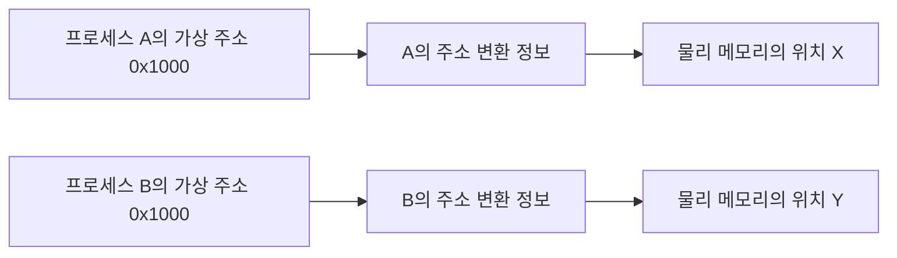
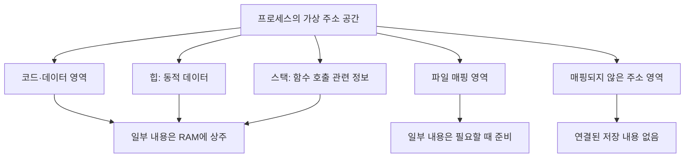
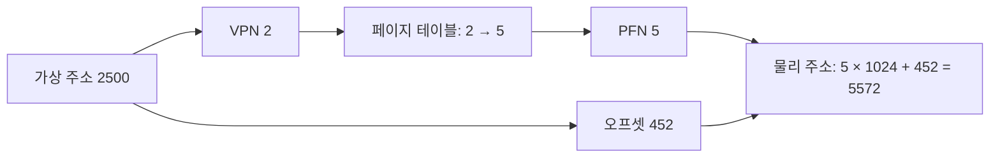
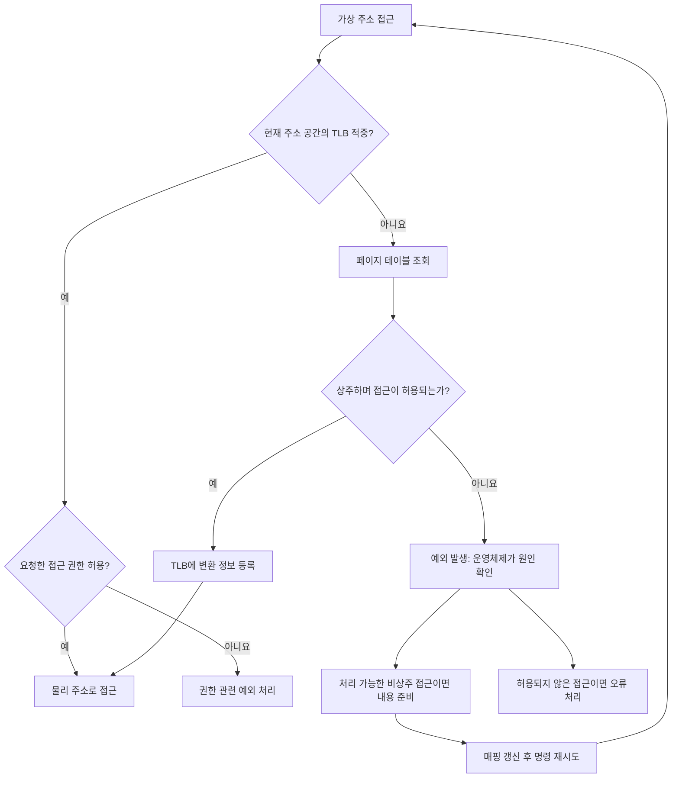
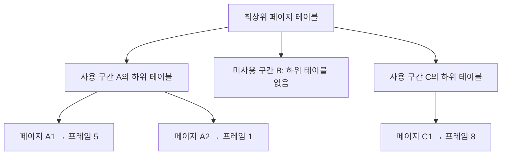
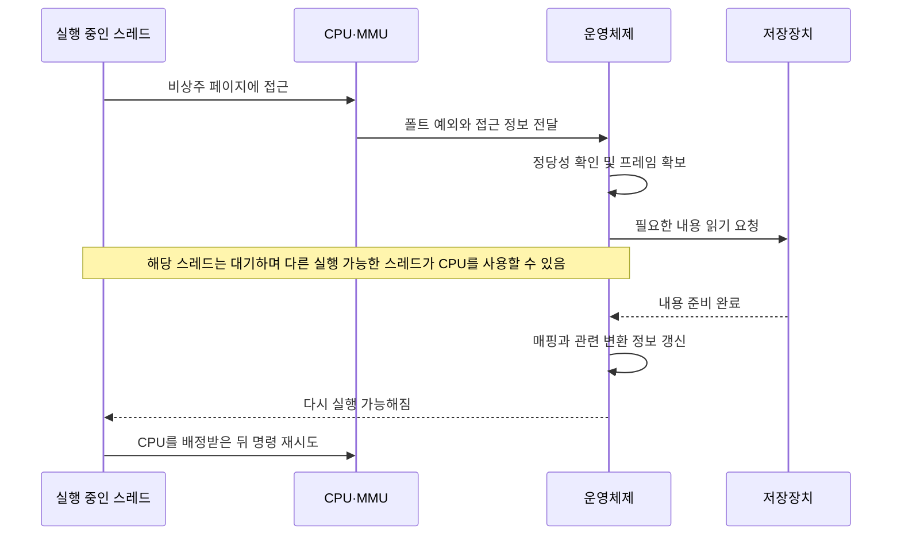
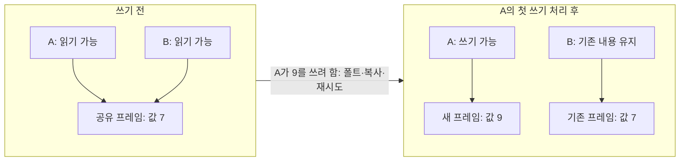
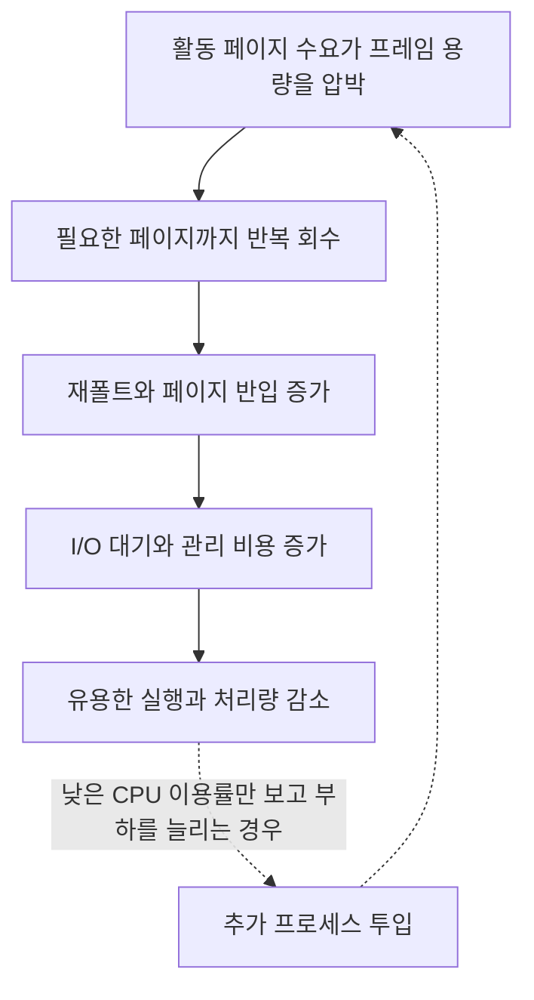
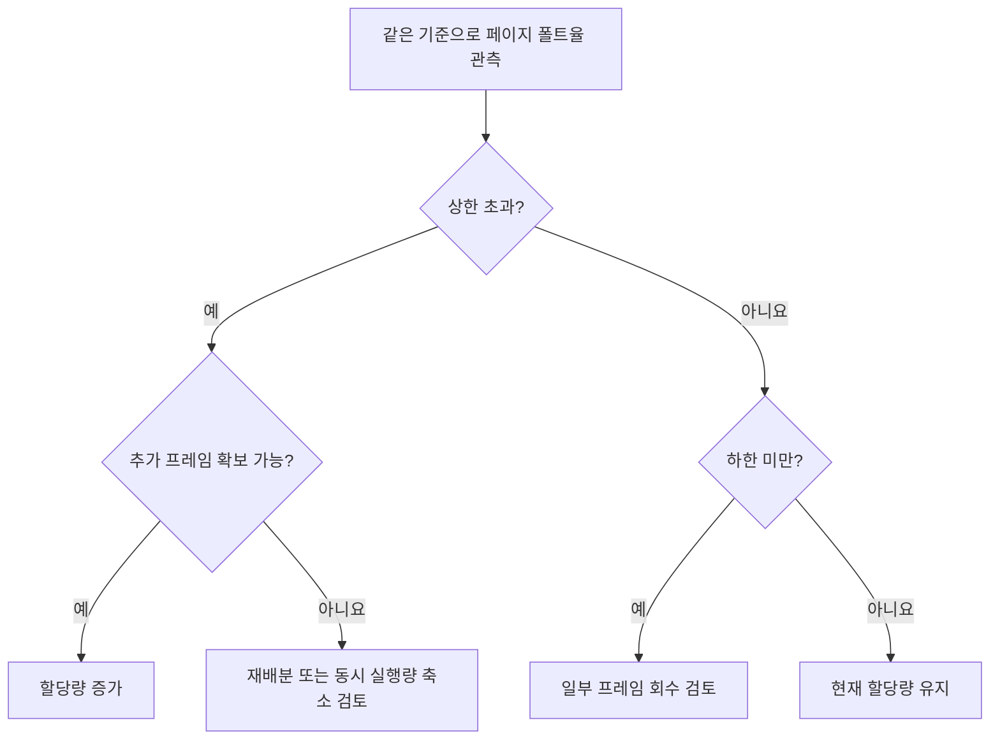

# 9회차 — 메모리 관리

프로그램이 사용하는 주소와 실제 RAM의 위치는 같을 필요가 없다. 운영체제와 하드웨어는 프로그램마다 독립적인 주소 공간을 제공하고, 그 주소에 대응하는 내용을 필요한 시점에 RAM에 준비한다. 덕분에 여러 프로그램이 서로의 메모리를 침범하지 않으면서 제한된 RAM을 함께 사용할 수 있다.

이 장은 프로세스, CPU, RAM, 보조 저장장치의 기본 의미를 안다고 가정한다. 먼저 가상 메모리라는 추상화를 이해하고, 페이징과 페이지 폴트가 이를 어떻게 구현하는지 살펴본다. 이어 RAM이 부족할 때의 페이지 교체, 현재 실행 중인 작업들의 메모리 수요가 지나치게 커졌을 때의 스래싱을 연결한다. 특정 운영체제의 주소 배치나 CPU의 비트 구성을 일반 규칙으로 가정하지 않는다.

## 1. Virtual Memory: 프로그램의 주소와 저장 위치를 분리하기

### 1.1 같은 주소를 사용하는 두 프로그램

프로세스 A와 B가 각각 주소 `0x1000`에 값을 저장한다고 하자. 두 주소가 모두 RAM의 같은 위치를 뜻한다면 한 프로그램의 쓰기가 다른 프로그램의 데이터를 덮어쓴다. 여러 프로그램을 안전하게 실행하려면 주소값에 더해 **어느 주소 공간에 속한 주소인가**를 구별해야 한다.

가상 주소는 프로그램이 사용하는 주소이고, 물리 주소는 실제 물리 메모리의 위치를 나타내는 주소다. 가상 메모리 시스템은 프로세스의 가상 주소를 적절한 물리 주소로 변환한다. A의 `0x1000`과 B의 `0x1000`은 숫자가 같아도 서로 다른 물리 위치로 연결할 수 있다.

주소와 그곳에 저장된 내용도 구별해야 한다. 주소는 위치를 지정하는 이름이고, 내용은 그 이름을 통해 읽거나 쓰는 명령어와 데이터다. 운영체제가 내용을 다른 물리 위치로 옮기더라도 주소 변환 정보를 바꾸면 프로그램은 기존 가상 주소를 계속 사용할 수 있다.

*같은 주소값이라도 어느 주소 공간에 속하는지에 따라 접근 대상이 달라진다. X와 Y는 서로 다른 물리 위치다.*

이러한 분리는 프로그램의 메모리 사용을 단순하게 한다. 프로그램은 다른 프로세스가 RAM의 어디를 사용하는지 몰라도 자신의 주소를 기준으로 실행할 수 있다. 운영체제는 물리 배치를 관리하고, 허용되지 않은 접근을 막으며, 필요하다면 일부 내용을 의도적으로 공유한다.

### 1.2 주소 공간에는 무엇이 있는가

**주소 공간(address space)**은 프로그램이 주소를 통해 메모리를 바라보는 범위다. 일반적인 프로세스에는 실행할 명령어가 있는 코드 영역, 전역·정적 변수 등의 데이터 영역, 동적으로 확보한 객체를 위한 힙, 함수 호출과 관련된 정보를 위한 스택 등이 있다. 파일을 메모리에 연결한 영역도 존재할 수 있다.

이들은 프로그램에서 맡는 역할에 따른 구분이다. 코드·힙·스택이 물리 메모리에서도 반드시 연속된 덩어리로 존재한다는 뜻은 아니다. 또한 각 영역의 순서, 시작 주소, 성장 방향은 시스템에 따라 달라진다. 여러 스레드를 가진 프로세스에는 스레드별 스택도 필요하므로, 하나의 고정된 주소 배치 그림을 모든 프로그램에 적용할 수 없다.

*주소 공간의 역할별 구성도다. 실제 주소 순서나 각 영역의 크기를 나타내는 그림은 아니다.*

가상 주소로 표현할 수 있는 모든 위치가 프로그램에 할당된 것은 아니다. 주소 공간 가운데 실제로 사용하는 부분만 매핑될 수 있고, 그 사이에는 접근이 허용되지 않은 빈 영역이 있을 수 있다. 따라서 “표현 가능한 주소가 있다”와 “그 주소를 읽을 수 있다”는 다른 말이다.

여기서는 네 가지 양을 분리해서 이해해야 한다.

| 구분 | 무엇을 나타내는가 |
|---|---|
| 가상 주소 공간의 범위 | 프로그램이 사용하는 주소 체계의 범위 |
| 매핑된 영역의 크기 | 코드·데이터·파일 등과 연결하도록 설정한 주소 영역의 크기 |
| RAM 상주량 | 그중 현재 물리 메모리에 실제로 올라와 있는 내용의 양 |
| 보조 저장 공간 사용량 | 파일이나 스왑 등에 보관된 내용이 차지하는 저장 공간 |

큰 주소 영역을 마련했다고 해서 같은 크기의 RAM을 즉시 소비하는 것은 아니다. 반대로 RAM에 아직 없다는 이유만으로 해당 주소가 잘못된 주소인 것도 아니다. 유효한 매핑에 속하지만 내용은 나중에 준비하도록 되어 있을 수 있다.

### 1.3 하드웨어와 운영체제의 역할

일반적인 하드웨어 지원 가상 메모리에서는 **MMU(Memory Management Unit)**가 주소 변환과 접근 권한 검사를 수행한다. 운영체제는 어떤 주소를 어떤 내용에 연결할지, 어떤 접근을 허용할지 결정하고 변환 정보를 관리한다.

프로그램이 메모리를 읽을 때마다 운영체제 함수가 호출되는 것은 아니다. 필요한 내용이 RAM에 있고 변환 정보와 접근 권한에 문제가 없다면 하드웨어가 정상 경로를 처리한다. 운영체제는 새로운 매핑을 만들거나, 접근을 바로 완료할 수 없는 예외가 발생했을 때 관여한다. 이 구분은 가상 메모리를 빠르게 구현하는 데 중요하다.

접근 권한은 주소 변환과 함께 작동한다. 어떤 페이지를 읽을 수 있어도 쓸 수는 없도록 설정할 수 있고, 데이터를 저장하는 페이지에서 명령어를 실행하지 못하게 할 수도 있다. 프로그램이 임의로 다른 프로세스의 물리 주소를 지정하는 대신 허용된 가상 주소와 권한을 통해 접근하게 하므로 보호와 격리를 제공할 수 있다.

가상 메모리의 주요 목적은 이런 독립적인 주소 공간을 투명하게 제공하고, 보호와 공유를 관리하며, 물리 메모리를 효율적으로 사용하는 것이다. 물리 메모리보다 큰 프로그램을 실행하는 능력도 이 체계에서 얻을 수 있지만, 용량 확장만이 가상 메모리의 의미는 아니다.

### 1.4 프로그램 전체가 RAM에 없어도 되는 이유

큰 프로그램도 매 순간 모든 코드와 데이터를 사용하지는 않는다. 문서 편집기의 맞춤법 검사 기능을 실행하는 동안에는 그 기능의 코드와 검사 중인 문서 일부가 집중적으로 사용될 수 있다. 다른 메뉴의 코드나 오래전에 열었던 문서의 일부는 당장 필요하지 않다.

이런 접근 경향을 **지역성(locality)**이라고 한다. 시간 지역성은 최근에 접근한 내용을 가까운 미래에 다시 접근하는 경향이다. 반복문의 명령어나 반복해서 갱신하는 변수에서 나타난다. 공간 지역성은 어떤 주소에 접근한 뒤 그 주변 주소에도 접근하는 경향이다. 배열을 순서대로 읽거나 연속된 명령어를 실행할 때 나타난다.

배열의 작은 구간을 여러 번 처리하는 상황을 생각해 보자. 같은 구간을 다시 읽는 것은 시간 지역성이고, 그 구간 안에서 이웃 원소로 이동하는 것은 공간 지역성이다. 해당 구간과 반복문 코드가 RAM에 있으면 배열 전체가 RAM에 없어도 한동안 실행할 수 있다.

운영체제는 이런 특성을 이용해 현재 필요한 부분을 RAM에 유지하고, 당장 필요하지 않은 부분은 다른 곳에서 복원할 수 있게 관리한다. 이 때문에 프로그램의 전체 메모리 내용이 RAM보다 커도 실행이 가능해진다. 다만 자주 사용하는 부분까지 RAM에 담지 못하면 내용을 계속 바꾸어 올려야 한다. 주소를 제공하는 능력이 빠른 접근이나 무제한 저장 용량을 보장하는 것은 아니다.

### 1.5 페이지 내용은 어디에서 오는가

아직 RAM에 없는 내용이 모두 스왑에 저장되어 있는 것은 아니다. 내용의 출처에 따라 준비 방법이 다르다.

실행 파일의 변경되지 않은 코드나 일반 파일에 연결된 데이터는 파일에서 읽어 올 수 있다. 원본과 동일한 내용이라면 RAM에서 제거한 뒤에도 같은 파일을 다시 읽어 복원할 수 있다. 이런 페이지를 **파일 기반 페이지(file-backed page)**라고 부른다.

힙이나 스택처럼 특정 파일의 내용을 직접 나타내지 않는 메모리는 보통 **익명 메모리(anonymous memory)**로 분류한다. 새로 제공하는 내용은 필요할 때 초기화할 수 있다. 프로그램이 수정한 익명 데이터를 RAM에서 내보내면서 보존하려면, 스왑 같은 별도의 저장 수단이 필요할 수 있다.

**스왑 공간**은 이런 내용을 물리 메모리 밖에 보관하는 데 사용하는 보조 저장 공간이다. 이미 원본 파일에서 복원할 수 있는 내용까지 항상 스왑에 중복 저장할 필요는 없다. 아직 사용하지 않은 가상 주소 영역은 보관할 내용 자체가 없을 수도 있다.

따라서 가상 메모리를 “RAM과 스왑 용량을 더한 것”으로 정의하면 주소 공간, 매핑, 저장 자원을 혼동하게 된다. 스왑이 없어도 주소 변환과 보호, 파일 매핑 같은 가상 메모리 기능은 의미가 있다. 다만 내용을 어디까지 보존하며 얼마나 많은 메모리 수요를 감당할 수 있는지는 실제 자원과 정책에 제한된다.

### 1.6 공유와 쓰기 시 복사

주소 공간이 분리되어 있다고 해서 모든 내용이 물리적으로 중복되어야 하는 것은 아니다. 여러 프로세스가 동일한 읽기 전용 코드를 사용한다면, 각 주소 공간의 매핑이 같은 물리 메모리를 가리키게 할 수 있다. 각 프로세스는 자신의 주소로 접근하면서 실제 내용은 한 벌만 유지한다.

공유 메모리에 쓰기도 허용하면 한 프로세스의 변경을 다른 프로세스가 볼 수 있다. 이 경우에는 의도적인 데이터 공유가 이루어지는 것이며, 동시에 수정할 때의 순서를 맞추는 동기화가 별도로 필요하다.

반대로 처음에는 내용이 같지만 이후에는 각자 독립적으로 수정해야 할 수도 있다. 이때 처음부터 전부 복사하는 대신 **쓰기 시 복사(Copy-on-Write, COW)**를 사용할 수 있다. 처음에는 같은 내용을 공유하고, 어느 한쪽이 실제로 쓰려고 할 때 필요한 부분만 복사해 분리한다. 수정하지 않는 페이지에는 복사 비용이 들지 않는다.

가상 메모리는 이처럼 주소와 저장 위치를 분리하는 추상화다. **페이징**은 그 주소 공간과 물리 메모리를 일정한 크기로 나누어 연결하는 방식이고, **요구 페이징**은 필요한 페이지를 언제 RAM에 준비할지 결정하는 적재 정책이다. 다음 절에서는 먼저 페이지가 이미 RAM에 있는 정상적인 접근부터 살펴본다.

## 2. Paging / Page Fault: 주소 변환과 필요한 내용의 준비

### 2.1 페이지와 프레임

물리 메모리에 작은 빈 공간 여러 개가 흩어져 있다고 하자. 빈 공간의 총합은 충분해도 프로그램 전체를 연속적으로 배치해야 한다면 적절한 자리를 찾지 못할 수 있다. 이런 문제가 외부 단편화다.

**페이징(paging)**은 가상 주소 공간을 고정 크기의 **페이지(page)**로 나누고, 물리 메모리를 같은 크기의 **프레임(frame)**으로 나눈다. 각 페이지를 서로 떨어진 빈 프레임에 배치할 수 있으므로 프로그램 전체를 담을 하나의 연속된 물리 공간을 찾을 필요가 없다.

예를 들어 가상 페이지 0, 1, 2를 물리 프레임 5, 1, 8에 배치할 수 있다. 프로그램은 여전히 가상 주소 순서대로 접근한다. 페이지 경계를 넘을 때 다음 가상 페이지의 변환 정보를 사용하므로 실제 물리 위치가 떨어져 있어도 문제가 없다.

이 설명은 하나의 고정 페이지 크기를 사용하는 기본 모형이다. 이 모형에서는 개별 페이지를 배치하기 위한 외부 단편화를 피할 수 있다. 다만 페이지 안의 남는 공간이라는 다른 낭비가 생기며, 그것은 뒤에서 다룬다. 의미 있는 가변 크기 영역을 단위로 나누는 세그먼테이션과 달리, 페이징의 기본 분할 단위는 일정한 크기다.

### 2.2 정상 접근: 페이지 번호를 프레임 번호로 바꾸기

가상 주소에는 두 정보가 들어 있다. 하나는 어느 페이지인지를 나타내는 **가상 페이지 번호(VPN)**이고, 다른 하나는 그 페이지 안에서의 위치인 **오프셋(offset)**이다. 페이지 테이블에서 VPN에 대응하는 **물리 프레임 번호(PFN)**를 찾으면 물리 주소를 만들 수 있다.

페이지 크기를 P라고 할 때 바이트 주소 기준으로 다음 관계가 성립한다.

- VPN = 가상 주소를 P로 나눈 몫
- 오프셋 = 가상 주소를 P로 나눈 나머지
- 물리 주소 = PFN × P + 오프셋

페이지와 프레임의 크기가 같으므로 **오프셋은 변환 전후에 보존된다**. 페이지가 어느 프레임으로 이동하든 페이지 내부의 바이트 순서는 그대로이기 때문이다. 페이지 크기가 2의 거듭제곱이면 주소의 하위 비트가 오프셋, 나머지 상위 비트가 페이지 번호에 해당한다.

페이지 크기가 1KiB, 즉 1,024바이트라고 하자. 가상 주소 2,500은 `2 × 1,024 + 452`이므로 VPN은 2, 오프셋은 452다. 페이지 테이블에 VPN 2가 PFN 5로 연결되어 있다면 물리 주소는 `5 × 1,024 + 452 = 5,572`가 된다.

*변환되는 것은 페이지가 놓인 위치다. 페이지 내부 위치인 오프셋은 그대로 사용한다.*

이 예제에서는 페이지가 이미 RAM에 있으며 해당 접근이 허용된다고 가정했다. 실제 변환에서는 프레임 번호뿐 아니라 상주 여부와 권한도 확인해야 한다.

### 2.3 페이지 테이블과 상태 정보

**페이지 테이블(page table)**은 가상 페이지의 매핑을 관리하는 자료구조다. 가장 단순한 형태에서는 VPN을 배열 인덱스로 사용하고, 그 위치의 **페이지 테이블 엔트리(PTE)**를 읽는다. 각 주소 공간에 대응하는 변환 정보가 필요하므로, 현재 실행 중인 주소 공간에 맞는 테이블을 사용해야 한다.

페이지 테이블 자체도 공간을 차지한다. 보통 메모리에 저장하고, CPU는 현재 테이블의 기준 위치나 최상위 테이블 위치를 나타내는 정보를 사용한다. 이를 설명하는 대표적인 이름이 페이지 테이블 기준 레지스터인 PTBR이다. 주소 공간이 전환되면 변환에 사용하는 기준 정보도 그에 맞게 선택해야 한다.

PTE와 운영체제의 관련 관리 정보는 다음 질문들에 답해야 한다.

| 정보 | 의미 |
|---|---|
| 매핑의 유효성 | 이 주소 영역이 프로세스에 허용된 매핑에 속하는가 |
| 상주 여부 | 현재 사용할 물리 프레임이 준비되어 있는가 |
| 프레임 번호 | 상주하는 페이지가 어떤 물리 프레임에 있는가 |
| 보호 정보 | 읽기·쓰기·실행 중 어떤 접근을 허용하는가 |
| 참조 정보 | 관측 기준 이후 페이지에 접근한 적이 있는가 |
| 수정 정보 | 보존된 내용과 비교해 변경을 보존해야 하는 상태인가 |

이 정보가 모든 시스템에서 각각 독립된 비트로 PTE에 들어간다는 뜻은 아니다. 하드웨어 PTE와 운영체제의 별도 자료구조가 역할을 나누기도 한다. 특히 `valid`와 `present`라는 이름은 교재와 구현마다 의미가 다를 수 있으므로 비트 이름보다 표현하는 상태를 먼저 확인해야 한다.

예를 들어 아직 할당하지 않은 주소는 유효한 매핑이 아니다. 반면 파일과 연결된 주소인데 그 내용이 RAM에 없을 뿐이라면, 운영체제가 내용을 준비한 뒤 접근을 계속할 수 있다. 하드웨어에서 두 상황이 비슷한 예외로 나타나더라도 운영체제는 주소 영역의 정보를 통해 처리 가능성을 판단한다.

**참조 비트(reference bit)**와 **수정 비트(dirty bit)**도 다르다. 읽기만 해도 참조한 것이지만 내용이 수정된 것은 아니다. 참조 비트는 교체 정책에서 최근 사용의 단서로 활용하고, 수정 비트는 내용을 내보낼 때 추가 보존 작업이 필요한지 판단하는 데 활용한다. 수정 비트로 잘못된 주소와 비상주 주소를 구별하는 것은 아니다.

운영체제는 페이지 테이블 외에 물리 프레임의 사용 상태도 관리한다. 프레임이 비어 있는지, 어떤 페이지와 연결되는지, 공유 중인지 등을 알아야 새 프레임을 할당하거나 기존 프레임을 회수할 수 있다. 페이지 테이블이 가상 주소에서 출발하는 정보라면, 프레임 관리 정보는 물리 메모리의 자원 상태에서 출발하는 정보다.

### 2.4 TLB: 변환 정보를 매번 다시 읽지 않기

데이터 한 번을 읽기 위해 페이지 테이블을 읽고 다시 실제 데이터를 읽는다면 주소 변환에도 메모리 접근 비용이 든다. 단일 단계 테이블과 캐시가 없는 단순 모형에서는 테이블 조회 한 번이 추가된다. 실제 비용이 항상 정확히 두 배라는 뜻은 아니지만, 변환을 반복해서 계산하는 비용을 줄일 필요는 분명하다.

**TLB(Translation Lookaside Buffer)**는 최근 사용한 주소 변환 정보를 저장하는 작은 하드웨어 캐시다. 데이터 페이지의 내용 자체를 저장하는 공간이 아니라, 어떤 VPN이 어떤 PFN에 연결되고 어떤 권한을 가지는지를 빠르게 찾기 위한 공간이다.

일반적으로 기대하는 빠른 경로는 **TLB 적중(hit)**이다. 현재 주소 공간의 변환 정보가 TLB에 있고 접근 권한도 맞으면, 페이지 테이블을 다시 조회하지 않고 물리 주소를 얻는다. 배열의 여러 원소가 같은 페이지에 있으면 같은 변환 정보를 반복해서 활용할 수 있다.

**TLB 미스(miss)**는 필요한 변환 정보가 TLB에 없다는 뜻이다. 페이지 테이블을 확인했을 때 페이지가 이미 RAM에 있다면 변환 정보를 TLB에 채우고 접근을 계속하면 된다. 데이터 페이지를 저장장치에서 가져올 이유는 없다.

반면 페이지 테이블을 확인한 결과 필요한 내용이 비상주 상태라면 운영체제의 페이지 폴트 처리가 필요하다. 따라서 TLB 미스와 페이지 폴트는 서로 다른 상태다. 전자는 변환 캐시의 부재이고, 후자는 이 절의 기본 모형에서 접근할 페이지 내용의 부재다.

*변환 정보가 TLB에 없는 경우와 내용이 RAM에 없는 경우를 구분한 개념도다. 예외의 구체적인 이름과 검사 순서는 하드웨어마다 다를 수 있다.*

TLB 미스 뒤의 페이지 테이블 조회를 하드웨어가 수행하는 시스템도 있고, 소프트웨어가 관여하는 시스템도 있다. 어느 쪽이든 “TLB 미스이면 반드시 저장장치 I/O가 발생한다”는 결론은 성립하지 않는다.

주소 공간 전환 때도 TLB를 주의해서 다루어야 한다. A의 VPN 2에 대한 변환을 B의 VPN 2에 적용하면 엉뚱한 데이터를 읽게 된다. 따라서 이전 변환을 무효화하거나, 주소 공간 식별자를 함께 저장해 구별하는 등의 방법이 필요하다. 같은 주소 공간의 매핑을 변경했을 때도 관련된 오래된 변환이 재사용되지 않도록 해야 한다.

### 2.5 페이지 테이블이 너무 커지면

단일 단계 페이지 테이블은 단순하지만, 가능한 가상 페이지마다 엔트리를 마련하면 주소 공간이 커질수록 테이블도 커진다. 예를 들어 32비트 바이트 주소 전체를 4KiB 페이지로 나누면 가능한 페이지는 2²⁰개다. PTE가 4바이트라는 가정에서는 한 테이블에 4MiB가 필요하다. 이는 원리를 보여 주는 계산이며 특정 시스템의 실제 PTE 크기를 정한 것은 아니다.

문제는 프로그램이 주소 공간의 일부만 사용해도 단순 배열에는 나머지 페이지의 자리까지 존재한다는 점이다. 코드와 힙, 스택 사이에 넓은 미사용 영역이 있는 **희소 주소 공간**에서는 사용하지 않는 엔트리를 위한 공간이 많이 낭비된다.

**다단계 페이지 테이블**은 테이블을 계층으로 나누어 이 낭비를 줄인다. 상위 테이블이 주소 구간별 하위 테이블을 가리키고, 실제로 사용하는 구간에만 필요한 하위 테이블을 만든다. 어떤 큰 주소 구간 전체가 미사용이라면 그 구간의 하위 테이블을 아예 만들지 않을 수 있다.

*사용하지 않는 주소 구간의 하위 테이블을 생략해 공간을 절약한다. 상위 테이블의 관리 공간까지 없어지는 것은 아니다.*

주소를 변환할 때는 VPN의 일부로 상위 엔트리를 선택하고, 그 엔트리가 가리키는 하위 테이블에서 VPN의 나머지 부분을 사용한다. 마지막 엔트리에서 PFN을 얻은 뒤 오프셋을 붙인다. 이런 계층적 조회를 **페이지 워크(page walk)**라고 한다.

다단계 구조는 공간을 절약하는 대신 TLB 미스 때 여러 단계의 조회가 필요하다. TLB에 최종 변환이 있으면 이 단계를 매번 반복할 필요가 없으므로, TLB와 다단계 테이블은 서로 다른 문제를 해결하면서 함께 작동한다. 전자는 반복 조회 비용을 줄이고, 후자는 큰 주소 공간의 테이블 공간을 줄인다.

다른 분류로는 가상 페이지 관련 키를 해시로 찾는 해시 기반 구조와, 물리 프레임을 기준으로 엔트리를 두는 역 페이지 테이블이 있다. 이들은 엔트리 수나 탐색 방식을 바꾸는 해법이다. 여기서는 주소 공간의 희소성과 조회 비용의 관계를 가장 직접적으로 보여 주는 다단계 구조에 집중한다.

### 2.6 페이지 크기의 절충

고정 크기 단위로 메모리를 할당하면 마지막 페이지의 일부가 남을 수 있다. 이처럼 할당된 단위 내부에서 사용하지 않는 공간이 **내부 단편화**다. 예를 들어 어떤 영역에 6KiB가 필요한데 4KiB 페이지 단위로 별도 공간을 마련하면 2페이지가 필요하고, 그 영역만 놓고 보면 2KiB가 남는다.

페이지가 작으면 이런 낭비를 줄이기 쉽고 실제로 필요한 내용을 더 세밀하게 적재할 수 있다. 대신 같은 양의 메모리를 표현하는 페이지 수가 늘어나 페이지 테이블 엔트리가 더 많이 필요하다. TLB 엔트리 수도 같다면 한 번에 변환을 기억할 수 있는 전체 메모리 범위가 작아진다.

페이지가 크면 테이블 엔트리 수를 줄이고 하나의 TLB 엔트리로 더 넓은 범위를 다룰 수 있다. 한 번의 반입으로 주변 내용도 함께 준비할 수 있지만, 사용하지 않을 내용까지 가져와 RAM과 전송 자원을 소비할 가능성도 커진다.

따라서 페이지 크기는 내부 단편화, 변환 정보의 크기, TLB가 포괄하는 범위, 적재·전송 단위 사이의 절충이다. 큰 페이지나 작은 페이지가 언제나 더 좋다고 말할 수는 없다.

### 2.7 요구 페이징과 페이지 폴트 처리

**요구 페이징(demand paging)**은 페이지를 실제로 필요로 할 때 준비하는 정책이다. 프로그램을 시작할 때 모든 내용을 RAM에 올리지 않아도 되므로, 실행 중 한 번도 사용하지 않는 부분의 적재 비용을 피할 수 있다. 사용자 프로그램의 페이지를 미리 적재하지 않고 최초 접근으로 준비하는 극단적인 모형을 순수 요구 페이징이라고 한다.

정상 경로에서 처리할 수 없는 메모리 접근이 발생하면 CPU는 예외를 통해 운영체제로 제어를 넘긴다. 우선 유효하지만 RAM에 없는 페이지에 접근한 경우를 **비상주 페이지 폴트(page fault)**의 기본 사례로 살펴보자.

첫째, 운영체제는 문제가 된 주소와 접근 종류를 확인한다. 파일 매핑이나 할당된 익명 영역에 대한 정당한 접근인지 검사한다. 매핑되지 않은 주소이거나 허용되지 않은 쓰기라면 아무 페이지나 가져와 실행을 계속해서는 안 된다.

둘째, 접근에 필요한 물리 프레임을 확보한다. 빈 프레임이 있으면 사용한다. 여유가 부족하면 기존 페이지를 회수해 프레임을 재사용해야 하며, 보존해야 할 수정 내용이 있다면 그 내용이 사라지지 않도록 처리한다. 어떤 페이지를 회수할지가 다음 장의 페이지 교체 문제다.

셋째, 필요한 내용을 준비한다. 파일이나 스왑에서 읽어야 할 수도 있고, 새 메모리의 초기 내용으로 채우거나 이미 RAM에 있는 내용을 복사하면 될 수도 있다. “폴트 처리”를 곧바로 “디스크 읽기”와 동일시해서는 안 된다.

넷째, 내용이 준비되면 페이지 테이블과 프레임 관리 정보를 갱신한다. 페이지가 어느 프레임에 있고 어떤 권한으로 접근 가능한지 기록하며, 오래된 TLB 변환이 남아 있다면 함께 정리한다.

마지막으로 해당 실행 흐름이 다시 CPU를 배정받으면 폴트를 일으킨 명령을 재시도한다. 프로그램의 관점에서는 필요한 데이터가 준비된 뒤 원래 하려던 읽기나 쓰기를 수행하게 된다. 이를 위해 하드웨어와 운영체제는 예외 전후의 실행 상태를 올바르게 보존해야 한다.

*저장장치 읽기가 필요한 폴트의 예다. 폴트를 일으킨 스레드가 기다린다고 해서 CPU 전체가 반드시 멈추는 것은 아니다.*

빈 프레임에 처음 내용을 올리는 것도 페이지 폴트를 처리하는 일이다. 기존 페이지를 내보내지 않았으므로 교체는 발생하지 않는다. **페이지 폴트 횟수와 페이지 교체 횟수는 같지 않다.**

반대로 접근을 미리 예측해 페이지를 가져오는 선행 적재도 가능하다. 예측이 맞으면 이후 접근의 대기를 줄일 수 있지만, 틀리면 쓰지 않을 내용을 위해 메모리와 I/O를 소비한다. 요구 페이징은 실제 접근을 기준으로 이 비용을 늦춘다는 점에서 구별된다.

### 2.8 저장장치 읽기 없이 처리할 수 있는 폴트

새 익명 페이지를 처음 사용할 때 필요한 내용이 모두 0인 경우를 생각해 보자. 저장장치에서 기존 내용을 읽을 필요 없이 프레임을 확보해 0으로 준비할 수 있다. 이런 방식이 **demand-zero**, 즉 요구 시점의 0 초기화다. 기존 사용자나 다른 프로세스의 잔여 내용이 보이지 않도록 하는 의미도 있다.

COW는 다른 사례다. 두 프로세스가 같은 내용을 공유하되 독립적으로 수정해야 한다면, 우선 공유 프레임에 대한 쓰기를 막는다. 읽기는 정상적으로 수행되지만 한쪽이 쓰려고 하면 권한 관련 폴트가 발생한다.

운영체제는 이 주소가 실제로 금지된 쓰기 대상인지, 복사를 미루기 위해 임시로 쓰기를 막아 둔 COW 대상인지 구별한다. COW 대상이고 여전히 공유 중이라면 별도 프레임을 확보하고 기존 내용을 복사한 뒤, 쓰려는 프로세스의 매핑을 새 프레임으로 바꾸고 쓰기를 허용한다. 명령을 재시도하면 새 복사본에 변경이 반영된다.

*공유 중인 원본이 RAM에 있고 새 프레임을 확보할 수 있다면, COW는 저장장치 읽기 없이 메모리 복사로 처리할 수 있다.*

이 사례는 페이지가 RAM에 있어도 폴트가 발생할 수 있음을 보여 준다. 페이지 폴트라는 이름이 비상주 접근만 가리키는지, 보호 관련 예외까지 포함하는지는 아키텍처와 설명 문맥에 따라 다르다. 여기서 중요한 구별은 정상적으로 복구할 수 있는 요구 페이징·COW와, 허용되지 않은 접근으로 처리해야 하는 실제 보호 위반이다.

일부 시스템은 저장장치 I/O의 필요 여부 등에 따라 폴트를 minor와 major로 구분한다. 정확한 집계 기준은 플랫폼마다 확인해야 한다. 모든 폴트를 같은 비용의 디스크 접근이나 프로그램 오류로 해석하지 않는 것이 기본이다.

### 2.9 적은 폴트도 평균 접근 시간에 영향을 주는 이유

정상 접근이 매우 빠르더라도 드물게 발생하는 비싼 폴트가 평균을 크게 바꿀 수 있다. 정상 접근 시간을 m, 폴트 확률을 p, 폴트가 발생한 접근의 전체 완료 시간을 F라고 하면 단순 모형의 유효 접근 시간은 다음과 같다.

**EAT = (1 − p) × m + p × F**

여기서 F에는 예외 처리, 필요한 I/O, 매핑 갱신, 재시도까지 포함한다고 가정한다. 폴트 처리에 추가되는 지연만 F로 정의한다면 식도 그 정의에 맞게 달라져야 한다.

가상의 값으로 m = 100ns, F = 1ms = 1,000,000ns, p = 0.0001을 대입하면 `0.9999 × 100 + 0.0001 × 1,000,000 = 199.99ns`다. 접근 1만 번 중 한 번만 폴트가 발생해도 이 모형에서는 평균이 정상 접근의 약 두 배가 된다.

이 값들은 실제 장비의 측정치가 아니다. 서로 다른 폴트의 비용, I/O 대기열, 다른 프로세스와의 실행 중첩도 생략했다. 계산의 목적은 빠른 정상 경로만 최적화해서는 충분하지 않으며, 비싼 폴트의 빈도를 낮추는 정책이 필요함을 이해하는 것이다.

## 3. Page Replacement: 어떤 페이지의 자리를 회수할 것인가

### 3.1 교체의 메커니즘과 정책

새 페이지를 준비해야 하는데 빈 프레임이 없다면 기존 페이지 하나의 자리를 회수해야 한다. 이때 선택되는 페이지가 **희생 페이지(victim page)**다. 필요한 내용을 보존하고, 이전 매핑을 수정하며, 새 페이지의 매핑을 설치하는 것은 교체의 공통 메커니즘이다. 후보 중 무엇을 선택하는지가 교체 정책이다.

좋은 희생 페이지는 내보낸 뒤 가까운 미래에 다시 필요하지 않을 페이지다. 하지만 운영체제는 일반적으로 프로그램의 미래 접근을 정확히 알 수 없다. 그래서 적재 순서, 최근 사용 시점, 사용 빈도 같은 관측 가능한 정보를 단서로 삼는다.

정책을 비교할 때는 같은 페이지 참조열, 같은 프레임 수, 같은 초기 상태를 사용해야 한다. **페이지 참조열**은 메모리 접근을 해당 페이지의 이름이나 번호로 나타낸 순서다. 이 절에서는 선행 적재 없이, 처음에는 프레임이 모두 비어 있다고 가정한다.

접근한 페이지가 이미 상주하면 적중이고, 없으면 폴트다. 빈 프레임이 있다면 폴트가 발생해도 기존 페이지를 제거하지 않는다. 프레임이 모두 찬 뒤 새 페이지가 필요할 때 실제 교체가 일어난다. 참조열을 임의로 줄이면 빈도나 관측 창의 의미가 달라질 수 있으므로 예제에서는 주어진 참조를 그대로 사용한다.

### 3.2 FIFO: 가장 먼저 들어온 페이지부터

**FIFO(First-In, First-Out)**는 가장 오래전에 RAM에 들어온 페이지를 내보낸다. 페이지를 적재 순서대로 큐에 넣고, 교체가 필요하면 맨 앞 페이지를 제거하면 된다. 적중이 발생해도 적재 순서는 바뀌지 않는다.

프레임이 3개이고 참조열이 `A → B → C → A → D → B`라고 하자. 처음 A, B, C에서 각각 폴트가 발생해 세 프레임이 채워진다. 네 번째 A는 적중이다. 그러나 FIFO의 순서는 여전히 A, B, C다.

D를 읽을 때는 빈 프레임이 없으므로 A를 제거한다. A가 바로 직전에 사용되었어도 가장 먼저 들어왔다는 이유로 선택된다. 그다음 B는 아직 상주하므로 적중한다. 전체 폴트는 4번이고 실제 교체는 D를 적재할 때의 1번이다.

FIFO의 장점은 관리 정보가 단순하다는 것이다. 단점은 오래전에 적재되었다는 사실이 더 이상 필요 없다는 뜻은 아니라는 점이다. 시작부터 계속 사용하는 핵심 코드도 먼저 들어왔다는 이유로 제거될 수 있다.

### 3.3 OPT: 미래를 안다면 무엇을 버릴까

**OPT 또는 MIN**은 앞으로 다시 사용되기까지 가장 오래 남은 페이지를 내보낸다. 앞으로 전혀 사용하지 않을 페이지가 있다면 그것을 선택할 수 있다. 가까운 미래에 필요한 페이지를 남겨 두므로, 고정된 참조열과 프레임 수에서 폴트 수를 최소화하는 비교 기준이 된다.

같은 예제에서 D를 가져오는 시점을 보자. 현재 A, B, C가 있고 남은 참조는 B 하나다. B는 곧 필요하지만 A와 C는 남은 구간에서 다시 쓰이지 않는다. OPT는 A나 C를 제거할 수 있다. 그다음 B는 적중하므로 전체 폴트 4번, 교체 1번이다.

일반적인 실행 중에는 미래의 전체 참조열을 알 수 없으므로 OPT를 그대로 온라인 정책으로 사용하기 어렵다. 대신 이미 기록한 참조열에 적용해 다른 정책이 얼마나 좋은지 평가한다. 어떤 정책의 폴트가 많아 보여도 OPT와 거의 같다면 주어진 프레임 수에서는 개선 여지가 작을 수 있다.

OPT의 최적성은 여기서 정의한 **페이지 폴트 수**에 관한 것이다. 수정 페이지의 쓰기 비용이나 정책 관리 비용까지 모두 합친 실제 실행 시간이 반드시 최소라는 뜻은 아니다.

### 3.4 LRU와 LFU: 최근성과 빈도

**LRU(Least Recently Used)**는 가장 오랫동안 참조되지 않은 페이지를 내보낸다. 최근에 사용한 페이지가 다시 사용될 가능성이 높다는 시간 지역성을 이용한다. FIFO가 적재 시점을 기억한다면 LRU는 마지막 사용 시점을 기억한다.

앞의 참조열에서 A, B, C, A까지 접근하면 최근 사용 순서는 A, C, B다. 따라서 D를 적재할 때 LRU는 가장 오래 참조되지 않은 B를 제거한다. 바로 다음 참조가 B이므로 다시 폴트가 발생한다. 그 시점에는 C가 가장 오래 사용되지 않았으므로 C를 제거하고 B를 적재한다. 전체 폴트는 5번, 교체는 2번이다.

| 정책 | D를 적재할 때 제거하는 페이지 | 마지막 B 접근 | 전체 폴트 | 실제 교체 |
|---|---|---|---:|---:|
| FIFO | A | 적중 | 4 | 1 |
| OPT | A 또는 C | 적중 | 4 | 1 |
| LRU | B | 폴트 | 5 | 2 |

이 작은 예제에서는 FIFO가 LRU보다 낫다. LRU가 시간 지역성을 잘 활용할 수 있다는 사실과 모든 참조열에서 FIFO보다 낫다는 주장은 다르다. 최근의 과거는 미래의 단서일 뿐 보장은 아니다.

**LFU(Least Frequently Used)**는 참조 횟수가 가장 적은 페이지를 선택한다. LRU의 최근성과 LFU의 빈도는 다르다. 페이지 X를 초반에 100번 사용한 뒤 오랫동안 사용하지 않고, Y를 방금 한 번 사용했다면 단순 누적 LFU는 X를 더 중요하게 취급할 수 있다. LRU는 마지막 사용이 더 최근인 Y를 남기려 한다.

LFU는 자주 사용하는 내용을 유지할 수 있지만 오래전의 높은 빈도가 현재 수요를 가릴 수 있다. 관측 기간을 제한하거나 오래된 기록의 영향력을 줄이는 방법으로 보완할 수 있다. 어떤 정보를 선택하든 프로그램의 실행 단계가 달라지면 과거의 예측력이 떨어질 수 있다는 한계가 남는다.

### 3.5 Belady의 이상 현상과 스택 포함 성질

프레임을 늘리면 더 많은 페이지를 보관할 수 있으므로 폴트가 줄 것처럼 보인다. 하지만 FIFO에서는 프레임 수 증가로 페이지가 들어오고 나가는 순서가 달라져 오히려 폴트가 증가할 수 있다. 이를 **Belady의 이상 현상**이라고 한다.

초기 프레임이 모두 빈 상태에서 참조열 `1 → 2 → 3 → 4 → 1 → 2 → 5 → 1 → 2 → 3 → 4 → 5`에 FIFO를 적용하면 다음 결과가 나온다.

| 프레임 수 | 페이지 폴트 수 |
|---:|---:|
| 3 | 9 |
| 4 | 10 |

이 현상은 RAM 추가가 본질적으로 해롭다는 뜻이 아니다. 특정 정책에서 용량을 바꾸면 선택의 이력이 달라지며, 더 큰 용량의 상주 집합이 작은 용량의 상주 집합을 항상 포함하지는 않는다는 뜻이다.

LRU는 이 점에서 다르다. 같은 참조열을 처음부터 처리하면 프레임이 n개인 LRU는 최근에 참조한 서로 다른 페이지 n개를 유지한다. n+1개인 LRU는 거기에 한 페이지를 더 유지한다. 따라서 매 시점에 n개 프레임의 상주 집합이 n+1개 프레임의 상주 집합에 포함된다. 이를 **스택 포함 성질(stack property)**이라고 한다.

예를 들어 최근 사용 순서가 D, A, C, B라면 3개 프레임의 집합은 `{D, A, C}`, 4개 프레임의 집합은 `{D, A, C, B}`다. 작은 쪽에서 적중한 페이지가 큰 쪽에서 빠져 있을 수 없으므로 프레임 증가로 새로운 폴트가 추가되는 현상을 막는다. OPT 역시 프레임 증가로 최적 폴트 수가 증가하지 않는다.

여기서 스택이라는 말은 최근성 순서와 집합의 포함 관계를 설명하는 용어다. 함수 호출에 사용하는 프로세스의 스택 메모리와는 다른 문맥이다.

### 3.6 정확한 LRU가 비싸서 Clock을 사용하는 이유

정확한 LRU를 구현하려면 페이지 폴트가 발생할 때만 사용 이력을 갱신해서는 안 된다. RAM에서 정상적으로 처리되는 읽기, 쓰기, 명령어 접근도 최근 사용 순서를 바꾸기 때문이다. 모든 참조에서 시각이나 순서를 기록하면 관리 비용이 커진다.

예를 들어 마지막 접근 시각을 페이지마다 기록할 수 있지만, 참조 때마다 기록을 갱신해야 한다. 최근 사용 순서의 목록을 관리한다면 적중 때도 목록 위치를 바꾸어야 한다. 따라서 정확한 LRU가 논리적으로 불가능한 것이 아니라, 일반적인 메모리 접근의 높은 빈도에서 비용이 부담스러운 것이다.

**Second Chance**는 FIFO의 단순한 순서에 참조 비트를 더한다. 제거 후보의 참조 비트가 1이면 최근에 사용한 흔적이 있으므로 바로 내보내지 않고, 비트를 0으로 지운 뒤 기회를 한 번 더 준다. 0인 후보를 만나면 제거한다.

이를 원형으로 배치된 프레임과 순환 포인터로 구현하는 대표적인 방식이 **Clock**이다. 시계바늘처럼 포인터를 움직이며 다음 과정을 반복한다.

1. 포인터가 가리키는 페이지의 참조 비트가 0이면 희생 페이지로 선택한다.
2. 비트가 1이면 0으로 바꾸고 포인터를 다음 프레임으로 이동한다.
3. 선택한 프레임에 새 페이지를 배치한 뒤 다음 탐색을 위한 포인터를 진행시킨다.

페이지가 다시 참조되면 참조 비트는 1로 설정된다. 비트를 지우는 일은 “지금부터 다시 사용되는지 관측하겠다”는 의미다.

*이 상태에서는 A에 한 번 더 기회를 주고 B를 선택한다. B를 교체한 뒤 다음 탐색은 C부터 시작하도록 할 수 있다.*

모든 비트가 1이라면 한 바퀴를 돌며 비트를 지울 수 있다. 그동안 추가 참조가 없었다면 다시 만난 첫 0을 선택한다. 반대로 자주 참조되는 페이지는 비트가 다시 1이 되어 살아남을 가능성이 높아진다.

Clock은 마지막 참조 시각을 정확히 비교하지 않는다. 비트가 1인 두 페이지 중 어느 것이 더 최근에 쓰였는지도 알 수 없다. 정확한 순서를 버리는 대신 더 적은 정보와 관리 비용으로 최근 사용 경향을 반영하는 근사 정책이다.

### 3.7 깨끗한 페이지와 수정된 페이지의 비용

교체할 페이지를 골랐다고 해서 언제나 저장장치에 쓰는 것은 아니다. 실행 파일에서 읽어 온 뒤 수정하지 않은 코드 페이지는 원본에서 다시 읽을 수 있다. 이런 **깨끗하고 재구성 가능한 페이지**는 내용을 별도로 기록하지 않고 프레임을 재사용할 수 있다.

반면 프로그램이 수정한 데이터를 보존해야 한다면 그냥 덮어쓸 수 없다. 필요한 변경 내용을 적절한 저장 위치에 반영하거나 다른 보존 수단을 확보한 뒤 프레임을 재사용해야 한다. 파일에 공유 매핑된 수정 내용과 독립적인 익명 데이터는 보존 대상이 다를 수 있지만, 아직 필요한 최신 내용을 잃어서는 안 된다는 원리는 같다.

이 때문에 폴트 수가 같은 두 정책도 실제 비용이 다를 수 있다. 한쪽이 수정 페이지를 자주 선택해 쓰기 I/O를 유발한다면 더 느릴 수 있다. 반대로 쓰기 비용을 피하려고 곧 다시 사용할 깨끗한 페이지를 계속 제거하면 재폴트가 늘 수 있다.

정책을 평가할 때는 폴트 횟수와 함께 희생 페이지 탐색 비용, 참조 이력 관리 비용, 필요한 읽기·쓰기, 대기 시간도 고려해야 한다. 수정 내용을 미리 기록해 두거나 빈 프레임을 준비해 두는 구현은 비용의 발생 시점을 바꿀 수 있지만, 내용 보존의 필요 자체를 없애지는 않는다.

### 3.8 프레임 할당과 지역·전역 교체

“프로세스에 프레임을 몇 개 줄 것인가”와 “그중 무엇을 내보낼 것인가”는 다른 결정이다. 전자는 **프레임 할당**, 후자는 교체 정책이다. 할당량이 충분하지 않으면 훌륭한 교체 정책도 필요한 페이지를 모두 남겨 둘 수 없다.

**지역 교체(local replacement)**에서는 자신의 할당 범위 안에서 희생 페이지를 고른다. A가 새 페이지를 필요로 하면 A에 할당된 프레임 중 하나를 회수한다. 다른 프로세스의 상주 페이지를 직접 빼앗지 않아 간섭을 제한하지만, A의 실제 수요가 커졌다고 자동으로 할당량이 늘어나는 것은 아니다. 별도의 할당 정책이 범위를 조정할 수 있다.

**전역 교체(global replacement)**에서는 다른 프로세스의 페이지도 정책상 허용된 후보가 될 수 있다. A의 수요가 증가했을 때 B가 덜 사용하는 페이지의 자리를 활용하기 쉽다. 반면 B가 곧 사용할 페이지를 빼앗으면 B에서 폴트가 증가할 수 있다. 프로세스의 성능이 자신의 접근뿐 아니라 다른 프로세스의 메모리 수요에도 영향을 받는다.

지역 교체는 후보 범위를 제한하는 정책이고, FIFO·LRU·Clock은 그 후보 중 희생 페이지를 고르는 기준이다. 서로 다른 분류이므로 함께 사용될 수 있다. 이제 모든 프로세스의 현재 수요를 합쳐도 RAM에 담을 수 없는 경우를 살펴보자.

## 4. Thrashing: 페이지를 바꾸느라 유용한 실행을 못 하는 상태

### 4.1 폴트가 있는 것과 스래싱은 다르다

프로세스가 조금 실행한 뒤 필요한 페이지가 없어 기다린다. 그 페이지를 가져오려고 다른 페이지를 내보냈는데, 실행을 재개하자 방금 내보낸 페이지가 다시 필요해진다. 이런 일이 반복되면 페이지를 준비하는 작업과 대기에 많은 비용을 쓰고 실제 계산은 거의 진행하지 못한다. 이것이 **스래싱(thrashing)**이다.

문제는 폴트가 한 번 발생했다는 사실이 아니다. 요구 페이징에서는 처음 쓰는 페이지를 준비할 때 자연스럽게 폴트가 발생한다. 스래싱의 핵심은 현재 자주 사용하는 페이지를 유지하지 못해 교체와 재폴트가 지속적으로 반복되고 유용한 처리량이 떨어지는 데 있다.

대표적인 원인은 현재 활동 중인 페이지 수요가 사용할 수 있는 프레임 수에 비해 너무 큰 것이다. 필요할 때마다 자리를 바꾸는 것으로 순간의 접근은 처리할 수 있어도, 다음 접근에 필요한 내용을 계속 잃어버리면 전체 실행은 비효율적이 된다.

### 4.2 상주 집합과 작업 집합

**상주 집합(resident set)**은 한 프로세스의 페이지 중 현재 RAM에 있는 페이지들의 집합이다. 이것은 실제 배치 상태를 나타낸다.

**작업 집합(working set, 작업 세트)**은 정해진 최근 관측 구간에서 그 프로세스가 참조한 페이지들의 집합이다. 이것은 최근 실행 이력으로 현재 활동 메모리 수요를 추정한 것이다. 앞으로 정확히 무엇을 사용할지 알려 주는 예언은 아니지만, 전체 프로그램 크기보다 현재 지역성을 잘 반영할 수 있다.

두 집합은 일치할 필요가 없다. 방금 사용한 페이지가 이미 교체되었다면 작업 집합에는 있지만 상주 집합에는 없을 수 있다. 오래전에 적재된 페이지가 아직 회수되지 않았다면 상주 집합에는 있지만 현재 작업 집합에는 없을 수 있다.

가령 현재 상주 집합이 `{A, B, C}`이고 최근 참조한 집합이 `{B, C, D}`라면, A는 RAM을 차지하지만 최근에는 쓰이지 않았다. 반면 D는 최근 활동에 필요했지만 현재 RAM에 없을 수 있다. 이 차이는 단순히 할당량의 크기만 아니라 어떤 페이지가 남아 있는지도 중요함을 보여 준다.

프로그램의 전체 크기, 명령을 수행하기 위해 필요한 최소 프레임 수, 현재 지역성을 유지할 수 있는 프레임 수 역시 서로 다르다. 어떤 명령은 명령어와 여러 피연산자가 놓인 여러 페이지를 필요로 할 수 있다. 그런 최소 실행 조건을 충족해도 반복 실행에 필요한 페이지들을 유지하지 못하면 스래싱이 발생할 수 있다.

### 4.3 정적인 프레임 배분만으로는 부족한 이유

가장 단순한 **균등 할당**은 프로세스마다 같은 수의 프레임을 배분한다. **비례 할당**은 프로세스의 크기 같은 기준에 비례해 배분한다. 이 방식들은 출발점이 명확하지만 현재의 접근 이력을 직접 반영하지 않는다.

큰 프로그램이 지금은 작은 반복문만 실행할 수 있고, 작은 프로그램이 자신의 대부분을 활발히 사용할 수도 있다. 또한 같은 프로세스도 실행 단계가 바뀌면 필요한 페이지가 달라진다. 입력 파일을 읽는 단계에서 정렬 단계로 넘어가면 사용 코드와 데이터 접근 범위가 바뀔 수 있다.

따라서 프레임 할당은 전체 크기만으로 고정하기보다 실행 중 관측한 수요를 반영할 필요가 있다. 작업 집합 모델과 페이지 폴트 빈도 제어는 이런 **동적 할당**을 위한 대표적인 접근이다.

### 4.4 다중 프로그래밍이 과도해질 때의 악순환

여러 프로세스를 함께 실행하면 하나가 I/O를 기다릴 때 다른 프로세스가 CPU를 사용할 수 있다. 적절한 다중 프로그래밍은 자원 이용을 개선한다. 그러나 메모리에서 활동을 유지하려는 프로세스가 너무 많아지면 각자가 필요한 페이지를 충분히 보유하기 어려워진다.

전역 교체에서는 A가 B의 페이지를 회수하고, 곧 B가 그 페이지를 다시 요구하면서 다른 프로세스의 페이지를 회수할 수 있다. 이런 간섭이 확산되면 여러 프로세스가 연쇄적으로 페이지 반입을 기다린다. CPU를 사용할 준비가 된 유용한 작업이 줄고 저장장치 대기열은 길어질 수 있다.

*점선은 특정한 잘못된 부하 제어에서 생기는 피드백이다. 모든 운영체제가 CPU 이용률 하락에 이런 방식으로 반응한다는 뜻은 아니다.*

스래싱으로 CPU 이용률이 낮아졌는데 이를 단순히 “실행할 작업이 부족하다”라고 해석해 프로세스를 더 받아들이면 상황이 악화된다. 늘어난 프로세스가 추가 메모리를 요구하기 때문이다. CPU 이용률 하나만으로 적정 동시 실행량을 결정하기 어려운 이유다.

CPU 이용률이 낮다는 사실만으로 스래싱을 진단할 수도 없다. 다른 I/O나 동기화 때문에 기다릴 수 있기 때문이다. 페이지 폴트와 반입·회수 활동, 메모리 수요, 유용한 실행의 진행을 함께 보아야 원인을 구별할 수 있다.

### 4.5 작업 집합의 관측 창

작업 집합을 구체화하기 위해 **W(t, Δ)**를 “시점 t까지 최근 Δ번의 페이지 참조에 등장한 서로 다른 페이지들의 집합”으로 정의하자. 이 장에서는 Δ를 참조 횟수로 표현한다. 시간으로 관측 창을 정의하는 방식도 있으므로 어떤 기준인지 명확히 해야 한다.

작업 집합 크기 **WSS(t, Δ)**는 그 집합의 원소 수다. 같은 페이지를 여러 번 참조해도 페이지는 한 개로 센다. 필요한 것은 참조 횟수의 합이 아니라 그 구간에서 사용한 페이지를 함께 유지하는 데 필요한 공간의 추정치이기 때문이다.

참조열 `A → B → A → C → D → C → E`에서 Δ = 4라고 하자.

| 관측 시점 | 최근 4번의 참조 | 작업 집합 | WSS |
|---|---|---|---:|
| 네 번째 참조 직후 | A, B, A, C | {A, B, C} | 3 |
| 다섯 번째 참조 직후 | B, A, C, D | {A, B, C, D} | 4 |
| 여섯 번째 참조 직후 | A, C, D, C | {A, C, D} | 3 |
| 일곱 번째 참조 직후 | C, D, C, E | {C, D, E} | 3 |

창이 이동하면서 오래된 참조가 빠지고 새 참조가 들어온다. 어떤 참조 하나가 창 밖으로 나가더라도 같은 페이지의 다른 참조가 창 안에 남아 있으면 그 페이지는 집합에서 제거되지 않는다. 예를 들어 C가 두 번 등장한다고 프레임 두 개가 필요한 것은 아니다.

Δ가 너무 작으면 현재의 반복 실행에서 조금 간격을 두고 사용하는 페이지를 놓칠 수 있다. 수요를 작게 추정한 탓에 필요한 프레임을 충분히 주지 못할 수 있다. 반대로 Δ가 너무 크면 이전 실행 단계에서만 쓰던 페이지까지 포함해 수요를 크게 추정한다. 더 많은 프로세스를 함께 실행할 수 있는 기회를 불필요하게 줄일 수 있다.

작업 집합은 “미리 적재하는 페이지 목록”이라는 뜻도 아니다. 최근 접근으로 지역성을 추정하는 개념이다. 그 추정치를 프레임 배분이나 동시 실행량 조절에 어떻게 활용할지가 정책이다. 모든 참조를 정확히 기록하는 비용이 크므로 실제 정책에서는 참조 비트 등을 이용해 근사할 수 있다.

### 4.6 전체 수요가 용량을 넘으면

페이지 크기가 같고 프로세스 사이에 공유 페이지가 없다고 단순화하자. 활동 중인 프로세스들의 작업 집합 크기 합을 D, 이들에게 사용할 수 있는 전체 프레임 수를 M이라고 하면 D와 M의 비교가 메모리 수요 판단의 단서가 된다.

여기서 M은 현재 비어 있는 프레임 수만을 뜻하지 않는다. 운영체제 등 다른 용도를 제외하고 이 프로세스들의 페이지를 담는 데 사용할 수 있는 전체 용량이다. 이미 이들에게 할당된 프레임도 포함한다.

D가 M보다 크면 관측된 작업 집합을 모두 동시에 담을 수 없다. 다만 이것만으로 앞으로 모든 접근이 폴트를 일으킨다거나 정확한 폴트율이 결정된다고 말할 수는 없다. 관측 창이 현재 수요를 얼마나 잘 나타내는지, 실제 참조 순서가 어떤지에 따라 결과가 달라진다. 페이지를 공유하는 경우에는 같은 물리 내용을 여러 번 더하지 않도록 보정도 필요하다.

공유가 없는 두 프로세스 P와 Q의 작업 집합이 각각 4페이지이고, 사용할 수 있는 프레임은 6개라고 하자. 3개씩 배분하면 두 프로세스 모두 자신의 현재 작업 집합 전체를 담지 못한다. P에 4개, Q에 2개를 주면 P는 나아질 수 있지만 Q의 부족은 커진다. 배분 비율만 바꾸어 두 집합을 모두 담을 수는 없다.

이때 한 프로세스의 실행을 잠시 미루고 그 프레임을 다른 쪽에 제공하면, 실행을 계속하는 프로세스는 자신의 4페이지를 유지하며 진행할 수 있다. 이후 다른 프로세스가 실행하도록 전환할 수 있다. 어떤 작업을 잠시 기다리게 하는 것이 전체 작업을 더 빠르게 완료하는 선택이 될 수 있다.

### 4.7 PFF: 관측한 폴트율로 할당량 조절하기

**PFF(Page-Fault Frequency)**는 작업 집합을 직접 계산하는 대신 관측한 페이지 폴트 빈도를 이용한다. 폴트가 지나치게 잦으면 프레임이 부족할 가능성이 있고, 매우 드물면 일부 프레임을 회수할 여지가 있다고 보는 피드백 방식이다.

비교를 위해 먼저 관측 기준을 정해야 한다. 이 장에서는 일정한 참조 구간에서 폴트 수를 참조 수로 나눈 비율을 생각하자. 실제 정책이 시간 기준 빈도를 사용한다면 임계값도 그 단위에 맞게 해석해야 한다.

폴트율이 상한을 넘으면 해당 프로세스에 추가 프레임을 주는 방향으로 조정한다. 하한보다 낮으면 일부 프레임을 회수해 다른 곳에 사용할 수 있다. 두 임계값 사이에서는 할당량을 유지한다. 상한과 하한을 구분하면 작은 변화마다 할당과 회수를 반복하는 일을 줄일 수 있다.

*PFF는 폴트율을 보고 배분을 조정하지만, 시스템 전체의 프레임 용량을 늘려 주지는 않는다.*

모든 프로세스가 상한을 넘는데 여유 프레임이 없다면 모두에게 추가 할당할 수 없다. 이때는 동시 실행량을 줄이는 부하 제어가 필요하다. 또한 새 실행 단계의 초기 적재처럼 일시적으로 폴트율이 높아지는 상황도 있으므로, 단 한 번의 관측만으로 지속적인 부족을 단정해서는 안 된다.

작업 집합 모델은 “현재 무엇을 사용하는가”를 통해 수요를 추정하고, PFF는 “현재 배분에서 얼마나 자주 페이지가 부족한가”를 통해 결과를 관측한다. 둘 다 프레임 할당과 부하 조절을 위한 방법이며, 희생 페이지 하나를 선택하는 FIFO·LRU·Clock과는 결정의 수준이 다르다.

### 4.8 대응 방법과 각각의 한계

스래싱을 완화하려면 어떤 원인을 줄이는지 구별해야 한다. 일부 프로세스에 불필요하게 많이 배분된 프레임이 있다면 재배분으로 해결할 수 있다. 그러나 전체 활동 수요가 용량을 넘으면 재배분만으로 모두를 만족시킬 수 없다. 새로운 작업의 시작을 늦추거나 일부 작업을 일시 중단해 동시에 유지해야 할 수요를 줄이는 방법이 필요하다.

물리 메모리를 늘리면 더 큰 활동 집합을 담을 수 있다. 프로그램의 접근 패턴을 바꾸어 한 번에 다루는 데이터 범위를 줄이는 것도 방법이다. 예를 들어 큰 데이터 전체를 여러 차례 흩어 접근하는 대신, 작은 구간을 충분히 처리한 뒤 다음 구간으로 이동하면 현재 필요한 페이지를 더 적은 프레임에 유지할 수 있다. 이는 프로그램의 계산 방식이 허용하는 범위에서 적용한다.

지역 교체는 스래싱 중인 프로세스가 다른 프로세스의 프레임을 직접 빼앗는 일을 제한한다. 하지만 자신의 할당 부족을 없애지는 못하며, 반복적인 페이지 I/O가 공유 저장장치의 대기열을 혼잡하게 만드는 문제도 남는다. 따라서 지역 교체만 적용했다고 시스템 전체가 영향을 받지 않는 것은 아니다.

더 빠른 저장장치는 한 번의 페이지 반입·기록 지연을 줄일 수 있다. 그러나 자주 쓰는 페이지가 RAM에 남지 못한다는 수요·용량의 불균형 자체는 그대로다. 반입과 회수의 반복 비용이 줄어들 수는 있어도, 충분한 상주 공간을 확보하거나 활동 수요를 줄이는 것과 같은 효과를 보장하지 않는다.

마지막으로 프로그램 시작 직후나 지역성이 바뀌는 순간의 폴트 증가를 구별해야 한다. 필요한 페이지가 채워진 뒤 안정적으로 실행된다면 정상적인 적재 과정일 수 있다. 필요한 페이지를 계속 내보냈다가 다시 가져오며 유용한 실행이 지속적으로 막힐 때 스래싱을 의심한다. 가상 메모리가 주소 공간과 물리 배치를 분리해 주더라도, 현재의 활동 내용을 빠른 메모리에 얼마나 유지할 수 있는지는 실행 성능의 실제 제약으로 남는다.